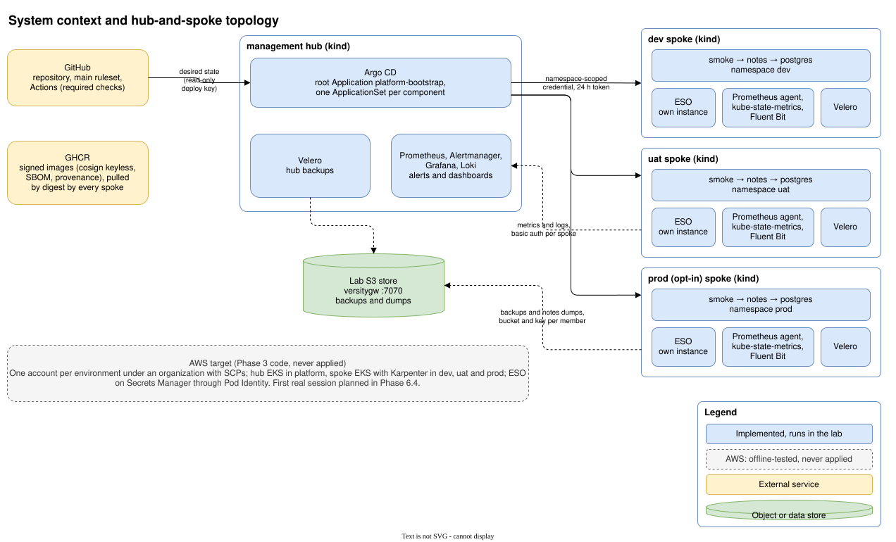

# eks-gitops-platform-project

A greenfield, portfolio-quality GitOps platform for AWS EKS, built from
scratch in small, reviewable phases. It demonstrates reproducible AWS/EKS
infrastructure, workload identity without static credentials, secrets
that never enter Git, Argo CD-driven environment reconciliation, and
production promotion gated by a reviewed pull request plus runtime trust
boundaries.

## What this demonstrates

- **GitOps hub and spokes, locally.** One Argo CD hub reconciles `dev`,
  `uat` and `prod` spoke clusters (`kind`) from this repository, one
  Application per spoke and component, never one on the hub
  ([ADR-0015](docs/adr/0015-hub-and-spoke-environment-model.md)).
- **Signed images promoted by pull request.** First-party images are
  built with tests, scanned, given an SBOM, signed keylessly and
  promoted `dev` → `uat` → `prod` by digest through reviewed PRs with a
  ledger ([ADR-0017](docs/adr/0017-image-supply-chain.md),
  [image-promotion](docs/runbooks/image-promotion.md)).
- **Secrets that never enter Git.** One External Secrets Operator per
  spoke, each isolated to its own source namespace; database passwords
  and store keys arrive the same way
  ([ADR-0010](docs/adr/0010-external-secrets-operator-contract.md)).
- **A reference application with state.** A Go front service, a Python
  service and PostgreSQL behind NetworkPolicies, with logical dumps and
  a non-destructive restore check
  ([ADR-0023](docs/adr/0023-reference-application.md),
  [reference-app-data](docs/runbooks/reference-app-data.md)).
- **Operations you can measure.** Metrics and logs shipped from every
  spoke to the hub, an SLO with tested burn-rate alerts, and restore
  drills with measured RTO
  ([observability](docs/runbooks/observability.md),
  [backup-restore](docs/runbooks/backup-restore.md)).
- **AWS as offline-tested code.** Organization and guardrails, per-account
  baseline, network, EKS with Karpenter, Pod Identity and Secrets
  Manager in Terraform, tested offline and against a local emulator in
  CI; never applied to AWS
  ([ADR-0016](docs/adr/0016-aws-organization-and-guardrails.md),
  [ADR-0018](docs/adr/0018-terraform-against-a-local-aws-emulator.md)).
- **Human identity and least-privilege access.** In the lab, Argo CD
  and Grafana sign people in through Keycloak with roles by group, and
  the local admin is an alerted, time-bound break-glass. On AWS, IAM
  Identity Center is code: no standing admin in prod, and elevation is a
  reviewed entry that CI refuses once it expires. Each environment has
  its own Argo CD project, so a developer role and a deployment both
  stop at their environment
  ([ADR-0025](docs/adr/0025-lab-identity-provider.md),
  [ADR-0026](docs/adr/0026-appproject-per-environment.md),
  [aws-access](docs/runbooks/aws-access.md)).
- **Honest status.** Each Definition-of-Done criterion has a status and
  its evidence in the TAD's
  [Definition of Done — status](docs/architecture/technical-architecture.md#definition-of-done--status);
  `make validate` checks that the TAD, the ADRs and this README agree.

## At a glance

| Measure | Value |
|---|---|
| Phases delivered, one reviewed pull request each | 0–7 (75 merged pull requests) |
| Architecture decisions and runbooks | 26 ADRs, 17 runbooks |
| Checks in `make validate`, required on every pull request | 42 targets |
| Terraform roots and `terraform test` runs (offline, mocked AWS) | 10 roots, 119 runs |
| Measured restore time (RTO), rebuilt from Git plus backup | spoke 556 s, hub 350 s |
| AWS spend so far | USD 0: nothing applied without an explicit go, enforced by `check-terraform-offline` |

## A 10-minute tour for reviewers

1. **The design:** the [TAD](docs/architecture/technical-architecture.md)
   and its [Definition of Done](docs/architecture/technical-architecture.md#definition-of-done--status),
   which says what is met and what is not, with evidence.
2. **GitOps in action:** `make gitops-switch-revision REVISION=<branch>`
   moves the hub to another revision in place, waits for three stable
   reads, and rolls back by itself if it does not converge
   ([`lab/gitops/switch-revision.sh`](lab/gitops/switch-revision.sh)).
3. **Supply chain:** [image-promotion](docs/runbooks/image-promotion.md):
   a signed digest moves `dev` → `uat` → `prod` only through a pull
   request, with a ledger.
4. **Access:** `make argocd-test-sso` signs in as each role and proves
   what it can and cannot do; `make argocd-breakglass` shows the
   emergency path and its alert
   ([argocd-access](docs/runbooks/argocd-access.md)).
5. **Resilience:** `make backup-drill-spoke` deletes a spoke and
   rebuilds it, checking every secret by hash
   ([backup-restore](docs/runbooks/backup-restore.md)).
6. **AWS without spending:** `terraform/envs/*` with its tests, and the
   emulator run in CI
   ([ADR-0018](docs/adr/0018-terraform-against-a-local-aws-emulator.md)).

## Target architecture, in brief

- **Terraform** provisions AWS infrastructure; **Argo CD**, running in
  the `management` hub, pulls desired state from Git and reconciles it
  toward the workload spokes after bootstrap.
- **Hub and spoke** ([ADR-0015](docs/adr/0015-hub-and-spoke-environment-model.md)) —
  `management` is the hub and control plane only (Argo CD; Keycloak for
  the local lab since Phase 4a); `dev`, `uat`, and `prod` are spokes, each running its
  **own** External Secrets Operator instance; application workloads run
  only in spokes. `dev` deploys automatically on merge, `uat` and `prod`
  by reviewed PR. On AWS the target is one account per environment.
  *The local lab (Phase 2.7.1), the aws-eks profile, and Terraform
  (Phase 2.7.2) all use `dev`/`uat`/`prod`.*
- **EKS Pod Identity** is the default workload identity mechanism; IRSA
  is an explicit compatibility path.
- **External Secrets Operator + AWS Secrets Manager**, one ESO instance
  per cluster, with a layered isolation model — not a single Kubernetes
  object.
- **Production promotion** requires a reviewed pull request, and that PR
  gate is paired with `AppProject`/RBAC/least-privilege-credential
  controls — a PR alone is treated as necessary, not sufficient.



The TAD has three more draw.io diagrams: delivery and promotion,
secrets and identity, and the reference application.

Full detail, diagrams, risks, and current implementation status live in
the [Technical Architecture Document](docs/architecture/technical-architecture.md).

## Quick start

Prerequisites: macOS or Linux, Docker with at least 4.2 GiB of memory
for the hub and two spokes (the preflight refuses less; observability
and backups need more), GNU Make, `git`, and `gh` signed in to an
account that administers the repository (Argo CD reads it with a
deploy key that `make gitops-repo-setup` creates). Every tool the lab
runs is downloaded pinned and checksum-verified into `.tools/`, and
every kubeconfig lives in `.local/`; nothing touches your global
`kubectl` context or any AWS account.

```bash
make tools-install          # pinned kind, kubectl, helm, terraform, trivy and the rest into .tools/bin/
make charts-fetch           # the pinned Argo CD, ESO and metrics-server charts into .tools/charts/
make validate               # every offline check CI runs
make mc-up                  # hub + dev + uat: Argo CD, registration, ESO, source Secrets, bootstrap from main
make lab-mc-status          # identity, registration and memory per member
```

`make mc-up` stops once per spoke to ask for its **source value**: a lab
value you make up (for example `openssl rand -hex 16`), different for
each spoke, which ESO copies into the workloads' Secret. It is never
printed. For an unattended run, put it in a mode-600 file and pass its
path as `MC_SOURCE_VALUE_FILE`.

When `mc-up` ends, `platform-smoke-*` is Healthy, but `platform-notes-*`
and `platform-postgres-*` stay Degraded until their database
credentials exist (the reference-app-data runbook below). After that,
External Secrets and the kubelet retry with backoff, so they can take
about 15 minutes to turn Healthy on their own.

A second checkout of a repository whose deploy key already exists (for
example a fresh clone next to your first one) must reuse that key:
copy `.local/gitops/github-deploy-key` and `github-deploy-key.pub` from
the first checkout, mode 600. Otherwise `mc-up` generates a new key and
refuses to replace the one on GitHub. A fork has no key yet, so this
does not apply.

Measured on a fresh clone (Phase 7d, 8 GiB for Docker): `tools-install`
about 1 minute, `validate` about 2.5 minutes, cluster creation about
1.5 minutes; the observability and backup runbooks add about 7 and 6
minutes.

Then, optionally, in this order:

- observability on the hub and each spoke:
  [observability runbook](docs/runbooks/observability.md);
- the backup store and Velero:
  [backup-restore runbook](docs/runbooks/backup-restore.md);
- database credentials and dump keys for the reference application:
  [reference-app-data runbook](docs/runbooks/reference-app-data.md).

`make lab-mc-destroy` removes the clusters; data and keys you created
stay in `.local/`. Working on a fork: the GitOps repository and its GitHub
account are set in `scripts/gitops/_lib.sh`, `gitops/root-application.yaml` and
`gitops/bootstrap/values.yaml`.

## Current status

| Phase | Scope | Status |
|---|---|---|
| Phase 0 | Discovery | Complete |
| Phase 1 | Documentation foundation (TAD, ADRs, validation) | Complete |
| Phase 2 | Local GitOps lab: `kind`, Argo CD, ESO, standard chart, hub and spokes, resilience | Complete |
| Phase 3 | Terraform for AWS: organization, accounts, network, EKS, identity, registry (offline-tested, never applied) | Complete |
| Phase 4 | Human identity and SSO: IAM Identity Center, Keycloak for the lab | Complete |
| Phase 5 | Image supply chain, promotion, Terraform CI, branch protection | Complete |
| Phase 6 | Observability, backup and restore, reference application, first AWS deployment | In progress (6.1–6.3 done; 6.4a done; 6.4b blocked on an AWS account) |
| Phase 7 | Consistency, diagrams, DOCX export, fresh rebuild | Implemented |

An `Accepted` ADR records an approved decision, not necessarily a fully
implemented one. Nothing has been deployed to AWS: the AWS code is
tested offline and against a local emulator only.

### Phase detail

| Phase | Scope | Status |
|---|---|---|
| 2.7.1 | `dev`/`uat`/`prod` in the local lab (`staging` → `uat`, `production` → `prod`, `dev` added, three ESO releases) | Implemented |
| 2.7.2 | Same rename in the aws-eks profile and Terraform, `dev` added there too (offline) | Implemented |
| 2.7.3 | `lab-multicluster`: `management` hub + `dev`/`uat` spokes (`prod` opt-in) in `kind`; spoke registration with a namespace-scoped, rotating credential | Implemented |
| 2.7.4 | Cluster-generator `ApplicationSet` and one ESO per spoke; `make mc-up` brings the whole profile up | Implemented |
| 2.8.1 | Workload resilience in the standard chart: PodDisruptionBudget, topology spread, graceful shutdown, NetworkPolicy (`make workload-test-resilience`) | Implemented |
| 2.8.2 | metrics-server per workload cluster and an HPA in `prod` (`make workload-test-autoscaling`) | Implemented |
| 3.4.1 | AWS organization and guardrails (plan-only): five member accounts, service control policies, organization trail, delegated security administration (GuardDuty, Security Hub, Config, Access Analyzer), consolidated budget | Implemented (offline) |
| 3.4.2 | Per-account baseline (plan-only): Config recorders in every allowed region delivering to a central bucket, EBS encryption and IMDSv2 defaults, S3 account public access block, per-account budgets | Implemented (offline) |
| 3.4.3a | Per-environment network and EKS (plan-only): system node group, five managed add-ons at explicit versions (VPC CNI with NetworkPolicy and its own Pod Identity, metrics-server); closes R-14, so the aws overlays turn NetworkPolicy and the prod HPA on | Implemented (offline) |
| 3.4.3b | Karpenter on the spokes (IaC) and the container registry: immutable, scanned repositories, pull-only for the spoke accounts (plan-only) | Implemented (offline) |
| 3.4.3c | Per-spoke ESO identity (plan-only): one apply per spoke account, one table of per-environment identities shared with the chart's cross-validation | Implemented (offline) |
| 3.4.4a | Hub-to-spoke Argo CD identity on EKS (plan-only): hub role via Pod Identity, spoke roles and STANDARD access entries with no EKS access policy, one shared namespaced Role (`platform/spoke-access/role.yaml`, `make check-spoke-access`) | Implemented (offline) |
| 3.4.4b | aws-eks GitOps profile in hub-and-spoke form: clusters generator to `spoke-<env>`/`<env>`, offline EKS cluster Secret renderer with `awsAuthConfig` and no token (`lab/eks/spoke-cluster-secret.sh`, `make eks-test-spoke-secret`) | Implemented (offline) |
| 4a | Keycloak on the hub, the lab-only identity provider: pinned image, Pod Security restricted, realm from Git with only `${KC_*}` placeholders (secrets generated in-cluster), one test user per role, one issuer for in-cluster and port-forward callers (`make idp-install`/`idp-status`, `make check-identity`; ADR-0025, `docs/runbooks/identity.md`) | Implemented; verified on lab-multicluster |
| 4b | Argo CD OIDC and RBAC by group (platform-admin, developer per environment, auditor), no default role, local admin off with a time-bound, alerted break-glass (`make argocd-test-sso`, `argocd-breakglass`, `check-argocd-rbac`; ADR-0025, `docs/runbooks/argocd-access.md`) | Implemented; verified on lab-multicluster |
| 4c | Grafana sign-in through Keycloak: platform-admins Admin, auditors and developers Viewer, no group refused; the local admin as alerted break-glass (`make obs-test-sso`, `check-grafana-sso`; ADR-0025, `docs/runbooks/observability.md`) | Implemented; verified on lab-multicluster |
| 4d | IAM Identity Center as code: four permission sets, standing access with prod ReadOnly only, time-bound elevation as a reviewed entry failing CI once expired, EKS view entries for Developer and ReadOnly (`terraform/envs/identity-center`, `make check-elevations`; ADR-0025, `docs/runbooks/aws-access.md`) | Implemented (offline-tested; never applied) |
| 4e | Argo CD's production identity provider (EKS Argo CD capability with IAM Identity Center; Cognito fallback) and the OIDC client-secret seeding (R-04 closed as a design), decided in ADR-0025 | Implemented (docs only; not deployed) |
| 4f | One AppProject per environment: `platform-<env>` deploys only to its own environment, developers through the `developer` role of their project, `policy.csv` with admins and auditors only (`make gitops-render`, `check-argocd-rbac`, `argocd-test-sso`; ADR-0026, `docs/runbooks/argocd-access.md`) | Implemented; verified on lab-multicluster |
| 5.1a | Image CI: first-party `apps/smoke`, build with tests, Trivy scan failing on fixable HIGH/CRITICAL, CycloneDX SBOM (`make image-all`, `make check-supply-chain`, `.github/workflows/image.yml`) | Implemented |
| 5.1b | Multi-platform image pushed to GHCR from `main` only, cosign keyless signature, SBOM attestation per platform, SLSA provenance, verified against the exact main-workflow identity (`make image-verify`, `docs/runbooks/image-publish.md`) | Implemented (published from `main`, package public) |
| 5.1c-1 | Promotion tooling: `make promote` (dev ← signed digest from main, uat ← dev, prod ← uat), append-only ledger, `make check-promotion`, `promotion.yml`; lab tests independent of the workload image (`docs/runbooks/image-promotion.md`) | Implemented |
| 5.1c-2 | dev promoted to the signed image from `main` (`sha-3b040e230d87`); both dev overlays and one ledger row | Implemented |
| 5.1c-3 | uat promoted from dev (same signed image); both uat overlays and one ledger row | Implemented |
| 5.1c-4 | prod promoted from uat (same signed image), with the resilience and autoscaling regression; both prod overlays and one ledger row | Implemented |
| 5.1c-5 | podinfo retired: the base default image is the first-party one, the chart passes `UI_MESSAGE`/`SHUTDOWN_TIMEOUT`, overlay messages renamed | Implemented |
| 5.2a | Terraform against a local AWS emulator (moto, pinned by digest, loopback only): `make tf-emulator-plan`/`tf-emulator-apply` run plan, apply, an empty re-plan and destroy in scratch copies; measured coverage in `terraform/emulator-coverage.tsv`; guards enforced by `check-terraform-offline` (ADR-0018, `docs/runbooks/terraform-emulator.md`) | Implemented |
| 5.2b | Terraform static analysis: `make tf-static` runs `trivy config` (pinned, embedded rules) on the tracked Terraform in `validate`; HIGH/CRITICAL fail unless accepted per file with an expiry in `terraform/.trivyignore.yaml` (ADR-0019) | Implemented |
| 5.2c | `terraform` workflow: every root against the emulator on Terraform PRs and `main`, each result compared with `terraform/emulator-coverage.tsv` (`make tf-emulator-ci`); read-only, no AWS credentials (ADR-0018 amendment) | Implemented |
| 5.3a | Ruleset for `main` as code (`.github/rulesets/main.json`: PR required, no force push or deletion, four strict required checks pinned to GitHub Actions, no bypass); `terraform`/`image`/`promotion` run on every PR with a paths job so their checks always report; `check-repo-governance`, `make governance-diff` (ADR-0020, `docs/runbooks/repository-governance.md`) | Implemented |
| 5.3b | Ruleset applied (`make governance-diff` OK), "Update branch", secret scanning and push protection on; verified with a docs-only PR (path-scoped checks skipped, mergeable) and a rejected direct push and force push | Implemented |
| 6.1 | Observability: per-spoke metrics shipped to the hub, dashboards, logs, one SLO with tested burn-rate alerts, Argo CD health alerts | Implemented (6.1a–6.1d) |
| 6.1a | `apps/smoke` serves request counts and durations in the Prometheus format on its own port (9090, standard library only); the chart renders the `metrics` port and opens it only to the `monitoring` namespace (ADR-0021) | Implemented; running in dev, uat and prod (#50–#52) |
| 6.1b | Metrics pipeline: Prometheus agent and kube-state-metrics per spoke, remote write with one credential per spoke to the hub's Prometheus; Alertmanager and Grafana (dashboards as code) on the hub; `make obs-install` / `obs-status`; configs and dashboards checked by promtool in `make validate` | Implemented; verified on lab-multicluster (hub, dev, uat) |
| 6.1c | Smoke availability SLO (99.5 % / 30 days) with recording rules and four multi-window burn-rate alerts; Argo CD alerts (Degraded, OutOfSync, failed sync, controller down); unit tests with `promtool test rules` in `make validate`; SLO and Argo CD dashboards | Implemented; Argo CD alert fired live on lab-multicluster |
| 6.1d | Logs: Fluent Bit per spoke (namespace `logging`, own-namespace files only) pushing to Loki on the hub behind a basic-auth gateway with the same per-spoke credential; 72 h retention; Grafana Loki datasource and logs dashboard | Implemented; verified on lab-multicluster (hub, dev, uat) |
| 6.2 | Backup and restore drill | Implemented (6.2a–6.2b) |
| 6.2a | Velero on every member backs up the state outside Git (platform Secrets and ConfigMaps) to a lab S3 store (`versitygw`, one bucket and key per member, under `.local/backups/`); every 6 h, TTL 72 h; least-privilege RBAC; backup alerts in the hub; `make backup-restore-check` restores into throwaway namespaces and compares by SHA-256 (ADR-0022, `docs/runbooks/backup-restore.md`) | Implemented; verified on lab-multicluster (hub, dev, uat) |
| 6.2b | Scripted, destructive restore drills: `make backup-drill-spoke SPOKE=<env>` and `make backup-drill-hub` (both `CONFIRM=yes`) rebuild a lost member from Git plus its backup and verify by SHA-256 that source values, credentials and registrations return unchanged; measured RTO 556 s (uat) and 350 s (hub) | Implemented; both drills run on lab-multicluster |
| 6.3 | Multi-language reference application with a data store, growing `apps/smoke` | Implemented (6.3a–6.3e) |
| 6.3a | Platform contract for stateful components: StatefulSet, PVC, Job, CronJob allowed on spokes in the AppProject, the spoke Role and Argo CD's inclusions (checked as one); `make argocd-upgrade` applies a reviewed Argo CD values change with diff, confirmation and rollback (ADR-0023, `docs/runbooks/argocd-upgrade.md`) | Implemented; upgrade and RBAC verified on lab-multicluster |
| 6.3b | `apps/notes` (Python) behind smoke's `/api/notes`, PostgreSQL from `charts/postgres-lab` with credentials through ESO, NetworkPolicies between the three; both images through the signed pipeline (ADR-0023, `docs/runbooks/reference-app-data.md`) | Implemented; tested on the dev spoke with local images (Argo CD delivery in 6.3c) |
| 6.3c | Delivery of the reference application through Argo CD: one ApplicationSet per component (smoke unchanged), `make promote APP=notes`, per-app ledgers; dev → uat → prod promotions as separate PRs (ADR-0023, `docs/runbooks/image-promotion.md`) | Implemented; dev and uat promoted and verified live, prod promoted and verified offline (prod spoke opt-in) |
| 6.3d+e | Logical dumps of the notes database every 6 h to the lab store (own bucket per environment), `make db-dump-key`, non-destructive `make db-restore-check`; scrape tells smoke and notes apart, `/api/notes` in smoke's SLO, five alerts and a dashboard (ADR-0022/0021 amendments, `docs/runbooks/backup-restore.md`) | Implemented |
| 6.4 | First real AWS deployment: hub plus one spoke in a single sandbox account, created and destroyed in one authorized session, measured cost recorded | In progress (6.4a implemented; 6.4b blocked until a personal sandbox AWS account exists) |
| 6.4a | Code for the session (offline, USD 0): single-account mode, aws-eks root Application, session scripts with a destroy sweep, budget first; one guarded runner for real AWS, checked by `check-terraform-offline` (ADR-0024, `docs/runbooks/eks-sandbox-session.md`) | Implemented (offline-tested; first run in 6.4b) |
| 6.4b | The authorized session: apply, prove EKS Pod Identity and hub-to-spoke registration, destroy, record the bill | Not started |
| 7a | Consistency pass: statuses aligned, Definition-of-Done scorecard in the TAD, this README's "What this demonstrates" and quick start, `check-docs-consistency` | Implemented |
| 7b | Four draw.io diagrams derived from the TAD (topology, delivery, secrets and identity, reference application), source and SVG committed; `make diagrams` exports, `check-diagrams` compares each export with its source | Implemented |
| 7c | DOCX export of the TAD with pandoc (`make docs-docx`, checked after building) and a guarded GitHub Release with the DOCX and SVGs (`make docs-release`) | Implemented; `docs-v0.40.0` published |
| 7d | Fresh lab rebuild following only this README: destroyed, rebuilt in a fresh clone, every Application Healthy; the gaps it found are fixed in "Quick start" | Implemented |

Full detail and ordering live in the TAD's
[Delivery Roadmap](docs/architecture/technical-architecture.md#delivery-roadmap).

## Local lab

Phase 2.1 provides a pinned, project-local `kind` cluster with zero
dependency on the machine's global `kubectl`/`kind` installation or
kubeconfig:

```bash
make tools-check       # read-only: verify the pinned local toolchain is installed
make tools-install     # download + checksum-verify kind/kubectl into .tools/bin/ (mutates .tools/ only)
make lab-create        # create the pinned lab-lite cluster (no-op if it already matches)
make lab-status        # read-only health/identity report
make lab-test          # read-only shape/identity checks against the existing cluster
make lab-test-lifecycle # mutating: proves create/destroy idempotency (cluster must be absent first)
make lab-destroy       # destroy only the exact project cluster (no-op if absent)
```

All lab commands use `.tools/bin/kind` and `.tools/bin/kubectl` (never
the global binaries) and `.local/kubeconfig` (never `~/.kube/config` or
the shell's current context) — both paths are gitignored. `lab-lite` is
a single physical cluster; `dev`/`uat`/`prod` are namespace-level
simulations at this stage, not real multi-cluster isolation (see the
TAD's "Cluster and Environment Topology"). Phase 2.1 creates only the
cluster itself — no `dev`/`uat`/`prod` namespace, no Argo CD, per
the imperative/declarative boundary in the TAD.

## Local lab: Argo CD bootstrap

Phase 2.2 installs Argo CD into the Phase 2.1 `lab-lite` cluster via a
pinned, checksum-verified Helm CLI and an immutable, digest-pinned chart
release — never `helm repo add`, never a floating tag:

```bash
make argocd-chart-fetch      # download + checksum-verify the pinned argo-cd-10.4.2 chart (only target allowed to fetch it)
make argocd-render           # fully offline render; proves every image is approved and digest-pinned
make argocd-install          # fail-closed idempotent install: absent->install, exact match->no-op, any drift->fail closed
make argocd-status           # read-only release/workload/CRD status report
make argocd-test-runtime-health # read-only health checks against an installed release
make argocd-test-lifecycle   # mutating: proves install/no-op/uninstall/restore idempotency and CRD retention end-to-end
make argocd-port-forward     # foreground port-forward to the Argo CD UI/API at https://localhost:8443
make argocd-uninstall        # uninstall the release; CRDs retained; namespace deleted only if owned and inventory-clean
```

Argo CD's own `dex` and `notifications-controller` are disabled; every
rendered image is digest-pinned; every rendered container has explicit
CPU/memory requests and limits. Phase 2.2 installs only the Argo CD
control plane itself — no root/bootstrap `Application`, `AppProject`, or
`ApplicationSet`, which are declarative, Phase 2.3 concerns (see the
TAD's "Local Lab Argo CD Bootstrap" and "GitOps Control Plane" sections).

## Local lab: private GitOps bootstrap

Phase 2.3 gives Argo CD read-only SSH access to this private repository
and reconciles the `dev`, `uat`, and `prod` environments from
`gitops/` — only the root `Application` and the Argo CD repository
credential `Secret` are ever applied imperatively; everything else
(`AppProject`, `ApplicationSet`, the two generated `Application`
objects, both namespaces, both `ConfigMap`s) is Git-reconciled:

```bash
make gitops-repo-setup       # idempotently provision the deploy key, GitHub deploy key, and Argo CD repository Secret
make gitops-repo-check       # read-only equivalent of the above (no mutation)
make gitops-render           # fully offline render; proves exactly 1 AppProject/1 ApplicationSet/2 generators/0 Secrets/no wildcards
make gitops-bootstrap        # fail-closed idempotent apply of the root Application only (REVISION=<value>, default main)
make gitops-status           # read-only status report
make gitops-test             # read-only runtime health checks
make gitops-test-lifecycle   # mutating: proves bootstrap/no-op/self-heal/isolation/uninstall/no-op (REVISION=<pushed branch>); run gitops-uninstall first - dev/uat/prod may stay for ESO
make gitops-uninstall        # two-phase transactional uninstall (Phase 2.6.3a): read-only preflight classification first, zero mutation on any unclassifiable object; retains a namespace an active ESO scoped release still targets
make gitops-repo-remove      # remove the repository Secret/deploy key (requires CONFIRM=REMOVE; never run by the lifecycle test)
```

Phase 2.6.3a hardens three GitOps lifecycle operations discovered to be
unsafe while testing Phase 2.6.2 against a cluster that also has ESO
installed (see `.local/evidence/phase-2.6.3-gitops-lifecycle-hardening-plan.md`,
local-only/gitignored like every other phase's planning document, for
the full root-cause analysis):

```bash
make gitops-switch-revision              # safely switch the root Application's targetRevision in place (patch, never delete+recreate); preserves UID/finalizers; requires 3 consecutive stable reads; rolls back automatically on failure (REVISION=<value>)
make gitops-test-revision-switch         # mutating: proves the above end-to-end (REVISION=<pushed branch>)
make gitops-retire-appproject-kind       # drain SecretStore/ExternalSecret from one environment before narrowing the AppProject whitelist - pauses self-heal, deletes while still whitelisted, verifies target-Secret retention, never leaves self-heal silently disabled (ENV=dev|uat|prod ACTION=--drain)
make gitops-resume-appproject-kind       # resume automated sync after the drain + the whitelist-narrowing Git change have both landed (ENV=dev|uat|prod)
make gitops-test-appproject-kind-retirement  # mutating: proves the full 8-step drain/resume sequence end-to-end
```

`gitops-uninstall`'s previous single-phase version deleted the root
Application first and only checked namespace contents afterward -
once ESO's scoped-RBAC `Role`/`RoleBinding` objects exist inside
`uat`/`prod` (Phase 2.6.1), that check always refused to
delete the namespace, but the workloads were already gone by then. The
two-phase version classifies every namespaced object
(`argocd-tracked`/`helm-eso-scoped`/`kubernetes-builtin`/`unknown`,
verified via real tracking-id/Helm-ownership metadata, never a name
guess) **before** touching the root Application, and aborts with zero
mutation if anything is unclassifiable.

The deploy key is repository-scoped and read-only — see
[ADR-0007](docs/adr/0007-private-gitops-bootstrap.md) for the full
comparison against a public repo, an HTTPS PAT, and a GitHub App. Its
private half never enters Git: it lives only at
`.local/gitops/github-deploy-key` (gitignored, mode `0600`) and as the
Argo CD repository Secret in-cluster — no script ever prints it.

## Local lab: standard workload contract

Phase 2.4 replaces the ConfigMap-only smoke example with a real,
reusable Helm chart at `charts/standard-workload/` — `Deployment`,
`Service`, `ServiceAccount`, `ConfigMap` only, Restricted-Pod-Security-
Standards-compliant by default (non-root UID/GID `65532`, dropped
capabilities, read-only root filesystem, `seccompProfile:
RuntimeDefault`), running the project's own digest-pinned, signed,
multi-arch image (`apps/smoke`, promoted per environment). `dev`/`uat`/`prod`
differ in replica count, resources, and a `UI_MESSAGE` value sourced from the chart's
own `ConfigMap` — proven functionally consumed via `GET /api/info`, not
just checksum-decoration. Ingress/HPA/PodDisruptionBudget/NetworkPolicy/
ServiceMonitor remain deliberately unimplemented (ADR-0006's
phased-implementation note) — never dead-configured.

```bash
make check-standard-workload-chart  # offline lint/render/schema/PSS/dry-run validation for both environments (also runs as part of `make validate`)
```

See [ADR-0008](docs/adr/0008-standard-workload-before-sso.md) for why
this phase came before Keycloak/SSO, not instead of it.

## Local lab: hub and spoke clusters (`lab-multicluster`)

Phase 2.7.3 adds a second local profile (ADR-0015): one `kind` cluster
for the `management` hub plus one per spoke. Every lab target accepts
`LAB_CLUSTER=lab-lite|hub|dev|uat|prod` (default `lab-lite`). lab-lite
and lab-multicluster never run at the same time.

Phase 2.7.4 puts the workloads in the spokes: the hub's Argo CD
generates one Application per registered spoke, and each spoke runs its
own ESO. One command does everything, in the only order that works on
fresh clusters, and is a no-op when run again:

```bash
make lab-destroy                              # lab-lite must be down first
make mc-up                                    # hub + dev + uat, Argo CD, registration, ESO, source Secrets, bootstrap
make mc-up SPOKES=dev,uat,prod                # same, with prod
make mc-test-e2e REVISION=<branch>            # mutating end-to-end proof (starts from nothing)
make mc-spoke-deregister SPOKE=dev            # removes dev's Application and workloads first, then its access
make lab-mc-destroy
```

The individual steps, as Phase 2.7.3 introduced them:

```bash
make lab-destroy                              # lab-lite must be down first
make lab-mc-create                            # hub + dev + uat (SPOKES=dev,uat,prod adds prod)
make argocd-install LAB_CLUSTER=hub           # Argo CD on the hub only
make gitops-repo-setup LAB_CLUSTER=hub        # repository Secret on the hub
make mc-spoke-register SPOKE=dev              # namespace-scoped credential, 24h token; re-run rotates it
make mc-spoke-register SPOKE=uat
make mc-spoke-rotate                          # rotate any spoke token with < 8h left (MIN_HOURS=<n>)
make mc-spoke-rotate-schedule                 # optional: a LaunchAgent rotates every 6h (unschedule removes it)
make lab-mc-status                            # identity, registration (never the token), memory per member
make mc-test-registration REVISION=<branch>   # mutating end-to-end registration proof
make lab-mc-destroy
```

Each spoke's credential can manage only the six AppProject kinds in its
own namespace: no ClusterRole, no Secrets, no `kube-system`. Measured
memory for the hub plus three spokes is about 4.4 GiB with ESO and the
workloads. See the TAD's "Hub-and-Spoke Registration" and "Cluster
Generator and Per-Spoke ESO" sections.

## Repository governance

Phase 2.5 applied the repository governance controls that were available
while this repository was **private on GitHub Free**: Dependabot vulnerability
alerts and automated security updates are enabled; Dependabot version
updates are configured for the one dependency ecosystem this repository
actually has (`.github/dependabot.yml`, `github-actions` only); GitHub
Actions are restricted to GitHub-owned actions with immutable SHA
pinning required platform-side; and the merge button only offers a real
merge commit (squash and rebase merging are disabled).

**`main` is protected by a ruleset** kept as code in
`.github/rulesets/main.json` and applied on 2026-11-17
([ADR-0020](docs/adr/0020-main-branch-ruleset.md)): no direct push,
force push or deletion; every change through a pull request with review
threads resolved and the branch up to date; required checks `validate`,
`emulator`, `build, scan, SBOM` and `verify promoted images`, each
accepted only from GitHub Actions; no bypass, the owner included. Secret
scanning and push protection are on. `make governance-diff` compares the
live ruleset with the file; the break-glass is in
`docs/runbooks/repository-governance.md`.

## Local lab: External Secrets Operator bootstrap

Phase 2.6.1 installs the External Secrets Operator (`v2.10.0`, chart
`2.10.0`) with its 25 CRDs applied once and owned by no Helm release
(`kubectl apply`, never a release — the chart renders them as plain
templates with no retention annotation, so a release that owned them
would delete them on `helm uninstall`), and **two namespace-scoped
controller releases** (three since Phase 2.7.1) — `eso-uat` (watches
only `uat`), `eso-dev` (only `dev`), and `eso-prod` (only `prod`), each with `scopedRBAC:
true` converting every cluster-scoped RBAC rule the controller itself
needs into a `Role`/`RoleBinding` restricted to exactly that one
namespace. The webhook and cert-controller components are cluster-wide
singletons by construction (their object names are fixed, not
release-qualified) and run from `eso-uat` only — proven, not
assumed, by a collision/ownership gate that renders the full
architecture offline before anything is ever applied. CRDs are applied
under a single stable field manager with a `--dry-run=server` preflight
first — a genuine field-ownership conflict stops the install with the
CRD completely untouched; `--force-conflicts` is never used. Because
`eso-dev` and `eso-prod` have no webhook/cert-controller of their own,
they depend on `eso-uat`'s — `make eso-uninstall ENV=uat` is refused
outright while either of them still exists, and `make eso-status`
fails if either exists but that shared webhook/cert-controller
is unhealthy:

```bash
make eso-chart-fetch          # download + checksum-verify the pinned external-secrets-2.10.0 chart (only target allowed to fetch it)
make eso-render                # fully offline render + collision/ownership proof (25 CRDs, no cross-release collision, webhook/cert-controller singleton, zero structural wildcard RBAC, digest-only images)
make check-eso-chart           # helm lint + the same proof (standalone - requires the network-fetched chart, so not part of `make validate`)
make eso-crds-install           # only the 25 CRDs (no release, no webhook) - the step before gitops-bootstrap on a fresh lab-lite
make eso-install                # fail-closed idempotent install: CRD preflight (no force) + the scoped releases; refuses with zero mutation while a scoped workload namespace is absent
make eso-status                 # read-only CRD/release/Deployment health report, including the shared-singleton dependency check
make eso-test-runtime-health   # read-only health checks against an installed bootstrap
make eso-test-lifecycle        # mutating: proves install/no-op/singleton guards/CRD-conflict fail-closed/uninstall(CRDs retained)/no-op/restore end-to-end
make eso-uninstall              # uninstall all three scoped releases (prod, dev, then uat; ENV=dev|uat|prod for one at a time); never touches the CRDs; refuses uat while dev or prod exists
```

On a fresh lab-lite the order matters (R-13): Argo CD cannot sync the
workload, and so never creates `dev`/`uat`/`prod`, until the ESO CRDs
exist, while the scoped ESO releases need those namespaces. Apply the
CRDs alone first; `make gitops-bootstrap` refuses on lab-lite while any
of them is missing, and `make eso-install` refuses, before applying
anything, while a namespace is missing:

```bash
make lab-create argocd-install gitops-repo-setup
make eso-crds-install
make gitops-bootstrap REVISION=<branch>   # then wait for dev/uat/prod
make eso-install
make eso-provision-source-secret ENV=dev  # and ENV=uat, ENV=prod (value on stdin or prompt)
make metrics-server-install
```

Phase 2.8.2: `prod` runs an HPA, which needs metrics-server on the same
cluster before the bootstrap (otherwise `prod` reports Degraded). `make
mc-up` installs it on every spoke; on lab-lite:

```bash
make metrics-server-chart-fetch   # download + checksum-verify the pinned chart (3.14.0)
make metrics-server-install       # fail-closed idempotent install (LAB_CLUSTER=dev|uat|prod for a spoke; never the hub)
make metrics-server-status        # release, APIService and node metrics
make workload-hpa-handover NS=prod DEPLOYMENT=platform-smoke-prod-standard-workload   # once, before Git puts an existing Deployment under an HPA
make workload-test-autoscaling REVISION=<branch> PRE_REVISION=<branch without the HPA>  # mutating HPA proof
```

Phase 2.6.2 adds the per-environment `SecretStore`/`ExternalSecret`
reconciliation contract on top of that bootstrap. The `kubernetes`-
provider `SecretStore` in each of `dev`/`uat`/`prod` reads from a
dedicated `eso-source-<env>` namespace that
is never touched by Argo CD or this chart — its Secret is created and
rotated exclusively by `lab/eso/provision-source-secret.sh`, an
imperative, out-of-Git script that reads the value only from stdin or
an echo-disabled prompt, never a CLI argument, and never prints it.
Each `ExternalSecret` reconciles that source into a target Secret it
owns exclusively (`creationPolicy: Owner`, `deletionPolicy: Retain`),
which `charts/standard-workload` mounts as a read-only volume
(`externalSecret.enabled`) — never `env`/`envFrom`. `dev`, `uat`, and
`prod` are pairwise isolated: distinct `SecretStore`s, distinct
source namespaces/Secrets, distinct auth `ServiceAccount`s, and no
`SecretStore` can resolve another environment's Secret. The `AppProject` grants
only the two new namespaced kinds (`SecretStore`, `ExternalSecret`) —
never `Secret`; Argo CD never manages a Secret in this design.

Phase 2.6.3b makes the script's default invocation genuinely
idempotent (`ensure`): if the source Secret already exists, it is a
true no-op — never read, never re-applied, and the piped/prompted
value is never even consumed — preserving the Secret's UID,
resourceVersion, content hash, and its Role/RoleBinding untouched.
Rotating an existing value requires the explicit `--rotate` flag.

```bash
make eso-provision-source-secret ENV=uat                    # ensure: create if absent, true no-op if already present (value never read on the no-op path)
make eso-provision-source-secret ENV=prod                 # same, prod (and ENV=dev)
make eso-provision-source-secret ENV=uat ACTION=--rotate    # rotate an EXISTING uat value only (fails if absent); preserves UID, changes resourceVersion/hash, never another environment
make eso-provision-source-secret ENV=uat ACTION=--delete    # idempotent teardown of that environment's source namespace
make eso-test-secret-lifecycle    # mutating: provision -> every SecretStore/ExternalSecret Ready -> target Secrets owned by ESO -> read-only mount hash-verified per environment -> uat/prod isolation -> controlled rotation + propagation (production unaffected) -> target-Secret delete/ESO-recreate -> no-op bootstrap -> ESO uninstall with target-Secret retention -> restore
make eso-test-provision-source-secret-idempotency  # mutating: proves ensure/--rotate/--delete semantics and the global kubeconfig fingerprint helper's isolation, restoring the pre-test value/state on exit
```

See [ADR-0010](docs/adr/0010-external-secrets-operator-contract.md) for
the full rationale, including why the chart's own default (both
releases running the webhook) was rejected after the collision gate
proved it would collide, not merely duplicate, and why the source
Secret lives outside both Git and Helm ownership.

## Main components

| Component | Role |
|---|---|
| Terraform | AWS infrastructure (VPC, EKS, IAM, KMS, Pod Identity associations) |
| Argo CD + `ApplicationSet` | GitOps reconciliation across environments |
| Standard workload chart | The one Helm chart every workload uses |
| EKS Pod Identity / IRSA | Workload-to-AWS identity (default / compatibility) |
| External Secrets Operator + AWS Secrets Manager | Secrets, never in Git — one ESO instance per cluster |
| IAM Identity Center + Keycloak | Human access to AWS/EKS, and to Argo CD in the local lab (Keycloak on the hub since 4a; Argo CD login since 4b, Grafana since 4c; Identity Center as code since 4d) |
| `kind` | Local lab with no AWS service charges, for GitOps and identity-contract shape testing |

## Architecture Decision Records

All 23 are `Accepted`: an approved decision, not necessarily a fully
implemented one. The TAD's "Evidence and Implementation Status" says
how much of each is implemented, and `make validate` checks that this
table, the TAD's decisions table and the ADR files agree.

| ADR | Decision | Status |
|---|---|---|
| [0001](docs/adr/0001-platform-scope-and-boundaries.md) | Platform scope and repository boundaries | Accepted |
| [0002](docs/adr/0002-environment-topology.md) | Environment topology | Accepted |
| [0003](docs/adr/0003-gitops-control-plane-and-promotion.md) | GitOps control plane and promotion | Accepted |
| [0004](docs/adr/0004-workload-identity-and-secrets.md) | Workload identity and secrets | Accepted |
| [0005](docs/adr/0005-sso-bootstrap-and-cluster-access.md) | SSO, bootstrap, and cluster access | Accepted |
| [0006](docs/adr/0006-standard-workload-contract.md) | Standard workload contract | Accepted |
| [0007](docs/adr/0007-private-gitops-bootstrap.md) | Private repository GitOps bootstrap | Accepted |
| [0008](docs/adr/0008-standard-workload-before-sso.md) | Standard workload contract before SSO | Accepted |
| [0009](docs/adr/0009-repository-governance-baseline.md) | Repository governance baseline | Accepted |
| [0010](docs/adr/0010-external-secrets-operator-contract.md) | External Secrets Operator contract | Accepted |
| [0011](docs/adr/0011-terraform-foundation.md) | Terraform foundation | Accepted |
| [0012](docs/adr/0012-network-eks-iac-foundation.md) | Network and EKS IaC foundation | Accepted |
| [0013](docs/adr/0013-pod-identity-secrets-manager-iac.md) | EKS Pod Identity and AWS Secrets Manager IaC | Accepted |
| [0014](docs/adr/0014-eks-application-identity-boundary.md) | EKS Application Generation and Identity Boundary | Accepted |
| [0015](docs/adr/0015-hub-and-spoke-environment-model.md) | Hub-and-spoke environment model | Accepted |
| [0016](docs/adr/0016-aws-organization-and-guardrails.md) | AWS organization, accounts and guardrails | Accepted |
| [0017](docs/adr/0017-image-supply-chain.md) | Image supply chain and promotion | Accepted |
| [0018](docs/adr/0018-terraform-against-a-local-aws-emulator.md) | Terraform plan and apply against a local AWS emulator | Accepted |
| [0019](docs/adr/0019-terraform-static-analysis.md) | Static analysis of the Terraform code | Accepted |
| [0020](docs/adr/0020-main-branch-ruleset.md) | Ruleset for the main branch | Accepted |
| [0021](docs/adr/0021-observability.md) | Observability for the hub and the spokes | Accepted |
| [0022](docs/adr/0022-backup-and-restore.md) | Backup and restore of the state outside Git | Accepted |
| [0023](docs/adr/0023-reference-application.md) | Reference application with a data store | Accepted |
| [0024](docs/adr/0024-sandbox-aws-session.md) | First AWS deployment as a single-account sandbox session | Accepted |
| [0025](docs/adr/0025-lab-identity-provider.md) | Lab identity provider and human roles | Accepted |
| [0026](docs/adr/0026-appproject-per-environment.md) | One AppProject per environment | Accepted |

## Runbooks

| Runbook | Covers |
|---|---|
| [argocd-access](docs/runbooks/argocd-access.md) | Signing in to Argo CD, roles and break-glass |
| [argocd-upgrade](docs/runbooks/argocd-upgrade.md) | Upgrading Argo CD's values on a running cluster |
| [aws-access](docs/runbooks/aws-access.md) | Human access to AWS through Identity Center, and time-bound elevation |
| [backup-restore](docs/runbooks/backup-restore.md) | Backup and restore on lab-multicluster |
| [docs-release](docs/runbooks/docs-release.md) | Publishing the architecture documents (DOCX and diagrams) |
| [eks-bootstrap-order](docs/runbooks/eks-bootstrap-order.md) | EKS Bootstrap Order |
| [eks-destroy-order](docs/runbooks/eks-destroy-order.md) | EKS Destroy Order |
| [eks-sandbox-session](docs/runbooks/eks-sandbox-session.md) | The sandbox AWS session (Phase 6.4b) |
| [identity](docs/runbooks/identity.md) | The lab identity provider (Keycloak) |
| [image-promotion](docs/runbooks/image-promotion.md) | Promoting the first-party images dev → uat → prod |
| [image-publish](docs/runbooks/image-publish.md) | Publishing and verifying the first-party image |
| [kubernetes-to-aws-secrets-migration](docs/runbooks/kubernetes-to-aws-secrets-migration.md) | Kubernetes-Provider to AWS-Secrets-Manager Migration |
| [observability](docs/runbooks/observability.md) | Observability on lab-multicluster |
| [reference-app-data](docs/runbooks/reference-app-data.md) | The reference application's data store |
| [repository-governance](docs/runbooks/repository-governance.md) | Repository governance (main ruleset) |
| [terraform-emulator](docs/runbooks/terraform-emulator.md) | Terraform against the local AWS emulator |
| [terraform-static-analysis](docs/runbooks/terraform-static-analysis.md) | Terraform static analysis |

## Working locally

```bash
make help      # list all available targets
make validate  # run every documentation validation check
```

## AWS EKS profile (`DESIGNED` / `STATICALLY VALIDATED` / `NOT DEPLOYED` / `NOT VALIDATED AGAINST AWS` — `ACTUAL COST: USD 0`)

**Runs today, against the `kind` lab:** everything in "Current status"
above — `make lab-create`, `make argocd-install`, `make gitops-bootstrap`
(default `PROFILE=local-kind`), `make eso-install`, and every `*-test*`
target. None of these touch AWS or require an AWS account.

**Designed only, not deployed, no AWS account exists to deploy it against:**
`terraform/envs/{network,eks,identity}` (VPC, EKS, Pod Identity Agent,
per-environment IAM/KMS/Secrets Manager metadata, Pod Identity
Associations); `charts/standard-workload`'s `aws` provider branch and its
`values-{dev,uat,prod}-aws.yaml` overlays;
`gitops/bootstrap`'s `profile: aws-eks` (explicit-only, never the
default); `scripts/lab/_lib.sh`'s `check_eks_cluster_identity()`. See
ADR-0013, ADR-0014, and `docs/runbooks/eks-bootstrap-order.md` (a
documented, not executed, future sequence).

**Statically validated today, entirely offline:** `terraform fmt/init
-backend=false/validate/test` (with `mock_provider "aws"`) for every
Terraform root; `helm lint`/`helm template` for both chart providers and
both GitOps profiles; `tests/lab/test-eks-identity-offline.sh` (a fake
`kubectl` and a fake `aws` that fails immediately if invoked - proving
the EKS identity check never shells out to the real AWS CLI). Run any of
these with:

```sh
make validate
make terraform-validate-offline
make gitops-render
make lab-test-eks-identity-offline
```

None of the above contacts AWS, mutates the `kind` cluster, or requires
any credential.

**Currently prohibited, project-wide, until an AWS account and budget
exist:** `terraform plan`/`apply`/`destroy`/`import`/`refresh` against a
real backend, any `aws` CLI invocation, and any mutation of
`lab/gitops/bootstrap.sh`'s `aws-eks` branch past its own identity
preflight (it deliberately stops before any `kubectl apply`, `helm
install`, or equivalent - see ADR-0014).

## Safety

**No `terraform apply`, no mutating `kubectl`, no AWS resource, and no
change to any external system (repository settings, remote branches,
secrets) happens without a fresh, explicit, scoped authorization first.**
See `AGENTS.md` for the full safety-gate rules that apply to anyone —
human or AI agent — working in this repository.

## Contributing

1. Open a pull request for every change — no direct commits once branch
   protection is configured.
2. Run `make validate` before proposing any change.
3. If a change affects architecture, update the TAD and/or the relevant
   ADR in the same PR — documentation drift is treated as a defect.
4. Keep changes scoped to the current delivery phase (see the TAD's
   roadmap); a PR reaching into a later phase should be split.
5. New ADRs start `Proposed`; moving one to `Accepted` requires an
   explicit review, not just a passing CI run.
6. Never introduce a secret value, and never reference any local-only,
   non-shared material by name — see `AGENTS.md` and `SECURITY.md`.

See `AGENTS.md` for the complete operating rules.

## License

[Apache License 2.0](LICENSE).
