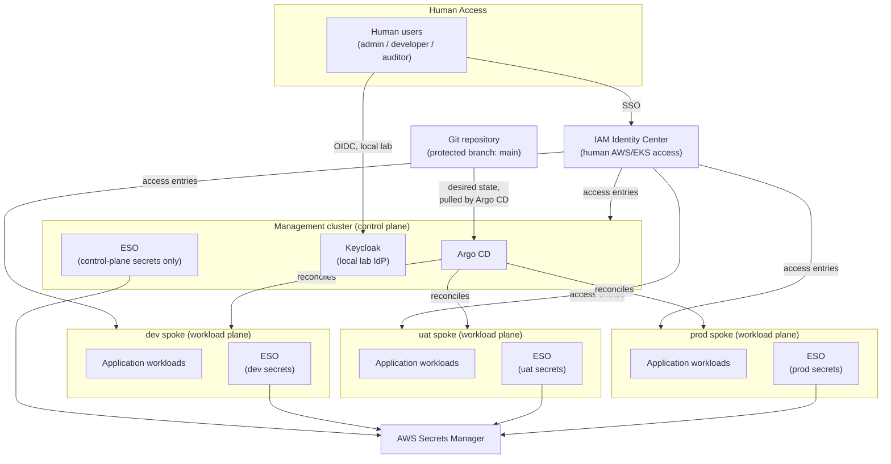
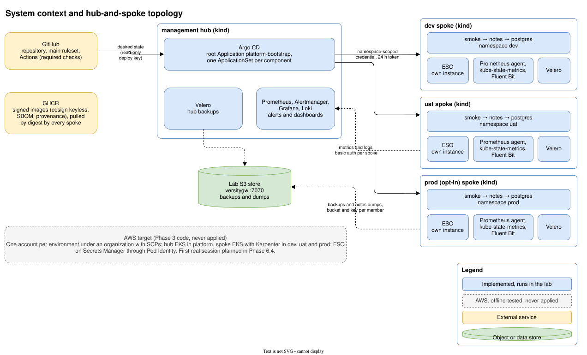
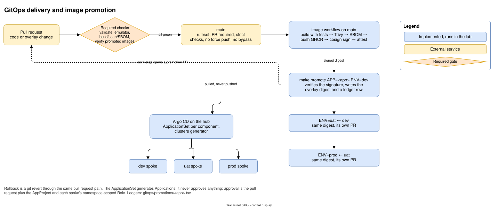
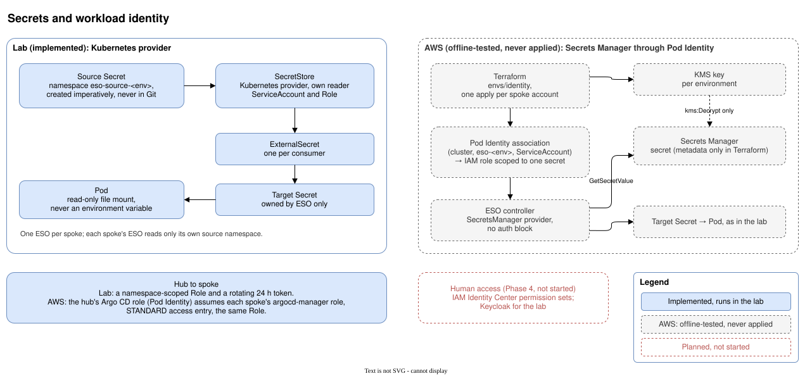
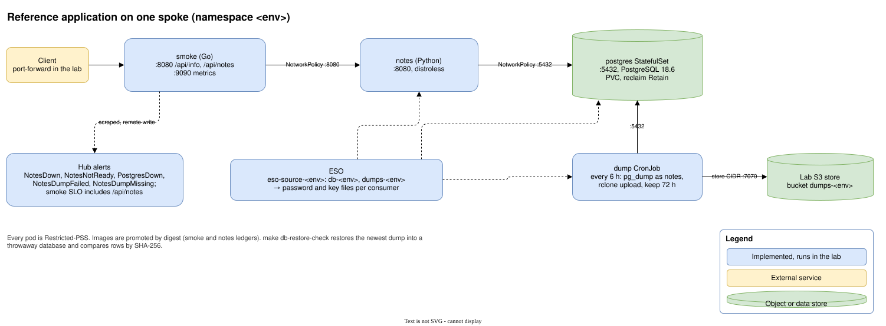
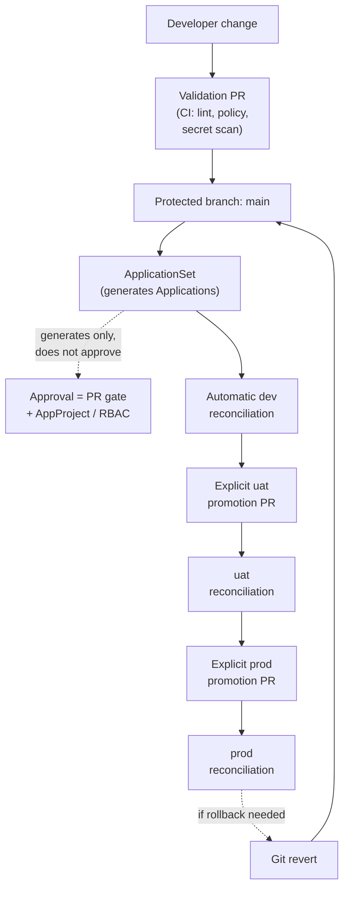
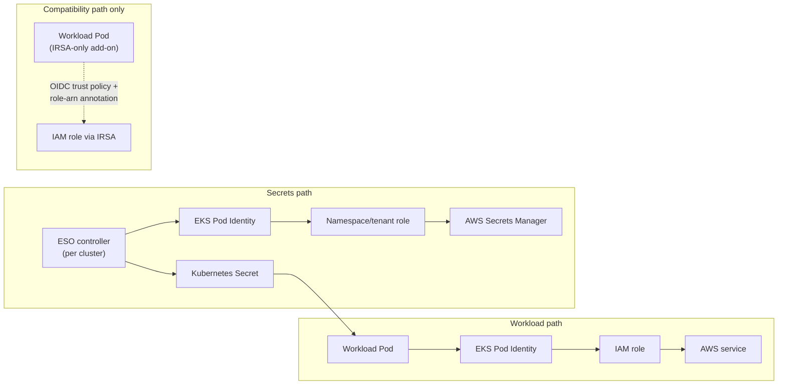
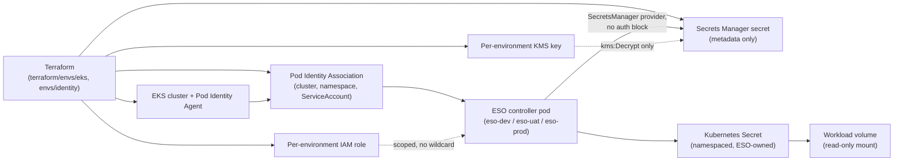

# Technical Architecture Document — eks-gitops-platform-project

## Document Control

| Field | Value |
|---|---|
| Document | eks-gitops-platform-project Technical Architecture |
| Version | 0.49.0 |
| Status | Implementation in progress |
| Phase | Phases 0–3 and 5 complete (Phase 3 as offline-tested code, never applied); Phase 4 complete (4a–4c runtime-tested; 4d offline-tested; 4e decided, docs only; 4f one AppProject per environment, offline-tested); Phase 6.1–6.3 implemented and runtime-tested on `lab-multicluster`; Phase 6.4a implemented (offline-tested); Phase 6.4b blocked on a sandbox AWS account; Phase 7 implemented (7a–7d) |
| Last updated | 2026-11-26 |

This document is the **single, authoritative source of truth** for the
project's architecture: scope, principles, topology, control plane,
identity, secrets, security, risks, evidence, and roadmap. Diagrams are
inline Mermaid, versioned as part of this file. The four draw.io
diagrams under "Diagrams (draw.io)" and the DOCX export (Phase 7c) are
derived from this document ([docs-release](../runbooks/docs-release.md)), never an independent source: when the
architecture changes, this document changes first, then the diagrams.

Architectural reasoning here stands on this project's own requirements
and on general, well-documented GitOps/Kubernetes/AWS engineering risks
— never on a claim that a specific external system, prior organization,
or private document informed a decision (see `AGENTS.md`).

## Executive Summary

`eks-gitops-platform-project` is a greenfield, portfolio-quality GitOps
platform for AWS EKS, built from scratch in small, reviewable phases. It
demonstrates: reproducible AWS/EKS infrastructure via Terraform; workload
identity without static credentials (EKS Pod Identity, IRSA as
compatibility); secrets that never enter Git (External Secrets Operator
+ AWS Secrets Manager, run per cluster, under a layered isolation model);
Argo CD reconciling a closed set of environments through
`ApplicationSet`; and production promotion gated by a reviewed PR
**plus** runtime trust boundaries (`AppProject`, RBAC, least-privilege
credentials) — the PR alone is treated as necessary, not sufficient.

As of this version, the **local GitOps lab is implemented and
runtime-tested** in a single `kind` cluster (Argo CD, `ApplicationSet`,
the standard workload contract, and External Secrets Operator with a
per-environment secret contract), and the **AWS layer exists as
offline-validated Terraform and GitOps profiles only** — nothing has
been applied against AWS. The environment model is being extended to a
hub-and-spoke shape (`management` hub, `dev`/`uat`/`prod` spokes,
ADR-0015); that extension is `PROPOSED`. The
[evidence table](#evidence-and-implementation-status) states each
capability's real status. An `Accepted` ADR below records an approved
decision — it does not mean that decision has been implemented.

## Scope and Non-Goals

**In scope:** a local, reproducible `kind`-based lab; a target AWS/EKS
Terraform substrate (plan-only until authorized); Argo CD +
`ApplicationSet` with an explicit trust model; a standard workload
contract; human identity (IAM Identity Center, Keycloak for the local
lab) and workload identity (Pod Identity, IRSA); secrets management with
a layered, per-cluster isolation model; PR-gated environment promotion.

**Non-goals:** a general-purpose internal-developer-portal UI; support
for cloud providers other than AWS; a self-service infrastructure
catalog in the MVP (Crossplane or equivalent — deferred, see ADR-0001);
Progressive Delivery as the primary production gate; permanently
running EKS clusters (hub or spokes); generating application workloads for the
`management` cluster; deciding Argo CD's production AWS identity
provider ahead of Phase 3/4 (see "Human Identity and SSO").

## Architecture Principles

1. **A single Git repository is the desired-state source of truth** for
   everything Argo CD reconciles.
2. **Application and infrastructure concerns are separated** — the
   standard workload chart never provisions cloud infrastructure.
3. **Identity contracts between independently evolving systems are
   tested, never assumed.** The (cluster, namespace, `ServiceAccount`)
   tuple that Terraform and the workload chart must agree on is covered
   by an automated contract test before it is trusted.
4. **Every required CI check blocks the merge it protects** — no
   required check is ever configured to continue past a failure.
5. **A reviewed pull request is necessary, but not sufficient, for
   production promotion** — it is paired with `AppProject` boundaries,
   Argo CD RBAC, and least-privilege cluster credentials.
6. **Pinning applies to what is consumed, not to the desired-state
   branch itself** — `main` may be tracked continuously because it is
   protected by review; external dependencies are pinned immutably.
7. **No control-plane component's identity is shared across clusters
   for convenience** — each cluster that needs to act on AWS (including
   each cluster's ESO instance) has its own scoped identity.
8. **Confidence is labeled honestly** — a capability described only in
   documentation is never `VERIFIED`.

## System Context



Argo CD **pulls** the desired state from Git and reconciles it toward
the `dev`, `uat`, and `prod` spokes — Git is a source Argo CD reads, not something Argo
CD reconciles. `management` is the control plane only; it is never a
workload plane. Every cluster that creates Kubernetes `Secret`s runs its
**own** ESO instance against AWS Secrets Manager — none is shared. See
"Cluster and Environment Topology."

### Diagrams (draw.io)

Four diagrams of the implemented lab and the offline-tested AWS target,
derived from this document (Phase 7b). Each `.drawio` source is
editable in draw.io; `make diagrams` re-exports the SVGs, and
`make check-diagrams` (in `make validate`) fails when an SVG no longer
matches its source.









Sources: [system-topology](diagrams/system-topology.drawio),
[delivery-promotion](diagrams/delivery-promotion.drawio),
[secrets-identity](diagrams/secrets-identity.drawio),
[reference-application](diagrams/reference-application.drawio).

## Cluster and Environment Topology

> **Target model (ADR-0015, `PROPOSED`):** `management` is the hub;
> `dev`, `uat`, and `prod` are spokes. `dev` is reconciled automatically
> on merge; `uat` and `prod` are PR-promoted, `prod` additionally behind
> the `AppProject`/RBAC/least-privilege controls. `uat` replaces
> `staging` and `prod` replaces the code's earlier `production`: the
> local lab uses `dev`/`uat`/`prod` since Phase 2.7.1, and the aws-eks
> profile and Terraform since Phase 2.7.2.
> `lab-multicluster` becomes hub + `dev` + `uat` with `prod` opt-in. On
> AWS the target is one account per environment; the first real
> deployment uses a single sandbox account.

| Environment | Role | Control-plane add-ons | Workload-cluster runtime add-ons | Application workloads |
|---|---|---|---|---|
| `management` | Control plane | Argo CD; Keycloak (local lab only); ESO, if a control-plane component needs a secret (e.g. Argo CD's OIDC client secret) | — | **No** |
| `dev` | Workload plane (spoke) | — | Its own ESO instance, own Pod Identity association, own namespace-scoped `SecretStore`s and IAM roles | Yes — auto-reconciled on merge |
| `uat` | Workload plane (spoke) | — | Same per-cluster shape as `dev`, fully separate | Yes — PR-promoted |
| `prod` | Workload plane (spoke) | — | Same per-cluster shape, fully separate from `dev` and `uat` | Yes — PR-promoted, plus `AppProject`/RBAC/least-privilege controls |

**No ESO controller instance is shared across clusters.** This
distinguishes three categories: **control-plane add-ons** (`management`
only), **workload-cluster runtime add-ons** (`dev`/`uat`/`prod`,
including each cluster's own ESO), and **application workloads**
(`dev`/`uat`/`prod` only, never `management`).

**Local lab profiles:**
- `lab-lite` — **implemented as of Phase 2.1**: one `kind` cluster
  (`kindest/node:v1.36.4`, pinned by digest), single control-plane node.
  As of Phase 2.1 it is only the cluster itself — the environment
  namespaces (`dev`/`uat`/`prod` since Phase 2.7.1), Argo CD, and any
  workload are added in later Phase 2
  increments (2.2/2.3), never created imperatively (see "GitOps Control
  Plane" for the imperative/declarative boundary). Namespace-level
  environment simulation validates GitOps generation, RBAC, destination
  restrictions, and reconciliation logic — it does **not** prove real
  cluster-level isolation.
- `lab-multicluster` — **implemented as of Phase 2.7.4** (clusters,
  registration, and per-spoke workloads with their own ESO; `make mc-up`
  brings it up end to end). One `kind` cluster for the
  `management` hub (`eks-gitops-hub`) plus one per spoke
  (`eks-gitops-dev`, `eks-gitops-uat`, and `eks-gitops-prod` opt-in via
  `SPOKES=dev,uat,prod`), each with its own kubeconfig
  (`.local/kubeconfig-<member>`). Every lab script selects its target
  with `LAB_CLUSTER=lab-lite|hub|dev|uat|prod` (default `lab-lite`,
  unchanged). `make lab-mc-create` refuses while lab-lite exists and
  when Docker's free memory is below the per-member budget. Real
  hub/spoke cluster separation is validated only here.

**Local toolchain and isolation (Phase 2.1):** `kind v0.33.0` and
`kubectl v1.36.4` run from project-local, checksum-pinned binaries
(`.tools/bin/`, gitignored, installed only via `make tools-install` —
never the machine's global `kubectl`/`kind`). The cluster's kubeconfig
lives at `.local/kubeconfig` (gitignored), never merged into
`~/.kube/config` and never read from an ambient `KUBECONFIG` — every
`lab/kind/*.sh` and `tests/lab/*.sh` script passes both explicitly. This
keeps the lab isolated from any EKS context, Docker Desktop Kubernetes,
or other `kind` clusters on the same machine.

**AWS**: Terraform prepares one VPC/EKS root per environment; **no AWS
cluster exists by default**. The first real deployment, once
authorized, is the hub plus one spoke in a single sandbox account
(ADR-0015); `uat` and `prod` stay plan-only until a separate
authorization. No AWS cluster runs permanently for the lab. See
ADR-0002 and ADR-0015.

## GitOps Control Plane

Argo CD, running in `management`, reads the protected `main` branch of
this repository and reconciles it toward the `dev`, `uat`, and `prod`
spokes.
`ApplicationSet` generates `Application` objects from an explicit, closed
environment list/matrix (never free text) — it **generates, it does not
authorize**. `AppProject` boundaries restrict allowed source
repositories, destination cluster/namespace pairs, and resource kinds
per trust domain. Control-plane add-ons and application workloads use
distinct GitOps boundaries — never the same `AppProject` or generator.
See ADR-0003.

**Imperative/declarative boundary across Phase 2 increments:** Phase 2.1
creates only the `kind` cluster itself — never `staging`, `production`,
`ApplicationSet`, `AppProject`, or any Argo CD resource. Phase 2.2's
bootstrap is a narrow, explicit exception: it may imperatively create
only what installing the GitOps controller itself requires (the Argo CD
namespace and the pinned Argo CD Helm release) — it does not create the
root/bootstrap `Application`, any `AppProject`, or any `ApplicationSet`.
Phase 2.3 narrows the imperative surface to exactly two objects: the
Argo CD repository-credential `Secret` and the root `Application`
(`platform-bootstrap`) itself. Everything the root `Application` points
at — the `AppProject`, the `ApplicationSet`, the `Application` objects
it generates, `staging`/`production`, and their `ConfigMap`s — is
rendered by the `gitops/bootstrap` Helm chart and reconciled
**declaratively** by Argo CD from there on. See ADR-0007.

### Local Lab Private GitOps Bootstrap (Phase 2.3)

`lab/gitops/*.sh` (backing the `make gitops-*` targets) gives the
already-installed Argo CD read-only SSH access to this repository and
bootstraps exactly one root `Application`.

- **Credential**: a repository-scoped, read-only Ed25519 deploy key —
  never a Personal Access Token, never a personal SSH key, never a
  GitHub App (see ADR-0007 for the full comparison). The private key
  lives only at `.local/gitops/github-deploy-key` (gitignored, mode
  `0600`) and as the `eks-gitops-platform-project-repo` Argo CD
  repository `Secret`; no script ever prints it — identity is verified
  by comparing SHA256 hashes and the (non-secret) repository URL only.
- **Root → chart relationship**: the root `Application` points at the
  dependency-free `gitops/bootstrap` Helm chart and passes its own Git
  revision through as a Helm value, so the `ApplicationSet` it renders —
  and every `Application` that `ApplicationSet` generates — always
  tracks the exact same revision as the root itself.
- **Environment generation**: a deterministic Helm `list` generator (not
  a `git`/`directory` generator) produces exactly two `Application`
  objects, `platform-smoke-staging` and `platform-smoke-production` —
  both now single-Helm-source Applications reading the constant path
  `charts/standard-workload` (Phase 2.4) with a per-environment
  `helm.valueFiles` entry, rather than a per-environment plain-manifest
  path — a third environment requires an explicit, reviewed chart
  change, never a stray file drop.
- **AppProject**: exactly one `sourceRepos` entry, exactly the
  `staging`/`production` destinations, exactly one cluster-scoped grant
  (`{group:"",kind:Namespace}`, proven necessary for `CreateNamespace=true`
  — an empty whitelist makes it fail, see ADR-0007) and, as of Phase 2.4,
  exactly the four namespace-scoped kinds `charts/standard-workload`
  renders (`ConfigMap`, `Service`, `ServiceAccount`,
  `apps/Deployment`) — no project `roles`, no wildcard group or kind.
- **Self-heal and prune** are enabled throughout — this is a single
  local `kind` cluster with no other tenant and no shared blast radius,
  so the tradeoffs that justify disabling `selfHeal` in a real
  multi-tenant production environment do not apply yet.
- **Namespace ownership**: `staging`/`production` carry the same
  `eks-gitops-lab-lite.local/owner: gitops-bootstrap` label Phase 2.2
  already established for the `argocd` namespace; `make gitops-uninstall`
  only ever deletes a namespace carrying that exact label and only after
  an exhaustive, `kubectl api-resources --namespaced`-driven inventory
  shows nothing unexpected remains.
- **Idempotency, proven not assumed**: `make gitops-bootstrap` is
  fail-closed — absent → applies the root `Application`; an exact match
  → a true no-op (its `resourceVersion` is asserted unchanged, not just
  "probably fine"); any drift → refuses to reconcile automatically.
  `make gitops-test-lifecycle` additionally proves that a deliberate,
  single-environment `ConfigMap` drift self-heals from Git within 90
  seconds while the other environment is provably unaffected, and that
  a foreground-cascading uninstall removes exactly the Phase 2.3
  workload resources while leaving Argo CD, its CRDs, the repository
  Secret, and the deploy key untouched.

### Hub-and-Spoke Registration (Phase 2.7.3)

`make mc-spoke-register SPOKE=<env>` connects one spoke to the hub's
Argo CD with the narrowest credential that still lets Argo CD manage the
platform's kinds (ADR-0015):

- **On the spoke:** the workload namespace `<env>` is created by the
  registration itself (Pod Security `restricted`, owner label), so Argo
  CD never needs `CreateNamespace` or any cluster-scoped permission.
  ServiceAccount `argocd-access/argocd-manager` gets a `Role` +
  `RoleBinding` in `<env>` for exactly the six AppProject kinds
  (ConfigMap, Service, ServiceAccount, Deployment, SecretStore,
  ExternalSecret). No ClusterRole, no `Secret`, no wildcard.
- **On the hub:** Argo CD cluster Secret `spoke-<env>` with
  `server: https://eks-gitops-<env>-control-plane:6443` (the address
  inside Docker's `kind` network; the spoke's API certificate carries
  that name), `namespaces: <env>`, `clusterResources: "false"`, the
  spoke's CA, the label `platform.environment=<env>`, and a 24 h
  `TokenRequest` token. Re-running the target rotates the token; it is
  never printed, written to disk, or passed as an argument.
- **Rotation:** `make mc-spoke-rotate` rotates every registered spoke's
  token with less than 8 hours left (`MIN_HOURS`). The commands that
  need the spokes (`gitops-switch-revision` on the hub, `mc-test-e2e`,
  `argocd-test-sso`, the backup drills) first rotate any token with less
  than 2 hours left. `make mc-spoke-rotate-schedule` optionally installs
  a user LaunchAgent that runs the rotation every 6 hours; nothing else
  installs it. `ArgoCDClusterUnreachable` pages when the hub loses a
  spoke for 5 minutes, and `ArgoCDApplicationUnknown` opens a ticket
  after 15 minutes of `Unknown`. A longer token was rejected: it would
  weaken the 24-hour bound and only postpone the same failure.
- **Argo CD cache scope:** `configs.cm."resource.inclusions"` in
  `lab/argocd/values-lab.yaml` keeps in-cluster unrestricted (identical
  to the chart default, so lab-lite is unaffected) and limits the spoke
  clusters (`https://eks-gitops-*-control-plane:6443`) to the same six
  kinds. Proven necessary empirically: without it, Argo CD's cluster
  cache lists every namespaced kind (Pods first, Secrets too) and the
  spoke's cluster sync fails under a credential that deliberately cannot
  read them.
- `make mc-spoke-deregister SPOKE=<env>` first removes the
  `platform.environment` label from the hub Secret and waits for the
  spoke's Application to be deleted (Phase 2.7.4, see below), then
  deletes the hub Secret, then the spoke's Role, RoleBinding, and
  `argocd-access` namespace (invalidating every token issued for that
  ServiceAccount). The workload namespace is kept.

### Cluster Generator and Per-Spoke ESO (Phase 2.7.4)

The hub's Argo CD deploys `charts/standard-workload` into every
registered spoke through the same `gitops/bootstrap` chart, under a third
profile, `local-multicluster`, which the hub selects automatically
(`LAB_CLUSTER=hub`; a spoke never runs the bootstrap, and a profile that
does not match the cluster fails closed):

- **Generator:** a `clusters` generator selecting hub cluster Secrets
  that carry both the registration owner label and
  `platform.environment` in `dev`/`uat`/`prod` (from
  `multicluster.environments`, the selector's only source). One
  Application `platform-smoke-<env>` per spoke, destination by cluster
  **name** (`spoke-<env>`), `values-<env>.yaml`,
  `CreateNamespace=false` (the namespace comes from registration with
  Pod Security `restricted`). The hub has no such Secret, so nothing is
  generated for it; an unlabelled Secret or one labelled `qa` generates
  nothing.
- **AppProject:** under this profile it allows only
  `spoke-dev/dev`, `spoke-uat/uat`, `spoke-prod/prod`, no
  server-addressed destination, and an empty
  `clusterResourceWhitelist` — not even a hand-made Application in the
  project can land on the hub. The `local-kind` and `aws-eks` renders
  are byte-for-byte unchanged.
- **ESO per spoke:** `scripts/eso/_lib.sh` derives its release table
  from `LAB_CLUSTER`. lab-lite keeps its three releases (`eso-uat` owns
  the webhook/cert-controller); a spoke runs exactly one release,
  `eso-<env>`, which owns its own cluster's singletons; the hub runs
  none, and every ESO script fails closed there. The workload chart's
  kubernetes-provider `SecretStore` is unchanged — source and consumer
  live in the same spoke.
- **Order:** `make mc-up` runs create → Argo CD and repository Secret on
  the hub → per spoke: register (creates the namespace), ESO, source
  Secret → hub bootstrap (which first checks every registered spoke is
  running with ESO Available and its source Secret present). The ESO
  CRDs therefore exist before Argo CD's first sync, so R-13 does not
  arise in this profile. A second `make mc-up` changes nothing; it
  rotates a spoke's token only when it expires within 2 h.
- **Deregistration with a live Application:** proven empirically that
  deleting the cluster Secret first **orphans** the spoke's workloads —
  the ApplicationSet deletes the Application within seconds and its
  finalizer completes without deleting anything, because the
  destination no longer exists. `spoke-deregister.sh` therefore removes
  the label first, waits for the Application (and its cascade on the
  spoke) to finish while the credential still works, then deletes the
  Secret. If it happens anyway, re-registering the spoke makes Argo CD
  adopt the orphaned objects again.

### Local Lab Argo CD Bootstrap (Phase 2.2)

`lab/argocd/*.sh` (backing the `make argocd-*` targets) installs Argo CD
into the Phase 2.1 `lab-lite` `kind` cluster, entirely offline once the
chart is fetched, and entirely isolated to the project-local toolchain
and kubeconfig — the same isolation discipline as Phase 2.1.

- **Chart:** `argo-helm/argo-cd` `10.4.2` (app version `v3.5.2`), fetched
  once as an immutable GitHub Release `.tgz` asset and SHA256-pinned in
  `scripts/argocd/_lib.sh` — never `helm repo add`, never a floating
  version. `make argocd-chart-fetch` is the only target permitted to
  download it; every other target requires it already present and
  checksum-verified.
- **Tooling:** Helm `v4.2.4`, installed the same way as `kind`/`kubectl`
  in Phase 2.1 — a pinned, checksum-verified download into
  `.tools/bin/helm` — except Helm ships as a `tar.gz` archive, so
  `scripts/lab/install-tools.sh` extracts exactly one validated,
  non-symlink, regular-file archive member before verifying and
  installing it.
- **Images:** every rendered image reference is digest-pinned
  (`repository:tag@sha256:digest`) — `quay.io/argoproj/argocd:v3.5.2` and
  `ecr-public.aws.com/docker/library/redis:8.6.4-alpine`, each verified
  against the registry's own `Docker-Content-Digest` at pin time.
  `dex` and `notifications-controller` are disabled; `make argocd-render`
  proves both are absent from the render and that no tag-only image
  exists.
- **Values contract:** `lab/argocd/values-lab.yaml` is the single,
  explicit source of every override — one replica per component,
  `ClusterIP`-only `server` service, ingress disabled, explicit
  CPU/memory requests and limits on every rendered container and init
  container (including the `copyutil` init container and the
  `redis-secret-init` pre-install hook `Job`), and `crds.keep: true` so
  Argo CD's CRDs survive an `uninstall`.
- **Idempotency, proven not assumed:** `make argocd-install` is
  fail-closed — absent → installs; an exact match against the pinned
  chart, values fingerprint, and live manifest → a true no-op (no `helm
  upgrade` call at all); any drift in any of those → refuses to
  reconcile automatically and fails closed. `make argocd-test-lifecycle`
  exercises install → install (asserting the Helm release revision, the
  live manifest checksum, and every managed workload's
  `.metadata.generation` are byte-identical — proving no rollout
  occurred) → uninstall (asserting the exact three Argo CD CRDs are
  retained and still schema-compatible via `kubectl diff`, and that no
  unexpected `*.argoproj.io` CRD exists) → uninstall no-op → a
  restoration install using those retained CRDs, leaving Argo CD
  installed and healthy at the end.
- **Namespace ownership:** the `argocd` namespace carries a dedicated
  `eks-gitops-lab-lite.local/owner=argocd-bootstrap` label (not the
  generic `app.kubernetes.io/managed-by`); `make argocd-uninstall` only
  ever deletes it when this bootstrap owns it and an exhaustive
  namespaced-resource inventory (every `kubectl api-resources
  --verbs=list --namespaced` type, not just `kubectl get all`) shows
  nothing beyond the two objects Kubernetes itself always creates.
- **Admin access:** since Phase 4b the local admin is off
  (`admin.enabled: false`) and people sign in through Keycloak (see
  "Human Identity and SSO"). The initial-admin `Secret` is kept as the
  break-glass password. It is decoded by hand by the operator, or by the
  break-glass test into a temporary file; never printed, logged, or
  written to an evidence file.
  `make argocd-port-forward` exposes the UI/API at
  `https://localhost:8443` in the foreground only.

## Application Delivery and Promotion



`dev` reconciles automatically from `main`. `uat` and then `prod` are
each promoted only through a **separate, explicit PR** that bumps a pinned
external-dependency value (chart version, image digest) — never a direct
commit. Rollback is a Git revert of the promotion commit, reconciled the
same way. The PR gate is necessary but not sufficient: it is paired with
the `AppProject`/RBAC/least-privilege-credential controls in "Security
and Trust Boundaries." See ADR-0003.

## Workload Deployment Contract

One standard Helm chart renders every workload: `Deployment`/`Service`,
an explicit `ServiceAccount` `identityMode` (`podIdentity` / `irsa` /
`none` — see "Workload Identity"), startup/readiness/liveness probes,
resource requests/limits, an HPA that does not fight a static replica
count, a `PodDisruptionBudget`, topology-spread/anti-affinity, graceful
termination, `NetworkPolicy`, optional `Ingress`, an optional
metrics/`ServiceMonitor` interface, and digest-pinned images. The chart
never provisions cloud infrastructure and fails clearly on invalid
values — every documented field is backed by a template that reads it.
See ADR-0006.

Implemented today: Deployment, Service, ServiceAccount, ConfigMap, the
ESO `SecretStore`/`ExternalSecret` pair, and since Phase 2.8.1 graceful
termination (native `preStop` sleep 5 s + 5 s server shutdown inside a
30 s grace period, checked at render time), a `PodDisruptionBudget`
(`maxUnavailable: 1`, only with two or more replicas), hostname and zone
topology spread (`ScheduleAnyway`; zone `DoNotSchedule` in prod-aws),
and a per-workload `NetworkPolicy` (http from its own namespace, DNS-only
egress; off in the aws overlays, see R-14). Since Phase 2.8.2, an
optional HPA (CPU, `autoscaling/v2`; on in `prod`, 2–4 replicas) backed
by metrics-server, installed per workload cluster by
`make metrics-server-install` (never on the hub, never through Argo CD).
Argo CD ignores `spec.replicas` only on Deployments the chart annotates
`replicas-owner: hpa`; moving an existing Deployment under an HPA needs
`make workload-hpa-handover` first, or server-side apply drops it to one
replica for a moment (measured; ADR-0006 amendment). Ingress and
`ServiceMonitor` are still deferred.

## Human Identity and SSO

- **Human → AWS/EKS:** AWS IAM Identity Center; EKS access entries mapped
  to groups. This is settled. Since Phase 4d it is code,
  `terraform/envs/identity-center`, offline-tested and never applied:
  - four permission sets on AWS managed policies;
  - standing access as data, with prod ReadOnly only;
  - elevation beyond that through a reviewed entry in
    `elevations.auto.tfvars.json`, at most 8 hours, failing CI once
    expired (`make check-elevations`);
  - `terraform/envs/eks` maps the Developer and ReadOnly roles to
    `AmazonEKSViewPolicy` (namespace and cluster scope).

  Runbook: [aws-access](../runbooks/aws-access.md).
- **Human → Argo CD, local lab:** Keycloak, direct OIDC — no Dex broker
  unless a concrete multi-connector need appears later. **Keycloak is
  the reproducible identity provider for the local lab only; this
  document does not assert it will be the production identity
  provider.**
- **Human → Argo CD, production AWS (Phase 4e,
  [ADR-0025](../adr/0025-lab-identity-provider.md)):** decided, not
  deployed. Argo CD in AWS is the EKS Argo CD capability, signed in
  through IAM Identity Center with 4d's groups: platform-admins ADMIN,
  auditors VIEWER, developers VIEWER plus an AppProject role for their
  environment, which needs one AppProject per environment (the lab has
  it since 4f, [ADR-0026](../adr/0026-appproject-per-environment.md)). Identity
  Center signs people in to a self-hosted app only through SAML, and
  Argo CD would need Dex's unmaintained SAML connector for that, so the
  self-managed path is the fallback: Argo CD with a Cognito user pool
  federated to Identity Center, its group claim still `UNKNOWN`. The
  lab keeps Keycloak; its job was to prove the OIDC/RBAC mechanism.
- Roles: platform administrator, application developer (scoped to owned
  namespaces), read-only auditor. `admin` is a bootstrap/break-glass
  fallback, not the standing path once OIDC is configured. Since Phase
  4b it is off in the committed values.
- Since Phase 4a ([ADR-0025](../adr/0025-lab-identity-provider.md)):
  Keycloak runs on the lab hub (namespace `keycloak`, pinned image,
  Pod Security `restricted`) with realm `platform` imported from Git.
  The realm holds groups (platform-admins, developers-dev,
  developers-uat, auditors), the confidential clients `argocd` and
  `grafana` with a flat `groups` claim, and one test user per role; every
  password and client secret is a `${KC_*}` placeholder filled from an
  in-cluster Secret generated by `make idp-install`. Every caller sees
  one issuer, `http://keycloak.keycloak.svc.cluster.local:8080/realms/platform`.
- Since Phase 4b ([ADR-0025](../adr/0025-lab-identity-provider.md)), on
  the lab hub:
  - Argo CD signs people in through Keycloak by direct OIDC. The client
    secret is a reference to the Secret `argocd-oidc`, which
    `make idp-install` writes.
  - Roles come from the `groups` claim, with no default role:
    - platform-admins: admin;
    - auditors: readonly;
    - developers-<env>: get, sync and logs on `platform/platform-*-<env>`
      only; since 4f ([ADR-0026](../adr/0026-appproject-per-environment.md)),
      through the role `developer` of AppProject `platform-<env>`, which
      can deploy only to its own environment;
    - no group: nothing.
  - The local admin is off. `make argocd-breakglass` turns it on for at
    most 8 hours, with a recorded reason and the alert
    `ArgoCDBreakGlassActive`; every local login pages
    (`ArgoCDLocalAdminLogin`). This closes ADR-0008's missing break-glass
    pattern (SSO-04) for the lab. Runbook:
    [argocd-access](../runbooks/argocd-access.md).
- Since Phase 4c, Grafana on the hub signs people in through the same
  realm (generic OAuth, client `grafana`, PKCE):
  - platform-admins get Admin; auditors and developers get Viewer;
  - a user with no mapped group is refused;
  - the client secret comes only from the Secret `obs-grafana-oidc`,
    which `make idp-install` writes;
  - the local admin is Grafana's break-glass, and every local sign-in
    pages (`GrafanaLocalAdminLogin`).
- Bootstrap: the Keycloak↔Argo CD OIDC secret is generated locally,
  stored only as an ephemeral in-cluster `Secret`, never written to Git.
  In AWS, Argo CD may start without SSO; the `management`-cluster ESO
  instance is installed before OIDC is finalized; the secret then lives
  in Secrets Manager. See ADR-0005.

## Workload Identity



EKS Pod Identity is the default: no `eks.amazonaws.com/role-arn`
annotation, requires the Pod Identity Agent, bound via a
Terraform-managed (cluster, namespace, `ServiceAccount`) association.
IRSA is an explicit compatibility path only — OIDC provider, trust
policy, and the annotation — never a silent fallback and never described
as the same mechanism as Pod Identity. The contract that must be tested
is the (cluster, namespace, `ServiceAccount`) tuple; `kind` validates its
shape only — it cannot prove Pod Identity itself. See ADR-0004.

## Secrets Management

External Secrets Operator runs as a **separate instance in every
cluster** that needs to create Kubernetes `Secret`s — `management`
(control-plane secrets only), `dev`, `uat`, and `prod`. **No ESO controller
instance is shared across clusters.** Each instance reconciles secrets
from AWS Secrets Manager under a layered model: IAM least privilege,
Kubernetes RBAC, that cluster's own ESO controller identity (via its own
Pod Identity association), and — where feasible — per-namespace/tenant
assumable roles scoped to that cluster. A namespace-scoped `SecretStore`
is the default in every cluster, referencing that cluster's own scoped
role; it is **not by itself the security boundary** — real isolation is
the combination of all layers above, evaluated per cluster.
`ClusterSecretStore` requires a separate, explicit decision, per cluster
if ever adopted. See ADR-0004.

In `lab-multicluster` (Phase 2.7.4) this holds locally: each spoke runs
its own ESO release reading a source Secret that lives in that spoke,
and the hub runs no ESO at all.

## Terraform and Bootstrap Boundary

Terraform provisions AWS infrastructure (VPC, EKS, IAM baseline, KMS,
Pod Identity associations for every cluster's workloads and ESO
instance) and Argo CD's initial bootstrap installation only. After
bootstrap, Argo CD manages its own declarative configuration — Terraform
does not keep patching it. The OIDC-secret bootstrap ordering (Argo CD
may start without SSO → the `management`-cluster ESO instance installed
→ OIDC finalized) is described in ADR-0005; Terraform must never store
a secret's plaintext value in state. Phase 4e (ADR-0025) settles the
seeding: the EKS Argo CD capability has no OIDC client secret; for the
self-managed fallback, Terraform creates the secret empty and the
operator writes the value with `put-secret-value` from a local file, as
`aws-session.sh seed-secret` does, for ESO to reconcile.
See ADR-0001 and ADR-0005.

## AWS EKS Profile (Phase 3.3, `DESIGNED` / `STATICALLY VALIDATED` / `NOT DEPLOYED` / `NOT VALIDATED AGAINST AWS` — `ACTUAL COST: USD 0`)

No EKS cluster exists. Nothing below has been applied against AWS. This
section documents the offline-validated design connecting the pieces
above into one chain, and the separate, parallel GitOps profile
mechanism that would select it — neither is reachable from the current
`kind` lab.

### Infrastructure → Secret → workload chain



Every box above is Terraform HCL and/or a chart template that exists
and passes `terraform test`/`helm lint` offline (Phase 3.1–3.3.3) — none
is a deployed resource.

### Git → root Application → profile → Applications → overlays

```mermaid
flowchart LR
    Repo["Git repository<br/>(this repo)"] --> Root["root Application<br/>platform-bootstrap"]
    Root -->|helm chart| Boot["gitops/bootstrap chart"]
    Boot -->|profile: local-kind<br/>(default)| ASetLocal["ApplicationSet<br/>generator: environments"]
    Boot -->|profile: aws-eks<br/>(explicit only, hub)| ASetAWS["ApplicationSet<br/>generator: clusters<br/>owner=eks-spoke-registration"]
    ASetLocal --> AppD["Application: dev"]
    ASetLocal --> AppS["Application: uat"]
    ASetLocal --> AppP["Application: prod"]
    ASetAWS --> AppDAWS["Application: dev<br/>→ spoke-dev / ns dev"]
    ASetAWS --> AppSAWS["Application: uat<br/>→ spoke-uat / ns uat"]
    ASetAWS --> AppPAWS["Application: prod<br/>→ spoke-prod / ns prod"]
    AppD -->|values-dev.yaml| Chart["charts/standard-workload"]
    AppS -->|values-uat.yaml| Chart
    AppP -->|values-prod.yaml| Chart
    AppDAWS -->|values-dev-aws.yaml| Chart
    AppSAWS -->|values-uat-aws.yaml| Chart
    AppPAWS -->|values-prod-aws.yaml| Chart
```

Both `ApplicationSet` branches are mutually exclusive by construction
(Phase 3.3.4a) — a single render never produces both sets, and an
unrecognized `profile` value fails the render closed rather than
defaulting to either one. Since Phase 3.4.4b `aws-eks` is hub-and-spoke:
the hub's Argo CD selects one EKS spoke per environment through a
clusters generator (the same branch as `local-multicluster`, different
owner label) and deploys to cluster `spoke-<env>`, namespace `<env>`,
never in-cluster. Each spoke is registered by a cluster Secret rendered
offline by `lab/eks/spoke-cluster-secret.sh` from that spoke's Terraform
outputs, with `awsAuthConfig` and no token. See ADR-0014 for the identity boundary that
would need to be satisfied before a real `aws-eks` bootstrap could
proceed past its own preflight step, and
`docs/runbooks/eks-bootstrap-order.md` for the full future activation
sequence (documented, not executed).

## Security and Trust Boundaries

- `AppProject` per trust domain; Argo CD RBAC; a restricted set of
  principals allowed to modify `ApplicationSet` definitions; a documented
  sync/prune policy; least-privilege Argo CD cluster credentials.
- **Explicit threat-model statement:** a compromised Argo CD controller,
  or an over-privileged/admin-level cluster credential, can mutate a
  cluster directly regardless of branch protection. This is why the PR
  gate (ADR-0003) is paired with the runtime controls above, not treated
  as sufficient alone.
- Secrets isolation depends on the layered, per-cluster model in
  "Secrets Management" — a namespace-scoped `SecretStore` is not a
  boundary by itself, and no ESO identity is shared across clusters.
- No long-lived AWS access keys are permitted anywhere in this
  repository (checked by `scripts/validate/check-secrets.sh`, within its
  documented pattern coverage).

## Observability and Operations

Phase 6.1 (ADR-0021) builds the stack in the hub-and-spoke shape.

- **Workload metrics (6.1a), running in dev, uat and prod:** `apps/smoke`
  serves request counts and durations on its own port, open only to the
  `monitoring` namespace.
- **Metrics pipeline (6.1b), as code:** each spoke runs Prometheus in
  agent mode and kube-state-metrics in `monitoring`, scraping kubelet
  cAdvisor, its environment's objects and the workload's `metrics` port,
  and remote-writes to the hub with its own basic-auth credential. The
  hub runs Prometheus (remote-write receiver, every endpoint behind basic
  auth), Alertmanager with no external receiver, and Grafana with one
  provisioned datasource and the dashboards in
  `platform/observability/dashboards/`. Installed by `make obs-install`,
  not by Argo CD; see the [runbook](../runbooks/observability.md).
- **SLO and alerts (6.1c):** the smoke availability SLO (99.5 % over 30
  days per environment). Recording rules for seven windows feed four
  multi-window burn-rate alerts. Argo CD alerts: Degraded, OutOfSync too
  long, failed sync, controller down. All of them are unit-tested with
  `promtool test rules` in `make validate`. Alertmanager delivers to no
  external receiver in the lab.
- **Logs (6.1d):** Fluent Bit on each spoke, in its own namespace
  `logging`, tails only the environment namespace's container logs and
  pushes them to Loki on the hub, behind a basic-auth gateway with the
  same per-spoke credential as metrics. Retention is 72 h on an
  `emptyDir`. Grafana has a Loki datasource and a logs dashboard. Reading
  node log files is the lab's one exception to Pod Security `restricted`
  (R-17).

## Availability and Recovery

Workload-level resilience (PodDisruptionBudget, topology spread,
graceful shutdown, HPA) is Phase 2.8.

**Backup (6.2a, ADR-0022).** Velero on every member backs up the state
that is not in Git (Secrets and ConfigMaps of the platform namespaces,
and PersistentVolumeClaims once 6.3 adds a data store). It writes every
6 hours to a lab S3 store, `versitygw` under `.local/backups/`, which
outlives every cluster.
- Each member has its own bucket and key.
- Workloads are rebuilt by Argo CD from Git, never restored from backup.
- Backup health alerts fire in the hub.
- A non-destructive restore check runs on demand.

**Restore drills (6.2b).** Both were measured on lab-multicluster on
2026-11-18:

| Drill | What happens | Measured |
|---|---|---|
| Lose a spoke (`make backup-drill-spoke`) | The spoke is rebuilt from Git plus its backup. Its ESO source value, its credential and the hub's user list come back unchanged; the other spokes are untouched | RTO 556 s |
| Lose the hub (`make backup-drill-hub`) | The hub is rebuilt and its backup restored. Argo CD reconnects with the restored cluster Secrets, without re-registration, while their 24 h tokens are valid. The spokes keep writing metrics and logs with unchanged credentials and nothing is reinstalled on them | RTO 350 s |

Loki and Prometheus data are lost with their pod (accepted, ADR-0021). Single-point-of-failure analysis
for the GitOps delivery path — now centered on the hub (R-11) and
including the bootstrap-cycle risk (R-04) — is Phase 6 scope.

## Costs and FinOps

| Item | Cost | Status |
|---|---|---|
| Local lab (`lab-lite` or `lab-multicluster`) | No AWS service charges — runs on local Docker | Both profiles implemented |
| Local memory, measured (Docker view, steady state, 2026-11-11) | lab-lite with Argo CD + 3 ESO releases + 3 workloads: 2.07 GiB. lab-multicluster bare: hub 0.81, dev 0.75, uat 0.55 GiB. With Argo CD on the hub and spokes registered: hub 1.20–1.46, dev 0.71–0.72, uat 0.62–0.83, prod 0.77 GiB (≈3.3 GiB for hub + 3 spokes) | `VERIFIED` by measurement. Phase 2.7.4, with ESO and the workload in every spoke: hub 1.31–1.39 GiB, each spoke 0.99–1.17 GiB (≈4.4 GiB for hub + 3 spokes) — more than the ≈0.12 GiB per spoke lab-lite suggested, because each spoke's single ESO release also runs its own webhook and cert-controller. Phase 2.8.2, with metrics-server in every spoke: hub 1.31 GiB, dev 1.07, uat 1.02, prod 1.19 GiB (prod while scaled by its HPA during the run), about 4.6 GiB in total |
| Terraform plan-only | No AWS service charges | `PROPOSED` as a standing rule |
| Multi-account guardrails and security services (Phase 3.4.1, if ever applied) | Organizations, SCPs, accounts and budgets: no charge. The first organization trail of management events: S3 storage only. GuardDuty and Security Hub: per events analyzed and per checks, with GuardDuty's EKS runtime protection as the main variable. EBS malware scanning deliberately off (billed per scan). Phase 3.4.2 adds AWS Config, charged per configuration item recorded: the variable cost, bounded by an explicit resource-type list and daily recording outside `prod`. Phase 3.4.3a: one EKS control plane per environment and, in `prod` only, one NAT Gateway per availability zone - the dominant costs if this shape were ever applied (Phase 6.4 uses a single sandbox account instead, ADR-0015). Phase 3.4.3b: ECR storage per GB, bounded by the lifecycle rules; Karpenter's queue and rules cost close to nothing, and the nodes it launches replace fixed node-group capacity | `INFERRED` from public pricing; nothing applied (USD 0) - see ADR-0016 |
| One EKS cluster, standard support, control plane only | ≈US$0.10/hour | `INFERRED` — public AWS pricing at time of writing, not re-verified live |
| Three EKS control planes running continuously | ≈US$219/month, before nodes/NAT/storage/transfer | `INFERRED` — same caveat; why this project never runs three permanent clusters |
| Full hub-and-spoke (four control planes) running continuously | ≈US$292/month, before nodes/NAT/storage/transfer | `INFERRED` — same caveat; never the intended mode (ADR-0015) |
| First sandbox deployment (hub + one spoke, a few hours, minimal spot nodes) | Low single-digit US$ | `INFERRED` — to be replaced by the measured bill once it is run; requires its own authorization and a budget alert in place first |

"No AWS service charges" means no billed AWS resource consumption — it
is not a claim of zero cost in every sense (local compute/electricity is
not counted). All figures must be re-verified against current AWS
pricing before any real deployment. **No AWS resource is created without
a fresh, explicit authorization.**

## Architecture Decisions

| ADR | Decision | Status |
|---|---|---|
| [ADR-0001](../adr/0001-platform-scope-and-boundaries.md) | Platform scope and repository boundaries | Accepted |
| [ADR-0002](../adr/0002-environment-topology.md) | Environment topology | Accepted |
| [ADR-0003](../adr/0003-gitops-control-plane-and-promotion.md) | GitOps control plane and promotion | Accepted |
| [ADR-0004](../adr/0004-workload-identity-and-secrets.md) | Workload identity and secrets | Accepted |
| [ADR-0005](../adr/0005-sso-bootstrap-and-cluster-access.md) | SSO, bootstrap, and cluster access | Accepted |
| [ADR-0006](../adr/0006-standard-workload-contract.md) | Standard workload contract | Accepted |
| [ADR-0007](../adr/0007-private-gitops-bootstrap.md) | Private repository GitOps bootstrap | Accepted |
| [ADR-0008](../adr/0008-standard-workload-before-sso.md) | Standard workload contract before SSO | Accepted |
| [ADR-0009](../adr/0009-repository-governance-baseline.md) | Repository governance baseline | Accepted |
| [ADR-0010](../adr/0010-external-secrets-operator-contract.md) | External Secrets Operator contract | Accepted |
| [ADR-0011](../adr/0011-terraform-foundation.md) | Terraform foundation | Accepted |
| [ADR-0012](../adr/0012-network-eks-iac-foundation.md) | Network and EKS IaC foundation | Accepted |
| [ADR-0013](../adr/0013-pod-identity-secrets-manager-iac.md) | EKS Pod Identity and AWS Secrets Manager IaC | Accepted |
| [ADR-0014](../adr/0014-eks-application-identity-boundary.md) | EKS application generation and identity boundary | Accepted |
| [ADR-0015](../adr/0015-hub-and-spoke-environment-model.md) | Hub-and-spoke environment model (amends ADR-0002) | Accepted |
| [ADR-0016](../adr/0016-aws-organization-and-guardrails.md) | AWS organization, accounts and guardrails (amends ADR-0015's AWS section) | Accepted |
| [ADR-0017](../adr/0017-image-supply-chain.md) | Image supply chain and promotion | Accepted (5.1a implemented; 5.1b as code, first run on `main`; 5.1c-1 promotion tooling implemented) |
| [ADR-0018](../adr/0018-terraform-against-a-local-aws-emulator.md) | Terraform plan and apply against a local AWS emulator | Accepted |
| [ADR-0019](../adr/0019-terraform-static-analysis.md) | Static analysis of the Terraform code | Accepted |
| [ADR-0020](../adr/0020-main-branch-ruleset.md) | Ruleset for the main branch (supersedes ADR-0009's branch protection gap) | Accepted |
| [ADR-0021](../adr/0021-observability.md) | Observability for the hub and the spokes | Accepted (6.1a–6.1d implemented) |
| [ADR-0022](../adr/0022-backup-and-restore.md) | Backup and restore of the state outside Git | Accepted (6.2a–6.2b implemented) |
| [ADR-0023](../adr/0023-reference-application.md) | Reference application with a data store | Accepted (6.3a–6.3e implemented) |
| [ADR-0024](../adr/0024-sandbox-aws-session.md) | First AWS deployment as a single-account sandbox session | Accepted (6.4a implemented; 6.4b not run) |
| [ADR-0025](../adr/0025-lab-identity-provider.md) | Lab identity provider and human roles | Accepted (4a–4d implemented) |
| [ADR-0026](../adr/0026-appproject-per-environment.md) | One AppProject per environment | Accepted (4f implemented) |

Each ADR above records an **approved decision**, not an implemented one
— every capability it describes is tracked honestly in "Evidence and
Implementation Status" below.

## Risks and Open Questions

| ID | Risk | Impact | Mitigation | Status |
|---|---|---|---|---|
| R-01 | The (cluster, namespace, `ServiceAccount`) Pod Identity contract is untested against real EKS | High | Shape-test in `kind`; positive/negative test against a temporary, authorized EKS cluster (ADR-0004) | Open |
| R-02 | Any cluster's ESO controller identity could be over-privileged, making that cluster's namespace-scoped `SecretStore`s a nominal boundary only — evaluated per cluster and per tenant | High | Per-cluster, per-namespace/tenant assumable roles; IAM least privilege; no ESO identity shared across clusters (ADR-0002, ADR-0004) | Open |
| R-03 | A compromised Argo CD controller or admin-level cluster credential can mutate a cluster regardless of branch protection | High | `AppProject`, Argo CD RBAC, least-privilege cluster credentials (ADR-0003) | Open |
| R-04 | Bootstrap cycle between Argo CD, the `management`-cluster ESO instance, and the OIDC client secret | Medium | Documented ordering (ADR-0005). Phase 4e (ADR-0025): the EKS Argo CD capability has no OIDC client secret; for the self-managed fallback, the operator seeds the value with `put-secret-value`, never through Terraform state, and ESO reconciles it while Argo CD runs on its local admin | Closed as a design (Phase 4e); verified on the first AWS deployment |
| R-05 | Remote cluster access/credentials for Argo CD | Medium | Designed and proven locally in Phase 2.7.3: one namespace-scoped ServiceAccount per spoke, no ClusterRole, 24 h rotating token, cache limited by `resource.inclusions`. EKS counterpart as code in Phase 3.4.4a: the hub's Argo CD role (Pod Identity) may only assume the three spoke `argocd-manager` roles; each spoke maps its role through a STANDARD access entry with no EKS access policy to a Kubernetes group bound to the same namespaced Role (`platform/spoke-access/role.yaml`, shared with the lab and checked against the AppProject) | Mitigated locally; closed as code for EKS (real behavior verified in Phase 6.4) |
| R-06 | `main` had no server-side branch protection — the PR-gate design was enforced by process only | High (if a mutating change happened today) | Ruleset `main` applied 2026-11-17 (ADR-0020): PR required, four strict required checks pinned to GitHub Actions, no force push or deletion, no bypass actor; a direct push and a force push were rejected (GH013) | Closed |
| R-07 | AWS costs could be incurred without authorization | High if it happened | Standing rule: no `apply` without fresh, explicit, scoped authorization | Mitigated by policy, not tooling yet |
| R-08 | TAD/code drift as implementation begins | Medium | TAD updated in the same PR as any architecture change (`AGENTS.md`) | Open |
| R-09 | Secret and confidentiality-term scanning is pattern-based, not exhaustive | Medium | Documented explicitly in each script; never presented as a complete scanner | Accepted limitation |
| R-10 | `lab-multicluster` may be too resource-intensive for routine local iteration | Low | Measured: hub + 3 spokes ≈3.3 GiB with registration only (Phase 2.7.3) and ≈4.4 GiB with ESO and workloads (Phase 2.7.4), below the 5.3–7.1 GiB first estimated; `prod` stays opt-in, the two profiles never run together, and `make lab-mc-create` refuses when Docker memory is short (spoke budget raised to 1300 MiB from the 2.7.4 measurement) | Mitigated |
| R-11 | The hub holds credentials for every spoke, making it the most sensitive component | High | One least-privilege identity per spoke, no credential shared across spokes, spokes never trust the hub back. Proven locally in Phase 2.7.3: each spoke's token is rejected by every other spoke (HTTP 401) and cannot read Secrets, `kube-system`, or anything outside its namespace. The hub itself remains a single point of compromise (ADR-0015) | Open — per-spoke isolation proven locally |
| R-12 | Naming drift between ADR-0015 (`dev`/`uat`/`prod`) and the code | Low | Local lab renamed in Phase 2.7.1; aws-eks profile and Terraform renamed in Phase 2.7.2 | Closed |
| R-13 | Fresh-cluster bootstrap ordering: Argo CD cannot sync `charts/standard-workload` until the ESO CRDs exist, while `make eso-install` needs the workload namespaces Argo CD creates. Only clusters that kept the CRDs from an earlier install bootstrap cleanly | Medium (a new engineer following the README on a fresh cluster gets three `OutOfSync`/`Missing` Applications) | Found during Phase 2.7.1 testing on a fresh `lab-lite`; worked around by applying the 25 CRDs first with the same pinned render and field manager as `lab/eso/install.sh` step 1. Phase 2.7.4 regression testing showed the CRDs alone are not enough: when Argo CD syncs before the `eso-uat` webhook answers, the `ExternalSecret` is rejected (`connection refused`), the Deployment never becomes healthy without its Secret, and the automated sync operation waits on it indefinitely; recovery is to terminate the operation and sync again. Fixed by a CRD-only entry point, `make eso-crds-install` (`lab/eso/install-crds.sh`, also step 1 of `make eso-install`), run before `make gitops-bootstrap`: the first sync then finds the CRDs and no admission webhook yet, so it neither fails nor races a webhook that is not answering. `make gitops-bootstrap` refuses on lab-lite while any of the 25 CRDs is absent, and `make eso-install` refuses with zero mutation while a scoped workload namespace is absent (before, it left a `failed` `eso-uat` release that the next run refused to reconcile). Verified on a fresh `lab-lite`: the documented order converges to three Synced/Healthy Applications with no manual sync. Does not arise in `lab-multicluster` (Phase 2.7.4): `make mc-up` installs ESO on each spoke before the hub bootstrap | Resolved |
| R-14 | EKS add-ons the workload chart depends on are not in Terraform: a `NetworkPolicy` is only enforced when the VPC CNI's network-policy agent is enabled, and an HPA needs metrics-server; the EKS root installs only `eks-pod-identity-agent` | Medium (a policy would look like protection while enforcing nothing; an HPA would never scale) | The aws overlays keep `networkPolicy.enabled: false` and `autoscaling.enabled: false`, and `check-standard-workload-chart` asserts no aws overlay renders either. Phase 3.4 adds the VPC CNI (network policy) and metrics-server add-ons in Terraform, then the overlays turn both on | Closed as code in Phase 3.4.3a: `terraform/envs/eks` runs the VPC CNI with `enableNetworkPolicy` and the `metrics-server` add-on, and the aws overlays turn NetworkPolicy and the prod HPA on (ADR-0006 and ADR-0012 amendments). Enforcement on a real cluster is verified in Phase 6.4 |
| R-15 | Spoke → hub metrics travel over plain HTTP, and Prometheus basic auth has no per-user authorization: any spoke's credential can also query every cluster's series | Low in the lab (local docker bridge, metrics only, no Secret values in any series) | LAB-ONLY and documented as such (ADR-0021). One credential per spoke, generated at install, only its bcrypt hash on the hub, removed with the spoke; unauthenticated reads and writes return 401 (`make obs-status`). TLS, a private endpoint and per-identity write access (SigV4) are the AWS design, decided at 6.4 | Accepted for the lab |
| R-16 | The SLO alerts are proven by unit tests only: `apps/smoke` never answers 5xx on its user routes, and lab traffic is sparse | Low (the alert logic is tested case by case; what is untested live is the end-to-end firing of an SLO alert) | 12 `promtool` test cases, including thresholds, both windows, per-cluster isolation and excluded routes; live, the recording series exist per spoke and an Argo CD alert was fired end to end through the same Prometheus → Alertmanager path. A failure-injection mode for the workload would close it | Accepted |
| R-17 | The log agent needs read access to node log files: a read-only `hostPath` of `/var/log` and the root user, the one exception to Pod Security `restricted` in the lab | Medium (a compromised agent could read every container's logs on its node) | Confined to its own namespace `logging` (enforced `privileged`, `restricted` audited and warned, ingress denied). Inside it: read-only root filesystem, all capabilities dropped, no escalation, RuntimeDefault seccomp, no service account token, no RBAC, no host network. It collects only its environment namespace's files; `obs-render` enforces every one of these settings. EKS uses its own log path (decided at 6.4) | Accepted for the lab |
| R-18 | Velero backups hold Secrets in clear text: Velero does not encrypt resource data | Medium (whoever reads `.local/backups` reads every platform credential and the ESO source values) | The store is reachable only from the kind network, with no host port; `.local/backups` is mode 700 and gitignored; one S3 key per member, confined to its own bucket (another member's key gets 403, tested); the root credential is used only inside the container. On AWS: S3 with SSE-KMS, a bucket policy per member role and Object Lock, decided at 6.4 | Accepted for the lab |
| R-19 | The reference application's data has no logical dump yet: a lost PersistentVolume loses the notes rows (Velero backs up Kubernetes objects, not volume data, in the lab) | Low (lab data, recreated by use) | PVC retained on delete and scale-down; Phase 6.3d: logical dumps every 6 h to bucket `dumps-<env>` (kept 72 h), `make db-restore-check`, `NotesDumpFailed`/`NotesDumpMissing` alerts (ADR-0022 amendment) | Mitigated in the lab (6.3d); on EKS, decided at 6.4 |

## Evidence and Implementation Status

| Capability | Status | Evidence required |
|---|---|---|
| Repository foundation (TAD, ADRs, validation scripts) | `CODE-CONFIRMED` | Files exist and pass `make validate` |
| Local documentation validation (`make validate`) | `VERIFIED`, within each script's documented pattern coverage | Executed with a reproducible result during this phase |
| AWS target architecture described in this document | `PROPOSED` | Design and offline-tested code only; nothing deployed to AWS (Phase 6.4) |
| Local lab tooling (`make tools-check`/`tools-install`, `lab/kind/*.sh`) | `VERIFIED` | Executed in this phase: `make tools-install` downloaded and checksum-verified `kind v0.33.0`/`kubectl v1.36.4` into `.tools/bin/`; `make tools-check` confirmed them read-only |
| `lab-lite` cluster: creation, idempotency, teardown, identity match | `VERIFIED`, scoped to exactly what was exercised (cluster lifecycle and identity — not Argo CD/workloads, which remain `NOT IMPLEMENTED`) | `make lab-test-lifecycle` proved create→create(no-op)→destroy→destroy(no-op); the persistent cluster was then created and confirmed: server `v1.36.4` exactly, node image digest matches the pin, node `Ready`, reachable only via `.local/kubeconfig`, no `staging`/`production`/`argocd` namespace present |
| `lab-multicluster` clusters and spoke registration (Phase 2.7.3) | `PARTIALLY VERIFIED` at commit time — results of this phase's runs recorded in its PR description rather than asserted here in advance | `make lab-mc-test-lifecycle` (create/no-op/destroy/no-op, bad input fails closed, global kubeconfig untouched); `make mc-test-registration` with `dev`/`uat` and again with `prod` (token rotation and 24 h expiry, RBAC matrix, cross-spoke token rejection, probe ConfigMap reconciled by the hub into every spoke, out-of-scope destination never lands, deregistration cuts the hub off) |
| Repository governance baseline (Dependabot, Actions policy, merge-button policy) | `PARTIALLY VERIFIED` at commit time — the five settings are applied and read back via the GitHub API after this PR opens, with the result recorded in that PR's description rather than asserted here in advance | `.github/dependabot.yml` renders exactly one `github-actions` ecosystem entry; branch protection for `main` is the ADR-0020 ruleset (row below); secret scanning and push protection enabled 2026-11-17 |
| Argo CD control-plane bootstrap in `lab-lite` (`make argocd-*`) | `VERIFIED`, scoped to exactly what was exercised (Argo CD's own install/uninstall/upgrade lifecycle — not `ApplicationSet`/`Application` reconciliation behavior, which remains `NOT IMPLEMENTED` until Phase 2.3) | `make argocd-chart-fetch` downloaded and checksum-verified `argo-cd-10.4.2.tgz`; `make argocd-render` confirmed all 7 rendered image occurrences (2 distinct images) are digest-pinned and dex/notifications are absent; `make argocd-test-lifecycle` proved install→install(true no-op: Helm revision, live-manifest sha256, and every managed workload's `.metadata.generation` byte-identical)→uninstall(exactly the 3 pinned CRDs retained and `kubectl diff`-compatible)→uninstall(no-op)→restoration install using those retained CRDs, ending installed and healthy; a further two `make argocd-install` runs confirmed persistence (second run a true no-op) |
| Private repository GitOps bootstrap (`make gitops-*`) | `PARTIALLY VERIFIED` at commit time — offline render and repository-authentication provisioning verified pre-merge; the runtime bootstrap/self-heal/uninstall lifecycle is verified via this phase's own PR feature-branch lifecycle test, whose result is recorded in that PR's description (and, if a correction was needed after that run, in a follow-up commit's message) rather than asserted here in advance | `make gitops-render` confirmed the chart renders exactly 1 `AppProject`, 1 `ApplicationSet` with exactly 2 generator elements, 0 `Secret` objects, no wildcard permissions, and correct revision propagation; `make gitops-repo-setup` provisioned the deploy key/GitHub deploy key/repository Secret and was confirmed idempotent (re-run is a true no-op); client- and server-side `kubectl apply --dry-run` passed for the root Application, the rendered AppProject/ApplicationSet, and both environment ConfigMaps |
| Argo CD reconciliation / `ApplicationSet` behavior | `VERIFIED`, scoped to exactly what Phase 2.4's lifecycle test exercises | Scope is exactly `platform`/`platform-environments`/`platform-smoke-{staging,production}`, each now rendering `charts/standard-workload` (`Deployment`/`Service`/`ServiceAccount`/`ConfigMap`) instead of a bare `ConfigMap` — no other `Application`/`ApplicationSet`/`AppProject` exists |
| Standard workload contract (`charts/standard-workload`) | `VERIFIED`, scoped to the mandatory baseline plus the Phase 2.8.1 resilience set (graceful termination, PDB, topology spread, NetworkPolicy) and the Phase 2.8.2 HPA; Ingress/ServiceMonitor remain `NOT IMPLEMENTED` (ADR-0006 amendments). Phase 2.8.x runtime results are recorded in their PR descriptions | `make check-standard-workload-chart` proved the rendered-kind allowlist, digest-only images, Restricted-PSS fields, matching Service/Deployment selectors, and 13 deterministic post-merge negative schema cases; the Phase 2.4 lifecycle test proved both environments' Deployment/Service/ServiceAccount/ConfigMap, in-cluster reachability, correct differing `/api/info` messages, a checksum-triggered rollout via two real Git commits, and production's isolation from the staging-only change |
| EKS Pod Identity workload access | `UNKNOWN` | Requires a real, temporary, authorized EKS cluster |
| Workload-identity (cluster/namespace/ServiceAccount) contract | `CODE-CONFIRMED`, offline only | `terraform/envs/identity` tests (19 runs, pairwise isolation) and `check-standard-workload-chart` read one table, `environments.tf`; `make lab-test-eks-identity-offline`. Not exercised against a real EKS cluster |
| External Secrets Operator bootstrap (`make eso-*`) | `PARTIALLY VERIFIED` at commit time — offline collision/ownership render proof verified pre-merge (`make eso-render`: exactly 25 CRDs, no scoped-release collision, webhook/cert-controller singleton, zero structural wildcard RBAC, digest-only images); the runtime install/no-op/uninstall(CRD-retention)/restore lifecycle, the CRD field-ownership-conflict fail-closed preflight, and the singleton-dependency guards are verified via this phase's own PR feature-branch lifecycle test, whose result is recorded in that PR's description rather than asserted here in advance | `make eso-render` / `make check-eso-chart` proved the full collision gate offline; `make eso-test-lifecycle` proves install→true no-op (per-release Helm revision + manifest sha256 unchanged)→singleton-health guard (`status.sh` fails if production exists while staging's shared webhook is unhealthy)→simulated CRD field-ownership conflict (`install.sh` fails closed, zero mutation, never `--force-conflicts`)→singleton-dependency guard (`uninstall.sh staging` refused while production exists)→uninstall(25/25 CRDs retained)→uninstall(no-op)→restoration install, throughout preserving Argo CD and the standard-workload baseline and the global kubeconfig/context |
| Per-environment External Secrets reconciliation contract (`make eso-provision-source-secret`/`eso-test-secret-lifecycle`) | `PARTIALLY VERIFIED` at commit time — offline chart/schema render proof verified pre-merge (`make check-standard-workload-chart`: zero `Secret` rendered, read-only volume only, no `env`/`envFrom`/`secretKeyRef`, staging/production `SecretStore`/`ExternalSecret` fully isolated, `AppProject` grants exactly the two new namespaced kinds and never `Secret`); the runtime provision/reconcile/mount/rotate/propagate/delete-recreate/no-op/uninstall/restore lifecycle is verified via this phase's own PR feature-branch lifecycle test, whose result is recorded in that PR's description rather than asserted here in advance | `make check-standard-workload-chart` proved the static contract offline, including a disabled-by-default render byte-for-byte equivalent (kind-set and volume-set) to Phase 2.4's original 4-kind baseline; `make eso-test-secret-lifecycle` proves independent synthetic source Secrets for both environments (imperative, out-of-Git, never printed) → both `SecretStore`s Ready → both `ExternalSecret`s Ready → target Secrets owned exclusively by ESO → workload rollout → source/target/mounted-file SHA256 match per environment and differ between environments → controlled rotation of staging's source value propagates to its target Secret and mounted file with production's Secret resourceVersion/Pod UID/hash unchanged → manual deletion of the target Secret is recreated by ESO with the same value → a repeated `gitops-bootstrap` is a true resourceVersion no-op → `eso-uninstall` retains both target Secrets (never owned by the Helm release) with Argo CD and the workload baseline unaffected → a repeated uninstall is a no-op → restoration from `main` leaves both `ExternalSecret`s Ready again, throughout printing only hashes, resource states, and metadata, never a decoded secret value |
| Transactional GitOps lifecycle and safe revision rollback (`make gitops-switch-revision`/`gitops-retire-appproject-kind`/`gitops-uninstall`) | `PARTIALLY VERIFIED` at commit time — offline classifier logic verified live read-only against the persistent lab cluster pre-merge (correctly classifies every real object in `staging`/`production` with zero `unknown`, and correctly flags an injected synthetic fixture as `unknown`); the runtime preflight-abort/ESO-retention/revision-switch/kind-retirement lifecycle is verified via this phase's own PR feature-branch test run, whose result is recorded in that PR's description rather than asserted here in advance | `tests/gitops/test-lifecycle.sh` proves an injected unclassifiable fixture aborts `gitops-uninstall` with zero mutation (root Application UID/generation unchanged, workload untouched), and that ESO's Helm-owned scoped RBAC (verified via exact `app.kubernetes.io/managed-by`/`meta.helm.sh/release-name` metadata) correctly forces `staging`/`production` to be retained rather than deleted or blocking the cascade; `tests/gitops/test-revision-switch.sh` proves a nonexistent revision fails closed with zero mutation, an in-place switch preserves the root Application's UID/finalizers across both directions (to a feature branch and back to `main`), and the stale-operation detector/remediation helpers work correctly; `tests/gitops/test-appproject-kind-retirement.sh` proves the full 8-step drain (self-heal paused, `SecretStore`/`ExternalSecret` deleted while still whitelisted, stable absence, target Secret retained per `deletionPolicy: Retain` with content hash unchanged, zero pending operations) and resume (self-heal restored, `SecretStore`/`ExternalSecret` recreated and Ready again) against staging's real, live contract |
| Source-secret idempotency and kubeconfig evidence hardening (`lab/eso/provision-source-secret.sh` `--rotate`, `global_kubeconfig_fingerprint`) | `PARTIALLY VERIFIED` at commit time — offline fixture-based proof of the kubeconfig helper's isolation verified pre-merge (synthetic, credential-free fixtures under a `mktemp -d` scratch directory prove it measures an explicit path while ignoring an inherited `KUBECONFIG`, a stable `ABSENT` state, and correct handling of paths containing spaces); the runtime ensure/no-op/rotate/isolation lifecycle for the real source Secrets is verified via this phase's own PR feature-branch test run, whose result is recorded in that PR's description rather than asserted here in advance | `tests/eso/test-provision-source-secret-idempotency.sh` proves ensure is a true no-op against an existing Secret even when a different value is piped in (UID/resourceVersion/content-hash/RoleBinding all unchanged), `--rotate` changes resourceVersion/hash while preserving UID, a repeated ensure after rotate stays at the rotated value, full staging↔production isolation in both rotation directions, and the closed environment-name allowlist rejects an arbitrary value before any mutation; `tests/eso/test-secret-lifecycle.sh` uses the same `--rotate` flag and the `global_kubeconfig_fingerprint` helper in place of its previous ad-hoc inline check |
| Production PR-gated promotion | `VERIFIED` in the lab; not on AWS | The `platform` `AppProject`, the `promotion` check and the ADR-0020 ruleset on `main` (PR and checks server-enforced since 2026-11-17) exist; the lab hub reconciles the spokes from `main`, and every promotion (5.1c, 6.3c) went through a PR and was verified live on the spokes it reached. No AWS cluster consumes `main` yet |
| Terraform/EKS/Pod Identity/Secrets Manager IaC and the `aws-eks` GitOps profile (Phase 3.1–3.3.5) | `CODE-CONFIRMED`, offline only — never applied against AWS | `terraform test` suites for `network`/`eks`/`identity`, the `aws-eks` profile render matrix, and the offline EKS identity matrix all run in `make validate` |
| Local lab renamed to `dev`/`uat`/`prod` with `dev` added (Phase 2.7.1): three environments, three ESO scoped releases (`eso-uat` singleton owner; `eso-dev`/`eso-prod` dependents) | `PARTIALLY VERIFIED` at commit time — offline proof verified pre-merge (`make validate`: chart lint/render and pairwise isolation for all three environments, `gitops-render` exactly 3 generator elements and 3 local destinations; `make check-eso-chart`: three releases, pairwise collision-free, singleton exactly once); the runtime lifecycle suites re-run against this phase's feature branch, with results recorded in that PR's description rather than asserted here in advance | `make validate`, `make check-eso-chart`, and the runtime suites listed in the PR |
| aws-eks profile and Terraform renamed to `dev`/`uat`/`prod` with `dev` added (Phase 2.7.2) | `CODE-CONFIRMED`, offline only - never applied against AWS | `make validate` (chart aws fixtures and Terraform-default cross-check for all three, pairwise isolation), `make gitops-render` (aws-eks exactly 3 generator elements and 3 destinations, swap and fourth-environment negatives), `make terraform-validate-offline` (identity: 16 tftest runs, including every-pair identity and IAM-isolation checks) |
| Hub-and-spoke workloads: cluster-generator `ApplicationSet`, one ESO per spoke (Phase 2.7.4, ADR-0015) | `PARTIALLY VERIFIED` at commit time — results of this phase's runs recorded in its PR description rather than asserted here in advance | `make gitops-render` and `make check-eso-chart` (offline: `local-multicluster` shape, unchanged `local-kind`/`aws-eks` renders, single-release spoke ESO); `make mc-test-e2e` with `dev`/`uat` and again with `prod` (`mc-up` from nothing and as a no-op, one Application per registered spoke and none for the hub, a `qa` or unlabelled cluster Secret, ESO-synced Secret per spoke, rotation and self-heal isolation, deregistration without orphans, hub uninstall cascading to the spokes); a one-off manual check that a `values-dev.yaml` change reaches `dev` only |
| Multi-account AWS layout with organization guardrails (ADR-0015, ADR-0016) | `CODE-CONFIRMED`, offline only (Phase 3.4.1: organization, accounts, service control policies, organization trail, delegated security administration, GuardDuty, Security Hub, Config aggregator, Access Analyzer, consolidated budget; Phase 3.4.2: per-account baseline - Config recorders in every allowed region delivering to a central bucket, EBS encryption and IMDSv2 defaults, S3 account public access block, per-account budgets); never applied against AWS. Phase 3.4.3a: per-environment network and EKS with the five add-ons managed at explicit versions. Phase 3.4.3b: Karpenter on the spokes and the container registry. Phase 3.4.3c: per-spoke ESO identity. Phase 3.4.4a: hub-to-spoke Argo CD identity (hub role, spoke roles and access entries). Phase 3.4.4b: the aws-eks GitOps profile in hub-and-spoke form | `terraform test` in `terraform/envs/org` (12 runs, including an SCP/baseline cross-check), `terraform/envs/security` (10 runs) and `terraform/envs/account-baseline` (9 runs), `terraform/envs/network` (8 runs), `terraform/envs/eks` (12 runs) and `terraform/envs/registry` (8 runs) and `terraform/envs/identity` (19 runs) with `mock_provider "aws"`, including the exact SCP content (`terraform/envs/eks` now 17 runs); `check-spoke-access`; twenty-seven mutation checks caught; `make eks-test-spoke-secret`; `make terraform-validate-offline`, `check-terraform-offline`, `check-terraform-offline-regression`. Emulator `apply` is Phase 5.2 |
| Image supply chain: build, scan, SBOM (ADR-0017) | `CODE-CONFIRMED` and run locally (Phase 5.1a): `apps/smoke` image built with tests in the build stage, Trivy 0 fixable HIGH/CRITICAL, CycloneDX SBOM; CI workflow `image.yml` read-only, nothing pushed or signed yet | `make image-all`; `make check-supply-chain` with ten mutation checks caught; functional mutations: a failing unit test stops the build, Go 1.25.4 fails the scan (26 HIGH/CRITICAL) |
| Image supply chain: push, keyless signature, SBOM attestation, provenance (ADR-0017, Phase 5.1b) | `CODE-CONFIRMED` and run on `main`: published, signed and verified anonymously (package public) | multi-platform index built locally and both variants started; `make image-test-verify` (fake cosign pins the exact identity, the verified references and the fail-closed paths); `check-supply-chain` with twelve more mutation checks caught; `check-terraform-offline` allows `id-token: write` only in `image.yml` |
| Image promotion dev → uat → prod (ADR-0017, Phase 5.1c) | `CODE-CONFIRMED` and run: dev, uat and prod promoted in order to the image signed on `main` (5.1c-2..4) | `make promote-test` (full dev → uat → prod flow, refusals and six hand-edit cases in a scratch repository with fake cosign); `make check-promotion`; mutation checks caught; lab regression of the refactored workload tests on lab-lite with podinfo (see the 5.1c-1 PR) |
| Terraform against a local AWS emulator (ADR-0018, Phase 5.2a, 5.2c) | `CODE-CONFIRMED`, run locally and in the `terraform` workflow | `make tf-emulator-coverage` on all ten roots (`terraform/emulator-coverage.tsv`); `make tf-emulator-ci` compares each root with the table in CI; `make check-terraform-offline-regression` (one rejected mutation per emulator guard and per workflow rule); runtime refusals of a remote endpoint, a non-emulator loopback server, and an account other than the emulator's |
| Terraform static analysis (ADR-0019, Phase 5.2b) | `CODE-CONFIRMED`, run locally and in the `validate` workflow | `make tf-static`: `trivy config` on the tracked Terraform, embedded rules of the pinned trivy, HIGH/CRITICAL gated, four dated single-file exceptions in `terraform/.trivyignore.yaml`; runtime mutations (expired, removed, glob, stale, short statement) fail; `check-terraform-offline` check 9d with seven rejected mutations; `terraform test` rejects open, wide, empty and IPv6 EKS public access lists |
| Main branch ruleset (ADR-0020, Phase 5.3) | `VERIFIED` on GitHub, 2026-11-17 | `make check-repo-governance` and its regression (22 rejected mutations; `changed-paths.sh` fails closed to running the job); ruleset applied with `ruleset.sh apply`, `make governance-diff` OK; docs-only PR #47: `validate` ran, `emulator`, `build, scan, SBOM`, `verify promoted images` skipped by their paths jobs, PR `MERGEABLE`/`CLEAN` (closed unmerged); direct push and force push to `main` rejected with GH013; secret scanning and push protection enabled |
| Workload metrics (ADR-0021, Phase 6.1a) | `CODE-CONFIRMED`, unit-tested; promoted and running in dev, uat and prod (#50–#52) | `go test -race` in `apps/smoke` (route/code counts, cumulative buckets, escaping, unmatched paths never labelled, `/metrics` only on its listener, clean shutdown of both servers); `check-standard-workload-chart` (metrics port and `METRICS_PORT` in every environment, never on the Service, NetworkPolicy from `monitoring` only, off when disabled, colliding ports fail); on lab-lite after each promotion: `/metrics` 404 on the application port and served on 9090, the port reachable from a pod in `monitoring` and from no other namespace, `gitops-test`, and for prod `workload-test-resilience` and `workload-test-autoscaling` |
| Metrics pipeline (ADR-0021, Phase 6.1b) | `CODE-CONFIRMED` and runtime-tested on lab-multicluster (hub, dev, uat), 2026-11-18 | `make obs-render` (exact object sets per role, pinned digests, restricted pods, no Secret in any release, cluster-wide RBAC limited to nodes and nodes/metrics, pods only in the environment namespace, no RBAC on the hub, TCP probes on the hub, one NodePort); `make check-observability` (promtool on the hub and every spoke config, per-environment scoping, no inline credential, dashboards with one datasource and parseable queries) and its regression (11 cases); live: `make obs-status` on every member (11 targets up, 401 without credentials, per-spoke labels and namespaces, Grafana datasource and dashboards), NetworkPolicy probes from other namespaces, idempotent re-run, spoke removal refused by the hub within 40 s, hub node +0.77 GiB and ~65 Mi per spoke |
| SLO and alerts (ADR-0021, Phase 6.1c) | `CODE-CONFIRMED`, unit-tested, and runtime-tested on lab-multicluster, 2026-11-18 | `make check-observability`: `promtool check rules` and `promtool test rules`, 12 cases; every alert has a firing case, every SLO alert a silent one; regression rejects 7 more mutations. Live: 15 rules loaded and healthy, recording series per spoke under generated traffic, the Argo CD controller scraped, all four dashboards answer through Grafana, `ArgoCDApplicationControllerDown` fired to Alertmanager after 361 s with the controller scaled to 0 and resolved after it returned |
| Logs (ADR-0021, Phase 6.1d) | `CODE-CONFIRMED`, offline-tested, and runtime-tested on lab-multicluster, 2026-11-18 | `make obs-render` (Loki: pinned digests, restricted pods, ClusterRole with no rules, no PVC, 72h retention, gateway basic auth, one NodePort; Fluent Bit per environment: own-namespace path, spoke labels and user, `hostPath` exactly `/var/log` read-only, no token, no RBAC, no Secret); `make check-observability` (two datasources one per panel, LogQL selects on `cluster`) with 3 more regression mutations. Live: log streams for spoke-dev and spoke-uat from their own namespaces only, 401 without credentials, NetworkPolicy probes, a removed spoke refused by Loki within 41 s, Grafana Loki datasource and logs dashboard; hub +0.28 GiB, Fluent Bit 4 Mi per spoke, ~2.5 GiB free |
| Reference application dumps and observability (ADR-0022/0021 amendments, Phase 6.3d+e) | `CODE-CONFIRMED`, offline-tested; runtime-tested on dev and uat, 2026-11-19 | Live: dumps written by the CronJob in dev and uat, `db-restore-check` matched by SHA-256, `PostgresDown`/`NotesNotReady`/`NotesDumpFailed` fired and resolved; `check-postgres-lab-chart` (dump CronJob: pinned images, restricted pods, files only, pg_dump as the app role, bucket and retention, NetworkPolicy DNS + postgres + store CIDR:7070); `check-observability` (reference-app alerts and the `/api/notes` SLO case unit-tested; dashboard queries parse). Live before the PR: the upload commands against the store; dump and Velero users denied each other's buckets |
| Per-component delivery and per-app promotion (ADR-0023, Phase 6.3c) | `CODE-CONFIRMED`, offline-tested; live result recorded with the pull request and each promotion | Default bootstrap render byte-identical to main's in the three profiles (compared by hand); `gitops-render`: exact per-component ApplicationSets, aws-eks excluded, out-of-profile environment and missing list refused; `promote-test` with 8 notes cases; `check-promotion` per app plus notes/postgres listing agreement |
| Reference application notes + postgres (ADR-0023, Phase 6.3b) | `CODE-CONFIRMED`, offline-tested; runtime-tested on the dev spoke with local images, 2026-11-18; delivered by Argo CD since 6.3c | Unit tests (notes 11, smoke proxy 7), `check-postgres-lab-chart`, `check-standard-workload-chart`, `check-supply-chain`. Live: POST through smoke 201 and read back; data kept across a postgres pod restart; app role without superuser/createdb/createrole; unlabelled pod blocked from postgres:5432, notes-labelled pod allowed (a notes:8080 probe in the first record was invalid and is withdrawn, ADR-0023); memory smoke 4 Mi, notes 29 Mi, postgres 35 Mi |
| Platform contract for stateful components (ADR-0023, Phase 6.3a) | `CODE-CONFIRMED`, offline-tested; upgrade and RBAC runtime-tested on lab-multicluster, 2026-11-18 | `check-spoke-access`: 13 kinds identical in AppProject, spoke Role and Argo CD's spoke inclusions; `check-spoke-access-regression` (6 cases). Live: `make argocd-upgrade` without confirmation showed the inclusions diff and applied nothing; with `CONFIRM=yes` the live manifest matched the render and `argocd-install` was a no-op again, every Application Synced/Healthy; on dev and uat Argo CD's identity may create StatefulSets/PVCs/Jobs/CronJobs in its namespace only and still no Secrets or DaemonSets |
| Restore drills (ADR-0022, Phase 6.2b) | `CODE-CONFIRMED` and run on lab-multicluster, 2026-11-18 | `make backup-drill-spoke SPOKE=uat`: RTO 556 s; source and workload Secrets identical by SHA-256, hub users unchanged, dev untouched, metrics/logs/backups with unchanged credentials. `make backup-drill-hub`: RTO 350 s; repository, user list and both cluster Secrets identical (no re-registration), spokes untouched and still writing, rebuilt Loki gateway accepts their credentials. Each drill rerun from scratch after the gaps it found were fixed (reader RBAC in backups, Argo CD cache refresh, probe port, GitHub preflight) |
| Backup of the state outside Git (ADR-0022, Phase 6.2a) | `CODE-CONFIRMED`, offline-tested, and runtime-tested on lab-multicluster, 2026-11-18 | `make backup-render` (hub/dev/uat/prod: pinned images, exact ClusterRole, no wildcard or `cluster-admin`, restricted pods, own bucket, schedule scope, Helm objects excluded); 5 backup alerts unit-tested with 2 regression mutations. Live: Velero on hub, dev and uat with locations Available; backups hold exactly the out-of-Git Secrets; `make backup-restore-check` restored 15 Secrets identical; store stopped → `VeleroBackupStorageUnavailable` on all three, recovered and resolved after restart; Velero 42–81 Mi per member, store 17 MiB |
| Documentation consistency and Definition-of-Done scorecard (Phase 7a) | `CODE-CONFIRMED`, offline-tested; live no-op check on lab-multicluster, 2026-11-19 | `make check-docs-consistency` (23 ADRs, 53 README phase rows, 12 runbooks) and its 15 mutation cases in `make validate`; the hub switched to the pushed branch and back to `main` with `make gitops-switch-revision` (root Application UID unchanged, 3 stable reads each way) and all seven Applications stayed Synced/Healthy |
| draw.io diagrams (Phase 7b) | `CODE-CONFIRMED`, offline-tested | Four `.drawio` sources and their SVG exports (draw.io 31.3.2, source embedded); `make check-diagrams` and its 11 mutation cases in `make validate`; each diagram rendered and reviewed by hand before commit; live no-op check on lab-multicluster, 2026-11-20: the hub switched to the pushed branch and back to `main` with `make gitops-switch-revision` (root Application UID unchanged) and all seven Applications stayed Synced/Healthy |
| DOCX export and documentation release (Phase 7c) | `CODE-CONFIRMED`; DOCX built and checked locally, 2026-11-23; release `docs-v0.40.0` published 2026-11-23 | `make docs-docx` on version 0.39.0: every TAD section and all 23 ADRs found in the DOCX read back as text, no Mermaid source, 4 figures embedded, generic patterns and local denylist clean; rendered to PDF (95 pages) and reviewed by hand. `make docs-release-regression`: 11 cases (every refusal, and publication through a fake `gh`) in `make validate` |
| Fresh lab rebuild from the README (Phase 7d) | `VERIFIED` on lab-multicluster, 2026-11-24 | Old lab destroyed (`make lab-mc-destroy`, 10 s); fresh clone of `main`; then, timed: `make tools-install` 57 s (nothing cached), `make validate` 140 s, `make mc-up` (clusters 82 s; the rest not separable from the time its prompts waited), `make lab-mc-status` OK. Runbooks: observability 7 min, `obs-status` OK with series and logs from hub, dev and uat; backups 6 min, then `backup-now`, `backup-status` and `backup-restore-check` OK on all three members; database and dump credentials for dev and uat. All 7 Applications Synced/Healthy about 15 min after the credentials existed (ESO and kubelet retry with backoff). Gaps found and closed here: `make charts-fetch` (`mc-up` stopped three times on a missing chart), a second checkout must reuse `.local/gitops/github-deploy-key*`, the source value is a value you choose, and the wait above. Bug: `change-bucket-owner` sometimes answered InternalError on a fresh store (uat's Velero location stayed Unavailable while `backup-install` reported success); `bk_store_ensure_user` now retries and checks the owner, with `make backup-store-regression` (5 cases, fake `docker`) in `make validate`. Live check from the branch on the rebuilt lab: the hub switched to the branch and back to `main` with the root Application UID unchanged and all 7 Applications Synced/Healthy both times |
| Sandbox AWS session code (ADR-0024, Phase 6.4a) | `CODE-CONFIRMED`, offline-tested, 2026-11-24; never run against AWS | `make eks-session-regression` (44 cases, fake `aws` and `terraform`): CI, empty and `default` profiles, an account off the allowlist and a config with `$` refused before any call; caller AWS keys and tokens never reach `aws`; provider pinned to the allowlisted account with project and session tags; apply refused without `CONFIRM=yes`, out of order, without a saved plan or after its inputs changed; destroy refused out of order or with Karpenter nodes left; spoke endpoint admits only the operator /32 and the hub's NAT IP; sweep fails on any leftover but deletion-window KMS keys and secrets and the budget; the aws-eks root renders HTTPS-only and selects EKS spoke Secrets. Each of the 12 guards removed by hand made a case fail. `check-terraform-offline` check 9f and 11 regression cases. `terraform test`: eks 26 (single-account hub, unknown or empty spoke keys refused, shared system nodes), network 9, sandbox-budget 4; emulator coverage row for `sandbox-budget` (Budgets gap, as for account-baseline). Live no-op check on lab-multicluster, 2026-11-24: the hub switched to the pushed branch and back to `main` with `make gitops-switch-revision` (root Application UID unchanged, 3 stable reads each way) and all seven Applications stayed Synced/Healthy |
| Lab identity provider (ADR-0025, Phase 4a) | `CODE-CONFIRMED`, offline-tested; runtime-tested on lab-multicluster, 2026-11-24 | `make check-identity` (pinned digest, restricted pod, in-cluster issuer, realm without secrets equal to the tables) and 16 mutation cases in `check-identity-regression`. Live (`make idp-status`): Keycloak 26.8.1 Ready on the hub; in-cluster discovery (pinned curl pod) shows the issuer; each of the five test users gets a token from the `argocd` client with that issuer, audience `argocd` and exactly its group (none for nogroup-user); a wrong password is refused (400 `invalid_grant`); a second `make idp-install` kept the same pod; after deleting the pod the realm was re-imported and every check passed again with the same secrets; memory 727–746 MiB of a 1 GiB limit. Live no-op check: the hub switched to the pushed branch and back to `main` with `make gitops-switch-revision` (root Application UID unchanged, 3 stable reads each way) and all seven Applications stayed Synced/Healthy |
| Argo CD SSO, roles and break-glass (ADR-0025, Phase 4b) | `CODE-CONFIRMED`, offline-tested; runtime-tested on lab-multicluster, 2026-11-24 | `make check-argocd-rbac` (admin and anonymous off, no other local account, lab issuer and client, secret by reference only, callback allowed by the realm, no default role, every realm group mapped to exactly its role, developers limited to get/sync/logs on their own environment) and 18 mutation cases in `check-argocd-rbac-regression`, each failing for its own reason; promtool unit tests for `ArgoCDLocalAdminLogin` and `ArgoCDServerDown`. Measured first with the admin still on: Argo CD v3.5.2 accepts the `http://` issuer and a Keycloak `id_token` as bearer; turning `admin.enabled` off refuses the admin's existing token within 5 s with no restart. Live, applied with `make argocd-upgrade` (manifest match, `argocd-install` a no-op afterwards): `make argocd-test-sso` passed 24 checks - admin sees and dry-run syncs everything; dev-user sees only the three `-dev` Applications, syncs them, and gets 403 on `-uat` and the root; uat-user the mirror; auditor sees all and gets 403 on sync; nogroup-user sees nothing; a forged token 401; admin login 401. `make argocd-test-breakglass` passed: on, admin login 200 and `ArgoCDBreakGlassActive` active in Alertmanager; an expired record fails status; the login raised `ArgoCDLocalAdminLogin` through Prometheus; off, the earlier token 401, login 401, alert resolved. The first run found the resolve refused (400: endsAt equal to startsAt), fixed by resolving with the recorded start. `make obs-status`: 27 rules healthy, API server scraped. `make idp-status` still OK; all seven Applications Synced/Healthy. Live no-op check: the hub switched to the pushed branch and back to `main` with `make gitops-switch-revision` (root Application UID unchanged, 3 stable reads each way) and all seven Applications stayed Synced/Healthy |
| Grafana SSO and roles (ADR-0025, Phase 4c) | `CODE-CONFIRMED`, offline-tested; runtime-tested on lab-multicluster, 2026-11-24 | `make check-grafana-sso` on the generated values (anonymous off; generic OAuth with the realm's `grafana` client and PKCE; auth, token and userinfo URLs on the lab issuer; no client secret in the values, only the optional Secret `idp-install` writes; callback allowed by the realm; role expression built from the realm's groups, strict, no server admin, role sync on) and 13 mutation cases in `check-grafana-sso-regression`, each failing for its own reason; promtool unit test for `GrafanaLocalAdminLogin`. Measured: Grafana 13 lets a Viewer list data sources (200), so roles are told apart by `datasources:write`; `grafana_api_login_post_total` counts only successful local sign-ins (a refused password does not), and basic auth does not count. Live (`make obs-install`, then `make idp-install`, which wrote `obs-grafana-oidc` and restarted Grafana; a second run kept the Secret and the same pod; `obs-install` again a no-op): `make obs-test-sso` ran Grafana -> Keycloak login form -> Grafana callback with curl - admin-user Admin with `datasources:write`, auditor-user, dev-user and uat-user Viewer without it, nogroup-user refused with no session, no session 401; the local admin still signs in and raised `GrafanaLocalAdminLogin` in Alertmanager (inactive before the run). `make obs-status` (the local admin through basic auth), `argocd-test-sso` and `idp-status` still OK. Live no-op check: the hub switched to the pushed branch and back to `main` with `make gitops-switch-revision` (root Application UID unchanged, 3 stable reads each way) and all seven Applications stayed Synced/Healthy |
| IAM Identity Center as code (ADR-0025, Phase 4d) | `CODE-CONFIRMED`, offline-tested, 2026-11-25; never applied against AWS | `terraform test` in `terraform/envs/identity-center` (14 runs, `mock_provider "aws"`): four permission sets with exactly their AWS managed policies, sessions of 1 h (4 h for ReadOnly), the Developer inline policy limited to `eks:DescribeCluster` on the project's clusters (no wildcard action, no `Resource "*"`); twelve standing group assignments, prod ReadOnly only, developers only in their own account, nothing standing for break-glass; elevations accepted up to exactly 8 hours, refused with no expiry, a non-UTC time, more than 8 hours, reversed times, an unknown permission set, a short reason, a duplicate, or repeating standing access. `terraform/envs/eks` 31 runs (5 new: developer and read-only view entries and scopes, none by default, no developer entry in prod, no role ARN with its path). `make check-elevations` and 12 regression cases with a fixed clock (expired, expiring now, booked more than 7 days ahead, no zone, no expiry, malformed). `check-terraform-offline` 9b now maps every resource and data source type to its AWS service and requires an emulator endpoint for it (3 new regression cases, 91 in all); measured: before `ssoadmin` and `identitystore` were added, the first emulator apply of this root reached the real endpoint, which refused the fake credentials - nothing was created. Emulator coverage row: plan ok, apply and destroy blocked by moto lacking SSO Admin ListTagsForResource. Live no-op check: the hub switched to the pushed branch and back to `main` with `make gitops-switch-revision` (root Application UID unchanged, 3 stable reads each way) and all seven Applications stayed Synced/Healthy. The first attempt did not converge and rolled back to `main` by itself: the spokes' 24-hour Argo CD tokens had expired (ComparisonError, credentials refused); `make mc-spoke-register` for dev and uat rotated them and the second attempt converged |
| Spoke token rotation and lost-cluster alerts (lab-multicluster) | `CODE-CONFIRMED`, offline-tested; runtime-tested on lab-multicluster, 2026-11-26 | `make mc-spoke-rotate-regression` in `make validate` (18 cases with a fixed clock: kept at exactly the threshold, rotated a minute under it, expired, missing or unreadable expiry; lifetimes 10m-24h accepted, 25h, 720h, 9m, empty and seconds refused); promtool unit tests for `ArgoCDClusterUnreachable` (a 3-minute blip and the hub's own cluster stay silent) and `ArgoCDApplicationUnknown`. Measured first: on 2026-11-25 both lab tokens expired, `argocd_cluster_connection_status` went 0 at about 14:22 UTC and six Applications stayed `Unknown` until 16:17 with no alert. Live: uat registered with a 10-minute token; after it expired (09:46 UTC) the controller kept its open watches and stayed connected for 5 minutes, until a restart made it reconnect: connection 0, `ArgoCDClusterUnreachable` firing 5 minutes after the rules loaded, `ArgoCDApplicationUnknown` firing at 15 minutes for the three uat Applications. `make mc-spoke-rotate MIN_HOURS=2` rotated uat, kept dev and skipped the unregistered prod; within 2 minutes the connection was back, both alerts resolved and all seven Applications Synced/Healthy. Preflight: dev given a 1-hour token, `make argocd-test-sso` rotated it first and passed; a 48-hour lifetime was refused. `make obs-status`: 30 rules healthy. `make mc-up` on the running lab kept both fresh tokens through the shared decision function. The opt-in LaunchAgent (`mc-spoke-rotate-schedule`) is not installed by any automated test; tested by hand on macOS: installed, its at-load run and a forced `launchctl kickstart` each exited 0 (19.5 hours left, nothing rotated), the rotation path rotated uat under the same empty launchd environment, and `mc-spoke-rotate-unschedule` unloaded it and left no plist. Switch: `make gitops-switch-revision REVISION=spoke-token-rotation` on the hub (preflight 0 rotated, root UID unchanged, seven Applications Synced/Healthy at 1df7942) and back to `main` |
| One AppProject per environment (Phase 4f, ADR-0026) | `CODE-CONFIRMED`, offline-tested | `make gitops-render`: for local-kind, local-multicluster and aws-eks the AppProjects are exactly `platform` and `platform-dev/uat/prod`, each `platform-<env>` with one destination (its own environment), the same source and kinds everywhere, developer roles only on the lab hub, every ApplicationSet on `platform-<env>`; self-test refuses an Application back on `platform` and a second destination in `platform-dev`. `make check-argocd-rbac` and 21 mutation cases: `policy.csv` with only the admin and auditor mappings, each `developers-<env>` the only group of the `developer` role of its own project, exactly get/sync on applications and get on logs of `platform-<env>/*`. Measured before: six Applications in one project `platform` (dev, uat, prod spokes), developer access by name pattern. Not yet run live |
| Argo CD's production AWS identity provider | `PROPOSED` (decided in Phase 4e, 2026-11-26, from vendor documentation; not deployed) | EKS Argo CD capability with IAM Identity Center (ADR-0025, sources listed there). To verify on the first deployment: developers limited to their environment by AppProject role, the namespaced spoke Role accepted, behavior while Identity Center is unavailable. Fallback's Cognito group claim `UNKNOWN`. Live no-op check of the documentation change: the hub switched to the pushed branch and back to `main` with `make gitops-switch-revision` (root Application UID unchanged, 3 stable reads each way) and all seven Applications stayed Synced/Healthy |
| Crossplane-based self-service infrastructure | `OUT OF SCOPE` | Deferred past the MVP (ADR-0001) |
| Progressive Delivery as primary production gate | `OUT OF SCOPE` | Not the design (see "Application Delivery and Promotion") |
| Cost estimates in "Costs and FinOps" | `INFERRED` | Public pricing at time of writing, not re-verified live |

No capability above `NOT IMPLEMENTED`/`PROPOSED`/`UNKNOWN` is claimed as
`VERIFIED` at the runtime level anywhere in this repository.

## Delivery Roadmap

- **Phase 0 — Discovery:** complete.
- **Phase 1 — Documentation foundation:** complete.
- **Phase 2 — Local GitOps lab:** complete.
  - **2.1 — Local tooling and `kind` foundation:** implemented (pinned `lab-lite` cluster, project-local toolchain and kubeconfig; no Argo CD, no Keycloak, no `ApplicationSet` yet).
  - **2.2 — Argo CD bootstrap:** implemented (pinned, digest-verified Argo CD control plane installed offline via Helm into `lab-lite`; fail-closed idempotent install, proven true no-op, CRD retention, and restoration; dex/notifications disabled; no `ApplicationSet`/`Application`/`AppProject` yet).
  - **2.3 — Private repository GitOps bootstrap:** implemented (read-only SSH deploy key; root `Application` applied imperatively; `platform` `AppProject`, `platform-environments` `ApplicationSet`, and `staging`/`production` with a `platform-smoke` `ConfigMap` each, all reconciled declaratively from Git; see ADR-0007).
  - **2.4 — Standard workload contract:** implemented (`charts/standard-workload` - `Deployment`/`Service`/`ServiceAccount`/`ConfigMap`, Restricted-PSS-compliant, digest-pinned `podinfo`, replacing the ConfigMap-only smoke example; see ADR-0006's phased-implementation note and ADR-0008). Keycloak OIDC/Argo CD RBAC is **postponed, not rejected**, per ADR-0008 — still unnumbered as a future phase.
  - **2.5 — Repository governance baseline:** implemented (Dependabot vulnerability alerts and security updates enabled; `github-actions`-only Dependabot version updates; GitHub Actions restricted to selected/GitHub-owned actions with SHA pinning required; merge button restricted to merge commits only; see ADR-0009). `main` branch protection/rulesets remain plan-gated and unavailable on this private, GitHub-Free repository — the owner explicitly declined both GitHub Pro and public visibility, so `main` relies on process (PR + passing `validate`), not server-side enforcement, until that decision changes.
  - **2.6 — External Secrets Operator contract:**
    - **2.6.1 — Operator bootstrap:** implemented (External Secrets Operator `v2.10.0`/chart `2.10.0`; 25 CRDs applied once via `kubectl apply`, owned by no Helm release; two `scopedRBAC` controller releases, `eso-staging`/`eso-production`, each restricted to exactly one workload namespace; the cluster-wide webhook/cert-controller singleton runs from `eso-staging` only; see ADR-0010).
    - **2.6.2 — Secret reconciliation contract and workload consumption:** implemented (namespaced `SecretStore`/`ExternalSecret` per environment, Kubernetes-provider local backend; `charts/standard-workload` mounts the ESO-owned target Secret as a read-only volume, never `env`/`envFrom`; the source Secret is created and rotated exclusively by `lab/eso/provision-source-secret.sh`, imperative and out of Git; `AppProject` extended with exactly the two new namespaced kinds, never `Secret`; per `.local/evidence/phase-2.6-external-secrets-plan.md`).
    - **2.6.3a — Transactional GitOps lifecycle and safe revision rollback:** implemented (two-phase `gitops-uninstall`: a strictly read-only preflight classifies every namespaced object in `staging`/`production` as `argocd-tracked`/`helm-eso-scoped`/`kubernetes-builtin`/`unknown` via verifiable tracking-id/Helm-ownership metadata before the root Application is ever touched, aborting with zero mutation on an unclassifiable object, and retaining a namespace an active ESO scoped release still depends on; `lab/gitops/switch-revision.sh` switches the root Application's `targetRevision` via an in-place patch only, never delete+recreate, preserving `.metadata.uid`/`.metadata.finalizers`, requiring 3 consecutive stable reads before declaring convergence, and rolling back automatically on failure; `lab/gitops/retire-appproject-kind.sh` drains `SecretStore`/`ExternalSecret` from a generated Application - pausing self-heal, deleting while the AppProject still permits the kind, verifying target-Secret retention per its `deletionPolicy`, and never leaving self-heal silently disabled on any error path; per `.local/evidence/phase-2.6.3-gitops-lifecycle-hardening-plan.md`).
    - **2.6.3b — Source-secret idempotency and kubeconfig evidence hardening:** implemented (`lab/eso/provision-source-secret.sh`'s default invocation is now a true no-op when the source Secret already exists - never read, never re-applied, UID/resourceVersion/hash/RBAC all preserved - and rotating an existing value requires the explicit `--rotate` flag, which fails closed if the Secret does not exist yet; `global_kubeconfig_fingerprint`/`assert_kubeconfig_paths_distinct` in `scripts/lab/_lib.sh` read the true global kubeconfig state at an explicit path, immune to any inherited `KUBECONFIG`, never printing certificate/token/user/cluster content; per `.local/evidence/phase-2.6.3-gitops-lifecycle-hardening-plan.md`).
  - **2.7 — Hub-and-spoke multicluster profile (ADR-0015):**
    - **2.7.1 — `dev`/`uat`/`prod` in the local lab:** implemented (`staging` → `uat`, `production` → `prod` across namespaces, values files, ESO releases/source namespaces, scripts, and tests; `dev` added as a third environment with its own `values-dev.yaml`, `eso-dev` scoped release, and `eso-source-dev`; the ESO singleton dependency generalized from one dependent to every dependent; `RESTORE_REVISION`/`BASE_REVISION` added to the two tests that restore to `main`, because a rename cannot restore to a pre-merge `main`). The aws-eks profile and Terraform are untouched.
    - **2.7.2 — Rename in the aws-eks profile and Terraform:** implemented, offline only (`awsEnvironments` = `dev-aws`/`uat-aws`/`prod-aws` with `values-{dev,uat,prod}-aws.yaml`; `terraform/envs/identity` instantiates `eso_dev`/`eso_uat`/`eso_prod` with `dev_*`/`uat_*`/`prod_*` variables and outputs; environment validations in `modules/eso-identity`, `modules/tags`, and the toolchain root accept `dev`/`uat`/`prod`; the cross-environment `check` block and the identity and IAM-isolation tftests cover every pair; no Terraform state existed, so no `moved` blocks were needed). `envs/identity` still models every environment in one cluster - the per-account split is Phase 3.4.
    - **2.7.3 — Hub and spoke clusters with registration:** implemented (`LAB_CLUSTER` selects the target of every lab script; `make lab-mc-create`/`destroy`/`status` for the hub plus `dev`/`uat`, `prod` opt-in; `make mc-spoke-register`/`deregister` with a namespace-scoped credential and a 24 h rotating token; Argo CD's spoke cache limited by `resource.inclusions`; probe-based end-to-end registration test; memory measured, see "Costs and FinOps"). The lab-lite suites (`gitops-test-lifecycle`, `eso-test-lifecycle`) were re-run after the `scripts/lab/_lib.sh` change.
    - **2.7.4 — Cluster generator and per-spoke ESO:** implemented (`gitops/bootstrap` profile `local-multicluster`: a `clusters` generator keyed on the registration owner label and `platform.environment` in `dev`/`uat`/`prod`, destination by cluster name, `CreateNamespace=false`, an AppProject that cannot target the hub; one ESO release per spoke owning its own webhook, none on the hub; `make mc-up` for an idempotent end-to-end bring-up; deregistration that cannot orphan workloads; `make mc-test-e2e`). The lab-lite suites and the Phase 2.7.3 multicluster suites were re-run.
  - **2.8 — Workload resilience and evidence hardening:**
    - **2.8.1 — PDB, topology spread, graceful shutdown, NetworkPolicy:** implemented (see "Workload Deployment Contract" and the ADR-0006 amendment; `AppProject`, the spoke credential and Argo CD's spoke cache grant exactly the two new kinds; `make workload-test-resilience` on lab-lite and on the `prod` spoke; kind's CNI was measured to enforce `NetworkPolicy`, refuting ADR-0006's WC-09; a rollout without `preStop` also gave zero errors on single-node kind, so that run does not discriminate there).
    - **2.8.2 — metrics-server and HPA:** implemented (metrics-server chart 3.14.0 / v0.9.0 by digest per workload cluster, `--kubelet-insecure-tls` lab-only, added to `make mc-up` and to the hub bootstrap's spoke preflight; HPA in `prod`; Argo CD ignores replicas only on HPA-owned Deployments; `make workload-hpa-handover` for existing Deployments, after measuring a drop to one replica without it; `gitops-uninstall` classifies metrics-server's virtual `PodMetrics` by their pod; `make workload-test-autoscaling` on lab-lite and the `prod` spoke). lab-lite needs `make metrics-server-install` before the bootstrap, like ESO, or `prod` reports Degraded.
- **Phase 3 — Terraform/EKS, plan-only:** complete as offline-tested code; nothing applied against AWS.
  - **3.1 — Network and EKS IaC foundation:** implemented, offline-validated only (ADR-0011, ADR-0012).
  - **3.2 — Pod Identity and Secrets Manager IaC:** implemented, offline-validated only (ADR-0013).
  - **3.3.1–3.3.3 — Dual-provider secret contract:** implemented, offline-validated only.
  - **3.3.4a — Declarative `aws-eks` Application generation:** implemented, offline-validated only.
  - **3.3.4b–3.3.5 — EKS application identity boundary:** implemented, offline-validated only (ADR-0014).
  - **3.4 — Multi-account hub-and-spoke IaC (ADR-0016):** plan-only and offline-tested; no real AWS apply.
    - **3.4.1 — Organization, guardrails and security account:** implemented, offline only.
      - `terraform/envs/org`: organization, OUs and five member accounts (`security`, `platform`, `dev`, `uat`, `prod`); service control policies built in `terraform/modules/scp` for region restriction with global exemptions, member hardening and security-services protection; the organization trail (second apply); delegated security administration to `security`; and a consolidated budget.
      - `terraform/envs/security`: the trail bucket and key scoped to the one organization trail; organization-wide GuardDuty (S3, EKS audit-log and runtime protection); central Security Hub configuration with the FSBP and CIS 3.0 standards; the Config aggregator; and the organization Access Analyzer.
    - **3.4.2 — Account baseline:** implemented, offline only.
      - `terraform/envs/account-baseline`, applied once per member account through the account access role: a Config recorder in every allowed region (explicit resource types, IAM only in `home_region`, `CONTINUOUS` in `prod`, `DAILY` elsewhere), delivering to a central bucket and key added to `envs/security` (scoped by `aws:SourceOrgID`); EBS encryption by default and IMDSv2 in every region; the S3 account public access block; and a monthly budget.
      - Regions use the per-resource `region` argument of `hashicorp/aws` 6.x, not provider aliases.
      - No per-account Access Analyzer: the organization analyzer covers every member.
    - **3.4.3a — Per-environment network/EKS and managed add-ons:** implemented, offline only.
      - `envs/network` and `envs/eks` take `environment` (`platform`, `dev`, `uat`, `prod`). `prod` gets one NAT per availability zone and ON_DEMAND system nodes.
      - A two-node `system` node group.
      - All five add-ons managed at explicit versions, including the VPC CNI with NetworkPolicy and its own Pod Identity role (no CNI policy on the node role), and metrics-server.
      - Closes R-14: the aws overlays render NetworkPolicy, and prod-aws the HPA.
    - **3.4.3b — Karpenter and ECR:** implemented, offline only.
      - Karpenter on the spokes only (IaC: Pod Identity controller, encrypted interruption queue with EventBridge rules, node role without the CNI policy, `EC2_LINUX` access entry, discovery tags on private subnets and the node security group). The spoke `system` node group is tainted `CriticalAddonsOnly`. Helm and `NodePool`/`EC2NodeClass` come in 6.4.
      - `terraform/envs/registry` in the platform account: immutable, scanned, KMS-encrypted repositories with lifecycle rules; only the spoke accounts of this organization may pull (ADR-0012 and ADR-0016 amendments).
    - **3.4.3c — Per-spoke ESO identity:** implemented, offline only.
      - `terraform/envs/identity` is applied once per spoke account (`environment` = `dev`/`uat`/`prod`, never `platform`), with one `modules/eso-identity` instance, a derived `cluster_name` and generic outputs.
      - The per-environment namespace, ServiceAccount and secret name live in one table, `environments.tf`, which both Terraform and `check-standard-workload-chart` read. The cross-environment `check` now runs over that table.
      - Tests were rewritten (19 runs) with every former guarantee mapped; isolation now requires the policy to reference exactly the environment's own secret and key (ADR-0013 and ADR-0014 amendments, runbooks updated).
    - **3.4.4 — Hub-to-spoke Argo CD identity on EKS:** implemented, offline only (3.4.4a–3.4.4b). Closes R-05 as code for EKS; ADR-0005's human IdP question stayed open until Phase 4e.
      - **3.4.4a — Hub-to-spoke Argo CD identity:** implemented, offline only.
        - `terraform/envs/eks`: on the hub, an Argo CD role (Pod Identity for the application controller and server) that may only assume the three spoke `argocd-manager` roles; on each spoke, an `argocd-manager` role with no IAM permissions, trusted only by that hub role, and a STANDARD access entry mapping it to the `argocd-manager` Kubernetes group with no EKS access policy.
        - `platform/spoke-access/role.yaml`: the one namespaced Role, shared with the lab's `spoke-register.sh` and checked by `check-spoke-access` against the AppProject.
        - Closes R-05 as code for EKS. ADR-0005's human IdP question stayed open until Phase 4e.
      - **3.4.4b — aws-eks profile in hub-and-spoke form:** implemented, offline only.
        - `gitops/bootstrap`: aws-eks shares the clusters-generator branch with local-multicluster (`awsEks` values: owner label `eks-spoke-registration`, environments dev/uat/prod, overlays `values-<env>-aws.yaml`). AppProject destinations are exactly `spoke-<env>`/`<env>` with no cluster-scoped grant; the `*-aws` in-cluster destinations are gone from every profile.
        - `lab/eks/spoke-cluster-secret.sh`: renders, never applies, the hub's cluster Secret for an EKS spoke from its Terraform outputs (new output `cluster_certificate_authority_data`), with `awsAuthConfig` and no token. `make eks-test-spoke-secret` checks it offline and checks its labels against the aws-eks selector.
        - Since Phase 6.4a (ADR-0024): `lab/eks/session-hub.sh` installs Argo CD on the EKS hub from the pinned chart and values, applies the spoke's cluster Secret and `gitops/root-application-aws-eks.yaml`. Real registration is Phase 6.4b.
- **Phase 4 — Identity and secrets:** complete (4a–4f). Human access through IAM Identity Center permission sets with a documented, time-bound elevation path for production; Keycloak for the local lab (ADR-0005, ADR-0008, ADR-0025). Spoke ESO instances on the AWS Secrets Manager provider were delivered as code in 3.4.3c and are exercised by the 6.4 session, so this phase does not redo them.
  - **4a — Lab identity provider (ADR-0025):** implemented and runtime-tested on lab-multicluster. Keycloak on the hub from a pinned image, realm `platform` from Git with only `${KC_*}` placeholders, secrets generated in-cluster, one test user per role, one issuer for every caller. Runbook: [identity](../runbooks/identity.md).
  - **4b — Argo CD OIDC and RBAC (ADR-0025):** implemented and runtime-tested on lab-multicluster. Login through Keycloak by direct OIDC, roles by group (platform-admin, developer per environment, auditor), default role none, local admin off with a guarded, time-bound, alerted break-glass. Runbook: [argocd-access](../runbooks/argocd-access.md).
  - **4c — Grafana OIDC (ADR-0025):** implemented and runtime-tested on lab-multicluster. Sign-in through Keycloak; platform-admins → Admin, auditors and developers → Viewer, no group → refused (stricter than first planned); the local admin is break-glass, alerted on every local sign-in. Runbook: [observability](../runbooks/observability.md).
  - **4d — IAM Identity Center as code (ADR-0025):** implemented, offline only (never applied). Root `terraform/envs/identity-center` with four permission sets, standing access as data (prod ReadOnly only), time-bound elevation as a reviewed entry checked against the clock in CI, and the Developer/ReadOnly EKS view entries in `terraform/envs/eks`. Runbook: [aws-access](../runbooks/aws-access.md).
  - **4e — Production IdP and secret seeding (ADR-0025):** implemented, documentation only. Argo CD in AWS is the EKS Argo CD capability signed in through IAM Identity Center (one AppProject per environment for developers); fallback: self-managed Argo CD with Cognito federated to Identity Center. Dex's SAML connector rejected (unmaintained). R-04 closed as a design: no client secret with the capability; `put-secret-value` seeding for the fallback.
  - **4f — One AppProject per environment (ADR-0026):** implemented, offline-tested. `platform-dev`, `platform-uat` and `platform-prod`, each with one destination (its own environment) and the same source and kinds; every generated Application in its environment's project, names unchanged; developers through the role `developer` of their project (`developers-<env>`), `policy.csv` with platform-admins and auditors only. `platform` stays unused until a follow-up removes it. Checks: `gitops-render` (`check_projects` and its self-test), `check-argocd-rbac` (21 mutations), `argocd-test-sso` (project boundary at create).
- **Phase 5 — Promotion and governance:** complete.
  - **5.1 — Image CI and promotion (ADR-0017):** build, vulnerability scan with a failing threshold, SBOM, signature, and push to the registry; promotion `dev` → `uat` → `prod` as PRs that bump an immutable image reference.
    - **5.1a — Build, scan, SBOM:** implemented. `apps/smoke` (first-party Go service honoring the chart contract), digest-pinned multi-stage Dockerfile with tests in the build stage, Trivy failing on fixable HIGH/CRITICAL vulnerabilities and HIGH/CRITICAL Dockerfile misconfigurations, CycloneDX SBOM by syft, `.github/workflows/image.yml` on PRs and `main` (read-only token, nothing pushed). `check-supply-chain` guards the static rules.
    - **5.1b — Push and sign:** implemented; the first publish ran on `main` and the package is public (`docs/runbooks/image-publish.md`). linux/amd64 + linux/arm64 index cross-compiled with pinned BuildKit; `publish` job (main push only, after the PR job) pushes to GHCR, re-scans every platform, signs with cosign keyless, attests a CycloneDX SBOM per platform and SLSA provenance, and verifies against the exact main-workflow identity.
    - **5.1c-1 — Promotion tooling:** implemented. Per-overlay `image` blocks (still podinfo); `make promote` (dev ← signed digest from main, uat ← dev, prod ← uat; verifies first; edits two overlays and appends one row to the append-only ledger `gitops/promotions/smoke.tsv`); `check-promotion` offline and `promotion.yml` online; lab tests send traffic from a pinned test client image and probe egress from an ephemeral container, so they no longer need a shell in the workload image (`docs/runbooks/image-promotion.md`).
    - **5.1c-2 — dev promotion:** implemented. dev and dev-aws run the image signed on `main` (`sha-3b040e230d87`), recorded as the first ledger row.
    - **5.1c-3 — uat promotion:** implemented. uat and uat-aws take dev's image, recorded as `uat ← dev`.
    - **5.1c-4 — prod promotion:** implemented. prod and prod-aws take uat's image, recorded as `prod ← uat`; every environment now runs the first-party signed image.
    - **5.1c-5 — retire podinfo:** implemented. The base default image is the first-party one, the chart passes `UI_MESSAGE`/`SHUTDOWN_TIMEOUT` (the image still reads the old names as fallbacks until its next change), the overlay messages say `platform smoke <env>`, and no test or check names podinfo.
  - **5.2 — Terraform CI (ADR-0018, ADR-0019):** `terraform plan` and static analysis on every PR; `apply` of the supported resource types against a local AWS emulator, so infrastructure changes are applied — not only validated — before any real account is involved.
    - **5.2a — Local emulator:** implemented. `scripts/terraform/emulator.sh` runs each root module in a scratch copy against moto (pinned by digest, loopback only) with a generated provider pinned to the emulator's account: plan, apply, a re-plan that must be empty, destroy. Measured coverage (`terraform/emulator-coverage.tsv`): full cycle for the toolchain root, network and registry; bootstrap applies with tag drift from an emulator gap; account-baseline, identity, org and security plan but stop at APIs moto lacks; eks does not plan (missing SSM AMI parameter). `check-terraform-offline` checks 9b/9c keep every guard.
    - **5.2b — Static analysis:** implemented (ADR-0019). `make tf-static` runs `trivy config` with the pinned binary's embedded rules on a copy of the tracked Terraform, in the `validate` workflow. HIGH/CRITICAL fail unless `terraform/.trivyignore.yaml` accepts them for one file, with an expiry and a statement; expired or stale exceptions fail. Four accepted (EKS public endpoint, node egress, regional Config aggregator, state bucket on the AWS managed key); `eks_public_access_cidrs` gained the validation its description promised. MEDIUM/LOW are reported, not gated.
    - **5.2c — CI:** implemented. `.github/workflows/terraform.yml` (read-only, path-filtered) starts moto with `make tf-emulator-up` and runs `make tf-emulator-ci`: every root's plan/apply/re-plan/destroy result must equal its row in `terraform/emulator-coverage.tsv`, so a regression fails and an improvement must update the table. `check-terraform-offline` check 9e keeps the workflow's shape.
  - **5.3 — Branch protection (ADR-0020):** implemented. A ruleset on `main`, kept as code, requiring a pull request and every PR check.
    - **5.3a — Ruleset as code:** implemented. `.github/rulesets/main.json`: exactly `refs/heads/main`, no deletion or force push, PR with 0 approvals, threads resolved, merge commits only, strict checks `validate`, `emulator`, `build, scan, SBOM`, `verify promoted images` pinned to GitHub Actions, no bypass actor. `terraform`, `image` and `promotion` run on every PR; a `<workflow> paths` job (`scripts/ci/changed-paths.sh`) lets the required job skip only when its paths did not change, and runs it if the paths job fails. `check-repo-governance` keeps the file and the workflows consistent; `make governance-diff` compares with the live ruleset.
    - **5.3b — Apply:** implemented 2026-11-17. Ruleset `main` created and matching the file (`make governance-diff`); "Update branch", secret scanning and push protection on. A docs-only PR became mergeable with the three path-scoped required jobs skipped; a direct push and a force push to `main` were rejected.
    - **5.3c — Evidence:** this record, TAD 0.27.0, README.
- **Phase 6 — Hardening and operations:** in progress (6.1–6.3 complete; 6.4a implemented; 6.4b blocked on an AWS account).
  - **6.1 — Observability (ADR-0021):** implemented (6.1a–6.1d). Per-spoke metrics shipped to the hub; dashboards and logs in the hub; one SLO with unit-tested multi-window burn-rate alerts; Argo CD health alerts.
    - **6.1a — Workload metrics:** implemented and running in dev, uat and prod (promoted in #50–#52). `apps/smoke` serves `http_requests_total{route,code}`, `http_request_duration_seconds{route}` and `smoke_build_info` on `METRICS_PORT` (9090), standard library only, `route` bounded to declared routes; the chart renders the `metrics` port (never on the Service) and a NetworkPolicy rule from `monitoring` only.
    - **6.1b — Metrics pipeline:** implemented as code. Prometheus agent and kube-state-metrics per spoke, remote write with one basic-auth credential per spoke to the hub's Prometheus; Alertmanager and Grafana with dashboards as code on the hub; `make obs-install|obs-status|obs-uninstall|obs-render`, `make check-observability` in `validate`. Installed and verified on lab-multicluster (hub, dev, uat); measured memory leaves about 2.8 GiB free, so 6.1d (logs) proceeds.
    - **6.1c — SLO and alerts:** implemented. SLO recording rules and four burn-rate alerts; Argo CD health alerts from the hub's application controller; unit tests in `make validate`; SLO and Argo CD dashboards; Argo CD alert fired end to end on lab-multicluster.
    - **6.1d — Logs:** implemented. Loki (single binary, 72 h, basic-auth gateway) on the hub; Fluent Bit per spoke in namespace `logging`, own-namespace files only, same per-spoke credential; Grafana Loki datasource and logs dashboard; verified on lab-multicluster. Phase 6.1 is complete.
  - **6.2 — Backup and restore (ADR-0022):** implemented (6.2a–6.2b). Cluster-resource and volume backup to object storage, with a scripted restore drill whose result is recorded as evidence.
    - **6.2a — Backups:** implemented. Velero on every member backs up the out-of-Git state to a lab S3 store (`versitygw`, one bucket and key per member, data under `.local/backups/`); least-privilege RBAC; schedule every 6 h, TTL 72 h; backup alerts in the hub; non-destructive restore check. Verified on lab-multicluster.
    - **6.2b — Restore drills:** implemented. `make backup-drill-spoke` (uat, RTO 556 s) and `make backup-drill-hub` (RTO 350 s) rebuild a lost member from Git plus its backup and verify by hashes that the source values, credentials and registrations came back unchanged.
  - **6.3 — Reference application (ADR-0023):** implemented (6.3a–6.3e). Grow `apps/smoke` into a small multi-language application (two or three services) and one data store whose credentials arrive through ESO, proving the standard chart across languages.
    - **6.3a — Contract for stateful components:** implemented. StatefulSet, PersistentVolumeClaim, Job and CronJob added in lockstep to the AppProject, the spoke Role and Argo CD's spoke inclusions, the three compared by `check-spoke-access`; `make argocd-upgrade CONFIRM=yes` applies a reviewed Argo CD values change with a diff, confirmation and rollback; `yq` pinned for YAML parsing in render checks.
    - **6.3b — notes and postgres:** implemented and tested on the dev spoke with local images. `apps/notes` (Python, distroless, hash-pinned driver), smoke's `/api/notes` proxy, `charts/postgres-lab` (PostgreSQL 18.6, ESO-file credentials, retained PVC, NetworkPolicy), `make eso-provision-db-secret`, `standard-workload` `extraEnv`/`egressToPods`, both images through the same signed pipeline. Argo CD delivery and promotions move to 6.3c.
    - **6.3c — Delivery per component:** implemented (one ApplicationSet per component with smoke's render unchanged; promotion per app with its own ledger; spoke deregistration waits for every Application of the spoke); dev and uat promoted and verified live (smoke with `/api/notes`, notes and postgres Synced/Healthy on each spoke, a note written and read back through smoke, separate credentials per environment); prod promoted in Git and verified offline (the prod spoke is opt-in and was not running).
    - **6.3d+e — Dumps and observability:** implemented. Logical dumps of the notes database every 6 h to the lab store (own bucket and key per environment), a non-destructive restore check, smoke and notes told apart in metrics, `/api/notes` in smoke's SLO, five reference-application alerts and a dashboard (ADR-0022 and ADR-0021 amendments).
  - **6.4 — First real AWS deployment (ADR-0024):** in progress; 6.4a implemented, 6.4b blocked until a personal sandbox AWS account exists. Hub plus one spoke in a single sandbox account, created and destroyed in one authorized session with a budget alert in place; measured cost and evidence recorded here.
    - **6.4a — Code for the session:** implemented, offline only, USD 0. Single-account mode for hub and spoke, the aws-eks root Application, session scripts (`preflight`, `plan`/`apply` per stack, `hub`, `verify`, `teardown`, `destroy`, `sweep`), a budget first; `scripts/terraform/aws-session.sh` is the one guarded runner for real AWS (check 9f of `check-terraform-offline`). Runbook: [eks-sandbox-session](../runbooks/eks-sandbox-session.md).
    - **6.4b — The authorized session:** not started; needs the account and an explicit go. Apply, prove EKS Pod Identity and the hub-to-spoke registration, destroy and sweep to zero, then record the measured bill.
- **Phase 7 — Final evidence, draw.io, and DOCX:** implemented.
  - **7a — Consistency and Definition-of-Done scorecard:** implemented. Statuses aligned across the TAD and README, the "Definition of Done — status" table, README "What this demonstrates" and quick start, and `check-docs-consistency` in `make validate`.
  - **7b — draw.io diagrams:** implemented. Four diagrams under "Diagrams (draw.io)" (topology, delivery and promotion, secrets and identity, reference application), `.drawio` source and SVG export committed; `make diagrams` exports locally, `check-diagrams` in `make validate` compares each SVG's embedded copy with its source without needing draw.io.
  - **7c — DOCX export:** implemented. `make docs-docx` builds the DOCX locally with pandoc (this document, the draw.io figures as PNG, an appendix with each ADR's Decision section, links pinned to the release tag) and checks what it produced; `make docs-release CONFIRM=yes` publishes it with the SVGs as GitHub Release `docs-v<version>`, refusing unless it runs on a clean, pushed `main` with a DOCX built from that commit ([docs-release](../runbooks/docs-release.md)). First release `docs-v0.40.0` published 2026-11-23.
  - **7d — Fresh lab rebuild from the README:** implemented, 2026-11-24. The lab was destroyed and rebuilt in a fresh clone of `main` following only the README and its three optional runbooks, ending with every Application Synced/Healthy. The run found four README gaps (the deploy key on a second checkout, three chart fetches `make mc-up` needs, what the source value is, the wait before notes and postgres turn Healthy) and one bug (a bucket-owner change in the backup store that failed silently); this change closes all five. Evidence row "Fresh lab rebuild".

## Definition of Done

The project is done only when: a new engineer can launch the local lab
from documented prerequisites; `ApplicationSet` creates the intended
spoke `Application` objects and never for the `management` hub; the
workload-identity contract is contract-tested and EKS Pod Identity is
proven against a real, temporary, authorized EKS cluster; production
promotion requires a reviewed PR **and** the `AppProject`/RBAC/
least-privilege-credential controls; external dependencies are pinned
immutably while the desired-state branch itself is protected by review;
every cluster's ESO instance reconciles under the layered isolation model
with no secret value ever in Git; required CI checks are blocking and
green; this TAD and its ADRs match the actual implementation; every
unverified runtime statement is labeled honestly; no
confidentiality-restricted material or its provenance is referenced
anywhere in this repository's history; and no AWS resource was created
without explicit authorization.

Not all of these criteria are met yet — the table below gives the status
of each one, and the evidence table the status of each capability.

### Definition of Done — status

Status words: `MET` (evidence exists and is linked), `PARTIAL` (part of
the criterion has evidence; the rest is named), `NOT MET`. Reviewed on
2026-11-24 against `main` plus this change (criterion 1 by Phase 7d).

| # | Criterion | Status | Evidence, or what is missing |
|---|---|---|---|
| 1 | A new engineer can launch the local lab from documented prerequisites | `MET` | Phase 7d, 2026-11-24: the lab was destroyed and rebuilt in a fresh clone following only the README "Quick start" and its three optional runbooks, ending with every Application Synced/Healthy; the gaps the run hit are fixed in the README (evidence row "Fresh lab rebuild"). `make mc-up` is idempotent, and the restore drills rebuilt a spoke and the hub from Git plus backups. Limit: the GitOps repository URL is fixed to this repository, so a fork must change it in `scripts/gitops/_lib.sh`, `gitops/root-application.yaml` and `gitops/bootstrap/values.yaml` (the README says so) |
| 2 | `ApplicationSet` creates the intended spoke `Application` objects and never one for the `management` hub | `MET` | `make gitops-render` in `make validate` (one ApplicationSet per component, clusters generator keyed on the registration label); runtime proof in `make mc-test-e2e` (generator selection); see "Cluster Generator and Per-Spoke ESO" |
| 3 | The workload-identity contract is contract-tested | `MET`, offline | `terraform/envs/identity` tests (19 runs: one identity per spoke, pairwise isolation, policy scoped to the environment's own secret and key); `check-standard-workload-chart` reads the same table, `terraform/envs/identity/environments.tf`; `make lab-test-eks-identity-offline` ([ADR-0013](../adr/0013-pod-identity-secrets-manager-iac.md), [ADR-0014](../adr/0014-eks-application-identity-boundary.md)) |
| 4 | EKS Pod Identity is proven against a real, temporary, authorized EKS cluster | `NOT MET` | Needs Phase 6.4b: a personal sandbox AWS account and an explicit go. The code it would exercise is offline-tested (criterion 3), and since Phase 6.4a so is the whole session that would prove it ([eks-sandbox-session](../runbooks/eks-sandbox-session.md)) |
| 5 | Production promotion requires a reviewed PR and the `AppProject`/RBAC/least-privilege-credential controls | `MET` in the lab | `make promote` only through a PR, checked by `make check-promotion` and the `promotion` workflow ([image-promotion](../runbooks/image-promotion.md)); `AppProject`, spoke Role and Argo CD inclusions compared by `check-spoke-access`; each spoke's credential is namespace-scoped and rotates ([ADR-0017](../adr/0017-image-supply-chain.md), [ADR-0015](../adr/0015-hub-and-spoke-environment-model.md)) |
| 6 | External dependencies are pinned immutably | `MET` | Images by digest (`check-supply-chain`, the chart checks); local tools by checksum (`scripts/lab/tool-versions.txt`); GitHub Actions by commit; Terraform providers by lock file |
| 7 | The desired-state branch is protected by review | `PARTIAL` | Ruleset on `main` as code: pull request required, four strict required checks, no force push or deletion, no bypass ([ADR-0020](../adr/0020-main-branch-ruleset.md), [repository-governance](../runbooks/repository-governance.md)). Required approvals are 0 because the project has one maintainer; a second reviewer is the missing part |
| 8 | Every cluster's ESO reconciles under the layered isolation model, with no secret value in Git | `MET` in the lab | One ESO per spoke with its own source namespace (2.7.4); `check-secrets` in `make validate`; restore drills compare every source and workload Secret by SHA-256 ([ADR-0010](../adr/0010-external-secrets-operator-contract.md)). The AWS Secrets Manager provider is offline-only (criterion 4) |
| 9 | Required CI checks are blocking and green | `MET` | `validate`, `emulator`, `build, scan, SBOM` and `verify promoted images` are strict required checks on `main`; path-scoped workflows always report a result |
| 10 | This TAD and its ADRs match the actual implementation | `MET` | `check-docs-consistency` (Phase 7a): ADR titles and statuses against "Architecture Decisions", README phase statuses against the roadmap, every runbook linked; `check-tad-sections` and `check-adr-structure`; content reviewed with each PR |
| 11 | Every unverified runtime statement is labeled honestly | `MET` | "Evidence and Implementation Status" uses `VERIFIED`, `PARTIALLY VERIFIED`, `CODE-CONFIRMED`, `PROPOSED`, `UNKNOWN`, `INFERRED`; evidence found invalid is withdrawn in place (ADR-0023, 6.3b isolation probe) |
| 12 | No confidentiality-restricted material or its provenance is referenced anywhere in this repository's history | `PARTIAL` | File contents and commit messages of all 234 commits scanned clean on 2026-11-19 (generic patterns of `check-forbidden-terms` in every PR, plus the local denylist by hand over the whole history). The author identity of the earliest commits (78 of 274, 2026-08-31 to 2026-09-11) does not follow the project's identity rule. Decided 2026-11-26: the published history is kept, and this stays `PARTIAL` by decision. Measured first: a rewrite changes every commit hash, and 62 of the 79 pull request refs, which GitHub keeps read-only, still contain those commits, so a force-push would not remove the identity; only GitHub Support can dereference pull requests, and its documented policy excludes non-sensitive data. A new repository would remove it, at the cost of every pull request, review, CI run and release that is this project's evidence. Every later commit is authored by the project identity or by Dependabot |
| 13 | No AWS resource was created without explicit authorization | `MET` | No `terraform apply` against AWS has ever run; Terraform runs offline or against the local emulator only, enforced by `check-terraform-offline` ([ADR-0018](../adr/0018-terraform-against-a-local-aws-emulator.md)). The one path to real AWS, `scripts/terraform/aws-session.sh` (Phase 6.4a, [ADR-0024](../adr/0024-sandbox-aws-session.md)), refuses CI, the default profile and any account off a local allowlist, and needs `CONFIRM=yes` per stack; Phase 6.4b needs its own explicit authorization |
