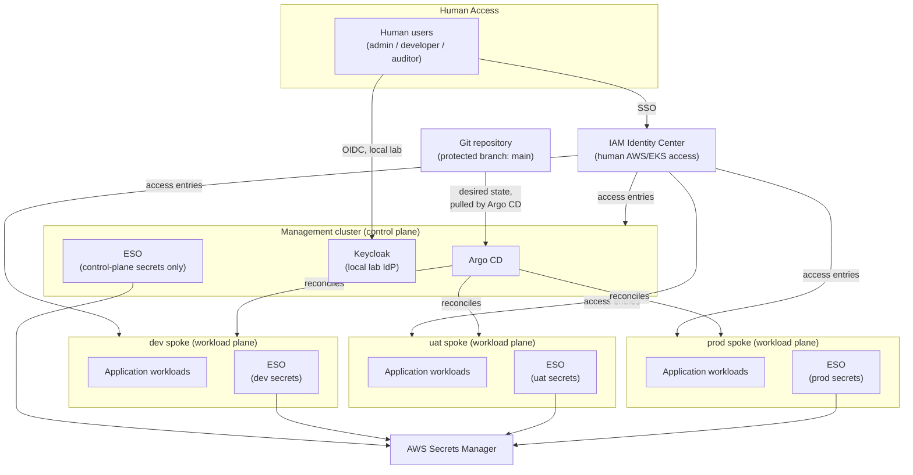
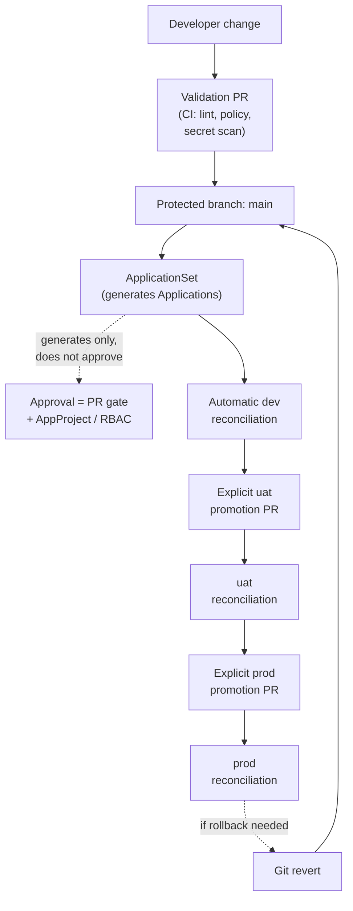
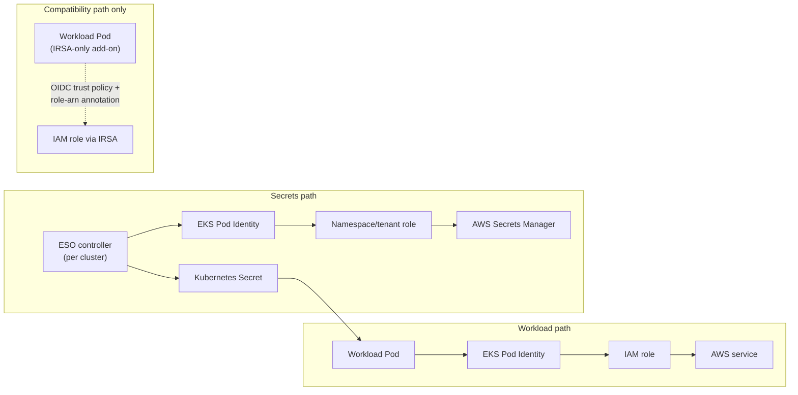
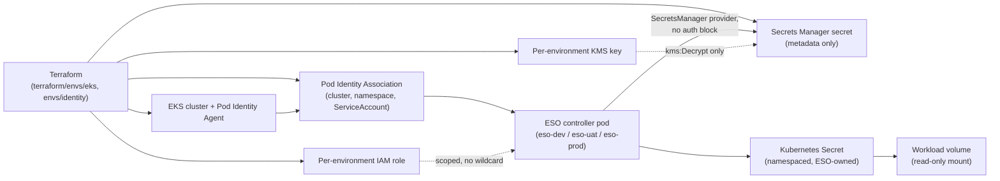

# Technical Architecture Document — eks-gitops-platform-project

## Document Control

| Field | Value |
|---|---|
| Document | eks-gitops-platform-project Technical Architecture |
| Version | 0.10.0 |
| Status | Implementation in progress |
| Phase | Phase 2.7 implemented (hub-and-spoke `lab-multicluster`, runtime-tested in `kind`); Phase 2.8 implemented (workload resilience and HPA, runtime-tested in `kind`); Phase 3.4.1 implemented as offline-tested code (AWS organization and guardrails); Phase 3.1–3.3.5 implemented as offline-validated code; roadmap realigned to the hub-and-spoke model (ADR-0015) |
| Last updated | 2026-11-13 |

This document is the **single, authoritative source of truth** for the
project's architecture: scope, principles, topology, control plane,
identity, secrets, security, risks, evidence, and roadmap. Diagrams are
inline Mermaid, versioned as part of this file; a standalone draw.io
diagram and a polished DOCX export are derived artifacts generated from
this document later (Phase 7), never an independent source to keep in
sync.

Architectural reasoning here stands on this project's own requirements
and on general, well-documented GitOps/Kubernetes/AWS engineering risks
— never on a claim that a specific external system, prior organization,
or private document informed a decision (see `AGENTS.md`).

## Executive Summary

`eks-gitops-platform-project` is a greenfield, portfolio-quality GitOps
platform for AWS EKS, built from scratch in small, reviewable phases. It
demonstrates: reproducible AWS/EKS infrastructure via Terraform; workload
identity without static credentials (EKS Pod Identity, IRSA as
compatibility); secrets that never enter Git (External Secrets Operator
+ AWS Secrets Manager, run per cluster, under a layered isolation model);
Argo CD reconciling a closed set of environments through
`ApplicationSet`; and production promotion gated by a reviewed PR
**plus** runtime trust boundaries (`AppProject`, RBAC, least-privilege
credentials) — the PR alone is treated as necessary, not sufficient.

As of this version, the **local GitOps lab is implemented and
runtime-tested** in a single `kind` cluster (Argo CD, `ApplicationSet`,
the standard workload contract, and External Secrets Operator with a
per-environment secret contract), and the **AWS layer exists as
offline-validated Terraform and GitOps profiles only** — nothing has
been applied against AWS. The environment model is being extended to a
hub-and-spoke shape (`management` hub, `dev`/`uat`/`prod` spokes,
ADR-0015); that extension is `PROPOSED`. The
[evidence table](#evidence-and-implementation-status) states each
capability's real status. An `Accepted` ADR below records an approved
decision — it does not mean that decision has been implemented.

## Scope and Non-Goals

**In scope:** a local, reproducible `kind`-based lab; a target AWS/EKS
Terraform substrate (plan-only until authorized); Argo CD +
`ApplicationSet` with an explicit trust model; a standard workload
contract; human identity (IAM Identity Center, Keycloak for the local
lab) and workload identity (Pod Identity, IRSA); secrets management with
a layered, per-cluster isolation model; PR-gated environment promotion.

**Non-goals:** a general-purpose internal-developer-portal UI; support
for cloud providers other than AWS; a self-service infrastructure
catalog in the MVP (Crossplane or equivalent — deferred, see ADR-0001);
Progressive Delivery as the primary production gate; permanently
running EKS clusters (hub or spokes); generating application workloads for the
`management` cluster; deciding Argo CD's production AWS identity
provider ahead of Phase 3/4 (see "Human Identity and SSO").

## Architecture Principles

1. **A single Git repository is the desired-state source of truth** for
   everything Argo CD reconciles.
2. **Application and infrastructure concerns are separated** — the
   standard workload chart never provisions cloud infrastructure.
3. **Identity contracts between independently evolving systems are
   tested, never assumed.** The (cluster, namespace, `ServiceAccount`)
   tuple that Terraform and the workload chart must agree on is covered
   by an automated contract test before it is trusted.
4. **Every required CI check blocks the merge it protects** — no
   required check is ever configured to continue past a failure.
5. **A reviewed pull request is necessary, but not sufficient, for
   production promotion** — it is paired with `AppProject` boundaries,
   Argo CD RBAC, and least-privilege cluster credentials.
6. **Pinning applies to what is consumed, not to the desired-state
   branch itself** — `main` may be tracked continuously because it is
   protected by review; external dependencies are pinned immutably.
7. **No control-plane component's identity is shared across clusters
   for convenience** — each cluster that needs to act on AWS (including
   each cluster's ESO instance) has its own scoped identity.
8. **Confidence is labeled honestly** — a capability described only in
   documentation is never `VERIFIED`.

## System Context



Argo CD **pulls** the desired state from Git and reconciles it toward
the `dev`, `uat`, and `prod` spokes — Git is a source Argo CD reads, not something Argo
CD reconciles. `management` is the control plane only; it is never a
workload plane. Every cluster that creates Kubernetes `Secret`s runs its
**own** ESO instance against AWS Secrets Manager — none is shared. See
"Cluster and Environment Topology."

## Cluster and Environment Topology

> **Target model (ADR-0015, `PROPOSED`):** `management` is the hub;
> `dev`, `uat`, and `prod` are spokes. `dev` is reconciled automatically
> on merge; `uat` and `prod` are PR-promoted, `prod` additionally behind
> the `AppProject`/RBAC/least-privilege controls. `uat` replaces
> `staging` and `prod` replaces the code's earlier `production`: the
> local lab uses `dev`/`uat`/`prod` since Phase 2.7.1, and the aws-eks
> profile and Terraform since Phase 2.7.2.
> `lab-multicluster` becomes hub + `dev` + `uat` with `prod` opt-in. On
> AWS the target is one account per environment; the first real
> deployment uses a single sandbox account.

| Environment | Role | Control-plane add-ons | Workload-cluster runtime add-ons | Application workloads |
|---|---|---|---|---|
| `management` | Control plane | Argo CD; Keycloak (local lab only); ESO, if a control-plane component needs a secret (e.g. Argo CD's OIDC client secret) | — | **No** |
| `dev` | Workload plane (spoke) | — | Its own ESO instance, own Pod Identity association, own namespace-scoped `SecretStore`s and IAM roles | Yes — auto-reconciled on merge |
| `uat` | Workload plane (spoke) | — | Same per-cluster shape as `dev`, fully separate | Yes — PR-promoted |
| `prod` | Workload plane (spoke) | — | Same per-cluster shape, fully separate from `dev` and `uat` | Yes — PR-promoted, plus `AppProject`/RBAC/least-privilege controls |

**No ESO controller instance is shared across clusters.** This
distinguishes three categories: **control-plane add-ons** (`management`
only), **workload-cluster runtime add-ons** (`dev`/`uat`/`prod`,
including each cluster's own ESO), and **application workloads**
(`dev`/`uat`/`prod` only, never `management`).

**Local lab profiles:**
- `lab-lite` — **implemented as of Phase 2.1**: one `kind` cluster
  (`kindest/node:v1.36.4`, pinned by digest), single control-plane node.
  As of Phase 2.1 it is only the cluster itself — the environment
  namespaces (`dev`/`uat`/`prod` since Phase 2.7.1), Argo CD, and any
  workload are added in later Phase 2
  increments (2.2/2.3), never created imperatively (see "GitOps Control
  Plane" for the imperative/declarative boundary). Namespace-level
  environment simulation validates GitOps generation, RBAC, destination
  restrictions, and reconciliation logic — it does **not** prove real
  cluster-level isolation.
- `lab-multicluster` — **implemented as of Phase 2.7.4** (clusters,
  registration, and per-spoke workloads with their own ESO; `make mc-up`
  brings it up end to end). One `kind` cluster for the
  `management` hub (`eks-gitops-hub`) plus one per spoke
  (`eks-gitops-dev`, `eks-gitops-uat`, and `eks-gitops-prod` opt-in via
  `SPOKES=dev,uat,prod`), each with its own kubeconfig
  (`.local/kubeconfig-<member>`). Every lab script selects its target
  with `LAB_CLUSTER=lab-lite|hub|dev|uat|prod` (default `lab-lite`,
  unchanged). `make lab-mc-create` refuses while lab-lite exists and
  when Docker's free memory is below the per-member budget. Real
  hub/spoke cluster separation is validated only here.

**Local toolchain and isolation (Phase 2.1):** `kind v0.33.0` and
`kubectl v1.36.4` run from project-local, checksum-pinned binaries
(`.tools/bin/`, gitignored, installed only via `make tools-install` —
never the machine's global `kubectl`/`kind`). The cluster's kubeconfig
lives at `.local/kubeconfig` (gitignored), never merged into
`~/.kube/config` and never read from an ambient `KUBECONFIG` — every
`lab/kind/*.sh` and `tests/lab/*.sh` script passes both explicitly. This
keeps the lab isolated from any EKS context, Docker Desktop Kubernetes,
or other `kind` clusters on the same machine.

**AWS**: Terraform prepares one VPC/EKS root per environment; **no AWS
cluster exists by default**. The first real deployment, once
authorized, is the hub plus one spoke in a single sandbox account
(ADR-0015); `uat` and `prod` stay plan-only until a separate
authorization. No AWS cluster runs permanently for the lab. See
ADR-0002 and ADR-0015.

## GitOps Control Plane

Argo CD, running in `management`, reads the protected `main` branch of
this repository and reconciles it toward the `dev`, `uat`, and `prod`
spokes.
`ApplicationSet` generates `Application` objects from an explicit, closed
environment list/matrix (never free text) — it **generates, it does not
authorize**. `AppProject` boundaries restrict allowed source
repositories, destination cluster/namespace pairs, and resource kinds
per trust domain. Control-plane add-ons and application workloads use
distinct GitOps boundaries — never the same `AppProject` or generator.
See ADR-0003.

**Imperative/declarative boundary across Phase 2 increments:** Phase 2.1
creates only the `kind` cluster itself — never `staging`, `production`,
`ApplicationSet`, `AppProject`, or any Argo CD resource. Phase 2.2's
bootstrap is a narrow, explicit exception: it may imperatively create
only what installing the GitOps controller itself requires (the Argo CD
namespace and the pinned Argo CD Helm release) — it does not create the
root/bootstrap `Application`, any `AppProject`, or any `ApplicationSet`.
Phase 2.3 narrows the imperative surface to exactly two objects: the
Argo CD repository-credential `Secret` and the root `Application`
(`platform-bootstrap`) itself. Everything the root `Application` points
at — the `AppProject`, the `ApplicationSet`, the `Application` objects
it generates, `staging`/`production`, and their `ConfigMap`s — is
rendered by the `gitops/bootstrap` Helm chart and reconciled
**declaratively** by Argo CD from there on. See ADR-0007.

### Local Lab Private GitOps Bootstrap (Phase 2.3)

`lab/gitops/*.sh` (backing the `make gitops-*` targets) gives the
already-installed Argo CD read-only SSH access to this repository and
bootstraps exactly one root `Application`.

- **Credential**: a repository-scoped, read-only Ed25519 deploy key —
  never a Personal Access Token, never a personal SSH key, never a
  GitHub App (see ADR-0007 for the full comparison). The private key
  lives only at `.local/gitops/github-deploy-key` (gitignored, mode
  `0600`) and as the `eks-gitops-platform-project-repo` Argo CD
  repository `Secret`; no script ever prints it — identity is verified
  by comparing SHA256 hashes and the (non-secret) repository URL only.
- **Root → chart relationship**: the root `Application` points at the
  dependency-free `gitops/bootstrap` Helm chart and passes its own Git
  revision through as a Helm value, so the `ApplicationSet` it renders —
  and every `Application` that `ApplicationSet` generates — always
  tracks the exact same revision as the root itself.
- **Environment generation**: a deterministic Helm `list` generator (not
  a `git`/`directory` generator) produces exactly two `Application`
  objects, `platform-smoke-staging` and `platform-smoke-production` —
  both now single-Helm-source Applications reading the constant path
  `charts/standard-workload` (Phase 2.4) with a per-environment
  `helm.valueFiles` entry, rather than a per-environment plain-manifest
  path — a third environment requires an explicit, reviewed chart
  change, never a stray file drop.
- **AppProject**: exactly one `sourceRepos` entry, exactly the
  `staging`/`production` destinations, exactly one cluster-scoped grant
  (`{group:"",kind:Namespace}`, proven necessary for `CreateNamespace=true`
  — an empty whitelist makes it fail, see ADR-0007) and, as of Phase 2.4,
  exactly the four namespace-scoped kinds `charts/standard-workload`
  renders (`ConfigMap`, `Service`, `ServiceAccount`,
  `apps/Deployment`) — no project `roles`, no wildcard group or kind.
- **Self-heal and prune** are enabled throughout — this is a single
  local `kind` cluster with no other tenant and no shared blast radius,
  so the tradeoffs that justify disabling `selfHeal` in a real
  multi-tenant production environment do not apply yet.
- **Namespace ownership**: `staging`/`production` carry the same
  `eks-gitops-lab-lite.local/owner: gitops-bootstrap` label Phase 2.2
  already established for the `argocd` namespace; `make gitops-uninstall`
  only ever deletes a namespace carrying that exact label and only after
  an exhaustive, `kubectl api-resources --namespaced`-driven inventory
  shows nothing unexpected remains.
- **Idempotency, proven not assumed**: `make gitops-bootstrap` is
  fail-closed — absent → applies the root `Application`; an exact match
  → a true no-op (its `resourceVersion` is asserted unchanged, not just
  "probably fine"); any drift → refuses to reconcile automatically.
  `make gitops-test-lifecycle` additionally proves that a deliberate,
  single-environment `ConfigMap` drift self-heals from Git within 90
  seconds while the other environment is provably unaffected, and that
  a foreground-cascading uninstall removes exactly the Phase 2.3
  workload resources while leaving Argo CD, its CRDs, the repository
  Secret, and the deploy key untouched.

### Hub-and-Spoke Registration (Phase 2.7.3)

`make mc-spoke-register SPOKE=<env>` connects one spoke to the hub's
Argo CD with the narrowest credential that still lets Argo CD manage the
platform's kinds (ADR-0015):

- **On the spoke:** the workload namespace `<env>` is created by the
  registration itself (Pod Security `restricted`, owner label), so Argo
  CD never needs `CreateNamespace` or any cluster-scoped permission.
  ServiceAccount `argocd-access/argocd-manager` gets a `Role` +
  `RoleBinding` in `<env>` for exactly the six AppProject kinds
  (ConfigMap, Service, ServiceAccount, Deployment, SecretStore,
  ExternalSecret). No ClusterRole, no `Secret`, no wildcard.
- **On the hub:** Argo CD cluster Secret `spoke-<env>` with
  `server: https://eks-gitops-<env>-control-plane:6443` (the address
  inside Docker's `kind` network; the spoke's API certificate carries
  that name), `namespaces: <env>`, `clusterResources: "false"`, the
  spoke's CA, the label `platform.environment=<env>`, and a 24 h
  `TokenRequest` token. Re-running the target rotates the token; it is
  never printed, written to disk, or passed as an argument.
- **Argo CD cache scope:** `configs.cm."resource.inclusions"` in
  `lab/argocd/values-lab.yaml` keeps in-cluster unrestricted (identical
  to the chart default, so lab-lite is unaffected) and limits the spoke
  clusters (`https://eks-gitops-*-control-plane:6443`) to the same six
  kinds. Proven necessary empirically: without it, Argo CD's cluster
  cache lists every namespaced kind (Pods first, Secrets too) and the
  spoke's cluster sync fails under a credential that deliberately cannot
  read them.
- `make mc-spoke-deregister SPOKE=<env>` first removes the
  `platform.environment` label from the hub Secret and waits for the
  spoke's Application to be deleted (Phase 2.7.4, see below), then
  deletes the hub Secret, then the spoke's Role, RoleBinding, and
  `argocd-access` namespace (invalidating every token issued for that
  ServiceAccount). The workload namespace is kept.

### Cluster Generator and Per-Spoke ESO (Phase 2.7.4)

The hub's Argo CD deploys `charts/standard-workload` into every
registered spoke through the same `gitops/bootstrap` chart, under a third
profile, `local-multicluster`, which the hub selects automatically
(`LAB_CLUSTER=hub`; a spoke never runs the bootstrap, and a profile that
does not match the cluster fails closed):

- **Generator:** a `clusters` generator selecting hub cluster Secrets
  that carry both the registration owner label and
  `platform.environment` in `dev`/`uat`/`prod` (from
  `multicluster.environments`, the selector's only source). One
  Application `platform-smoke-<env>` per spoke, destination by cluster
  **name** (`spoke-<env>`), `values-<env>.yaml`,
  `CreateNamespace=false` (the namespace comes from registration with
  Pod Security `restricted`). The hub has no such Secret, so nothing is
  generated for it; an unlabelled Secret or one labelled `qa` generates
  nothing.
- **AppProject:** under this profile it allows only
  `spoke-dev/dev`, `spoke-uat/uat`, `spoke-prod/prod`, no
  server-addressed destination, and an empty
  `clusterResourceWhitelist` — not even a hand-made Application in the
  project can land on the hub. The `local-kind` and `aws-eks` renders
  are byte-for-byte unchanged.
- **ESO per spoke:** `scripts/eso/_lib.sh` derives its release table
  from `LAB_CLUSTER`. lab-lite keeps its three releases (`eso-uat` owns
  the webhook/cert-controller); a spoke runs exactly one release,
  `eso-<env>`, which owns its own cluster's singletons; the hub runs
  none, and every ESO script fails closed there. The workload chart's
  kubernetes-provider `SecretStore` is unchanged — source and consumer
  live in the same spoke.
- **Order:** `make mc-up` runs create → Argo CD and repository Secret on
  the hub → per spoke: register (creates the namespace), ESO, source
  Secret → hub bootstrap (which first checks every registered spoke is
  running with ESO Available and its source Secret present). The ESO
  CRDs therefore exist before Argo CD's first sync, so R-13 does not
  arise in this profile. A second `make mc-up` changes nothing; it
  rotates a spoke's token only when it expires within 2 h.
- **Deregistration with a live Application:** proven empirically that
  deleting the cluster Secret first **orphans** the spoke's workloads —
  the ApplicationSet deletes the Application within seconds and its
  finalizer completes without deleting anything, because the
  destination no longer exists. `spoke-deregister.sh` therefore removes
  the label first, waits for the Application (and its cascade on the
  spoke) to finish while the credential still works, then deletes the
  Secret. If it happens anyway, re-registering the spoke makes Argo CD
  adopt the orphaned objects again.

### Local Lab Argo CD Bootstrap (Phase 2.2)

`lab/argocd/*.sh` (backing the `make argocd-*` targets) installs Argo CD
into the Phase 2.1 `lab-lite` `kind` cluster, entirely offline once the
chart is fetched, and entirely isolated to the project-local toolchain
and kubeconfig — the same isolation discipline as Phase 2.1.

- **Chart:** `argo-helm/argo-cd` `10.4.2` (app version `v3.5.2`), fetched
  once as an immutable GitHub Release `.tgz` asset and SHA256-pinned in
  `scripts/argocd/_lib.sh` — never `helm repo add`, never a floating
  version. `make argocd-chart-fetch` is the only target permitted to
  download it; every other target requires it already present and
  checksum-verified.
- **Tooling:** Helm `v4.2.4`, installed the same way as `kind`/`kubectl`
  in Phase 2.1 — a pinned, checksum-verified download into
  `.tools/bin/helm` — except Helm ships as a `tar.gz` archive, so
  `scripts/lab/install-tools.sh` extracts exactly one validated,
  non-symlink, regular-file archive member before verifying and
  installing it.
- **Images:** every rendered image reference is digest-pinned
  (`repository:tag@sha256:digest`) — `quay.io/argoproj/argocd:v3.5.2` and
  `ecr-public.aws.com/docker/library/redis:8.6.4-alpine`, each verified
  against the registry's own `Docker-Content-Digest` at pin time.
  `dex` and `notifications-controller` are disabled; `make argocd-render`
  proves both are absent from the render and that no tag-only image
  exists.
- **Values contract:** `lab/argocd/values-lab.yaml` is the single,
  explicit source of every override — one replica per component,
  `ClusterIP`-only `server` service, ingress disabled, explicit
  CPU/memory requests and limits on every rendered container and init
  container (including the `copyutil` init container and the
  `redis-secret-init` pre-install hook `Job`), and `crds.keep: true` so
  Argo CD's CRDs survive an `uninstall`.
- **Idempotency, proven not assumed:** `make argocd-install` is
  fail-closed — absent → installs; an exact match against the pinned
  chart, values fingerprint, and live manifest → a true no-op (no `helm
  upgrade` call at all); any drift in any of those → refuses to
  reconcile automatically and fails closed. `make argocd-test-lifecycle`
  exercises install → install (asserting the Helm release revision, the
  live manifest checksum, and every managed workload's
  `.metadata.generation` are byte-identical — proving no rollout
  occurred) → uninstall (asserting the exact three Argo CD CRDs are
  retained and still schema-compatible via `kubectl diff`, and that no
  unexpected `*.argoproj.io` CRD exists) → uninstall no-op → a
  restoration install using those retained CRDs, leaving Argo CD
  installed and healthy at the end.
- **Namespace ownership:** the `argocd` namespace carries a dedicated
  `eks-gitops-lab-lite.local/owner=argocd-bootstrap` label (not the
  generic `app.kubernetes.io/managed-by`); `make argocd-uninstall` only
  ever deletes it when this bootstrap owns it and an exhaustive
  namespaced-resource inventory (every `kubectl api-resources
  --verbs=list --namespaced` type, not just `kubectl get all`) shows
  nothing beyond the two objects Kubernetes itself always creates.
- **Admin access:** the initial-admin `Secret`'s password is decoded
  manually (`kubectl ... -o jsonpath='{.data.password}' | base64 -D` on
  macOS) — never scripted, logged, or written to any evidence file — and
  is expected to be deleted once a replacement auth method is in place.
  `make argocd-port-forward` exposes the UI/API at
  `https://localhost:8443` in the foreground only.

## Application Delivery and Promotion



`dev` reconciles automatically from `main`. `uat` and then `prod` are
each promoted only through a **separate, explicit PR** that bumps a pinned
external-dependency value (chart version, image digest) — never a direct
commit. Rollback is a Git revert of the promotion commit, reconciled the
same way. The PR gate is necessary but not sufficient: it is paired with
the `AppProject`/RBAC/least-privilege-credential controls in "Security
and Trust Boundaries." See ADR-0003.

## Workload Deployment Contract

One standard Helm chart renders every workload: `Deployment`/`Service`,
an explicit `ServiceAccount` `identityMode` (`podIdentity` / `irsa` /
`none` — see "Workload Identity"), startup/readiness/liveness probes,
resource requests/limits, an HPA that does not fight a static replica
count, a `PodDisruptionBudget`, topology-spread/anti-affinity, graceful
termination, `NetworkPolicy`, optional `Ingress`, an optional
metrics/`ServiceMonitor` interface, and digest-pinned images. The chart
never provisions cloud infrastructure and fails clearly on invalid
values — every documented field is backed by a template that reads it.
See ADR-0006.

Implemented today: Deployment, Service, ServiceAccount, ConfigMap, the
ESO `SecretStore`/`ExternalSecret` pair, and since Phase 2.8.1 graceful
termination (native `preStop` sleep 5 s + 5 s server shutdown inside a
30 s grace period, checked at render time), a `PodDisruptionBudget`
(`maxUnavailable: 1`, only with two or more replicas), hostname and zone
topology spread (`ScheduleAnyway`; zone `DoNotSchedule` in prod-aws),
and a per-workload `NetworkPolicy` (http from its own namespace, DNS-only
egress; off in the aws overlays, see R-14). Since Phase 2.8.2, an
optional HPA (CPU, `autoscaling/v2`; on in `prod`, 2–4 replicas) backed
by metrics-server, installed per workload cluster by
`make metrics-server-install` (never on the hub, never through Argo CD).
Argo CD ignores `spec.replicas` only on Deployments the chart annotates
`replicas-owner: hpa`; moving an existing Deployment under an HPA needs
`make workload-hpa-handover` first, or server-side apply drops it to one
replica for a moment (measured; ADR-0006 amendment). Ingress and
`ServiceMonitor` are still deferred.

## Human Identity and SSO

- **Human → AWS/EKS:** AWS IAM Identity Center; EKS access entries mapped
  to groups. This is settled.
- **Human → Argo CD, local lab:** Keycloak, direct OIDC — no Dex broker
  unless a concrete multi-connector need appears later. **Keycloak is
  the reproducible identity provider for the local lab only; this
  document does not assert it will be the production identity
  provider.**
- **Human → Argo CD, production AWS:** the identity provider is
  **`UNKNOWN`**, pending an explicit decision in Phase 3/4. The local
  lab's job is to prove the OIDC/RBAC mechanism (authenticate, map to a
  role, enforce that role) — not to pre-select a production IdP.
- Roles: platform administrator, application developer (scoped to owned
  namespaces), read-only auditor. `admin` is a bootstrap/break-glass
  fallback, not the standing path once OIDC is configured.
- Bootstrap: the Keycloak↔Argo CD OIDC secret is generated locally,
  stored only as an ephemeral in-cluster `Secret`, never written to Git.
  In AWS, Argo CD may start without SSO; the `management`-cluster ESO
  instance is installed before OIDC is finalized; the secret then lives
  in Secrets Manager. See ADR-0005.

## Workload Identity



EKS Pod Identity is the default: no `eks.amazonaws.com/role-arn`
annotation, requires the Pod Identity Agent, bound via a
Terraform-managed (cluster, namespace, `ServiceAccount`) association.
IRSA is an explicit compatibility path only — OIDC provider, trust
policy, and the annotation — never a silent fallback and never described
as the same mechanism as Pod Identity. The contract that must be tested
is the (cluster, namespace, `ServiceAccount`) tuple; `kind` validates its
shape only — it cannot prove Pod Identity itself. See ADR-0004.

## Secrets Management

External Secrets Operator runs as a **separate instance in every
cluster** that needs to create Kubernetes `Secret`s — `management`
(control-plane secrets only), `dev`, `uat`, and `prod`. **No ESO controller
instance is shared across clusters.** Each instance reconciles secrets
from AWS Secrets Manager under a layered model: IAM least privilege,
Kubernetes RBAC, that cluster's own ESO controller identity (via its own
Pod Identity association), and — where feasible — per-namespace/tenant
assumable roles scoped to that cluster. A namespace-scoped `SecretStore`
is the default in every cluster, referencing that cluster's own scoped
role; it is **not by itself the security boundary** — real isolation is
the combination of all layers above, evaluated per cluster.
`ClusterSecretStore` requires a separate, explicit decision, per cluster
if ever adopted. See ADR-0004.

In `lab-multicluster` (Phase 2.7.4) this holds locally: each spoke runs
its own ESO release reading a source Secret that lives in that spoke,
and the hub runs no ESO at all.

## Terraform and Bootstrap Boundary

Terraform provisions AWS infrastructure (VPC, EKS, IAM baseline, KMS,
Pod Identity associations for every cluster's workloads and ESO
instance) and Argo CD's initial bootstrap installation only. After
bootstrap, Argo CD manages its own declarative configuration — Terraform
does not keep patching it. The OIDC-secret bootstrap ordering (Argo CD
may start without SSO → the `management`-cluster ESO instance installed
→ OIDC finalized) and its open seeding question are described in
ADR-0005; Terraform must never store a secret's plaintext value in state.
See ADR-0001 and ADR-0005.

## AWS EKS Profile (Phase 3.3, `DESIGNED` / `STATICALLY VALIDATED` / `NOT DEPLOYED` / `NOT VALIDATED AGAINST AWS` — `ACTUAL COST: USD 0`)

No EKS cluster exists. Nothing below has been applied against AWS. This
section documents the offline-validated design connecting the pieces
above into one chain, and the separate, parallel GitOps profile
mechanism that would select it — neither is reachable from the current
`kind` lab.

### Infrastructure → Secret → workload chain



Every box above is Terraform HCL and/or a chart template that exists
and passes `terraform test`/`helm lint` offline (Phase 3.1–3.3.3) — none
is a deployed resource.

### Git → root Application → profile → Applications → overlays

```mermaid
flowchart LR
    Repo["Git repository<br/>(this repo)"] --> Root["root Application<br/>platform-bootstrap"]
    Root -->|helm chart| Boot["gitops/bootstrap chart"]
    Boot -->|profile: local-kind<br/>(default)| ASetLocal["ApplicationSet<br/>generator: environments"]
    Boot -->|profile: aws-eks<br/>(explicit only)| ASetAWS["ApplicationSet<br/>generator: awsEnvironments"]
    ASetLocal --> AppD["Application: dev"]
    ASetLocal --> AppS["Application: uat"]
    ASetLocal --> AppP["Application: prod"]
    ASetAWS --> AppDAWS["Application: dev-aws"]
    ASetAWS --> AppSAWS["Application: uat-aws"]
    ASetAWS --> AppPAWS["Application: prod-aws"]
    AppD -->|values-dev.yaml| Chart["charts/standard-workload"]
    AppS -->|values-uat.yaml| Chart
    AppP -->|values-prod.yaml| Chart
    AppDAWS -->|values-dev-aws.yaml| Chart
    AppSAWS -->|values-uat-aws.yaml| Chart
    AppPAWS -->|values-prod-aws.yaml| Chart
```

Both `ApplicationSet` branches are mutually exclusive by construction
(Phase 3.3.4a) — a single render never produces both sets, and an
unrecognized `profile` value fails the render closed rather than
defaulting to either one. See ADR-0014 for the identity boundary that
would need to be satisfied before a real `aws-eks` bootstrap could
proceed past its own preflight step, and
`docs/runbooks/eks-bootstrap-order.md` for the full future activation
sequence (documented, not executed).

## Security and Trust Boundaries

- `AppProject` per trust domain; Argo CD RBAC; a restricted set of
  principals allowed to modify `ApplicationSet` definitions; a documented
  sync/prune policy; least-privilege Argo CD cluster credentials.
- **Explicit threat-model statement:** a compromised Argo CD controller,
  or an over-privileged/admin-level cluster credential, can mutate a
  cluster directly regardless of branch protection. This is why the PR
  gate (ADR-0003) is paired with the runtime controls above, not treated
  as sufficient alone.
- Secrets isolation depends on the layered, per-cluster model in
  "Secrets Management" — a namespace-scoped `SecretStore` is not a
  boundary by itself, and no ESO identity is shared across clusters.
- No long-lived AWS access keys are permitted anywhere in this
  repository (checked by `scripts/validate/check-secrets.sh`, within its
  documented pattern coverage).

## Observability and Operations

`NOT IMPLEMENTED`. The standard chart reserves a metrics/`ServiceMonitor`
interface without forcing a Prometheus dependency. Phase 6.1 adds the
stack in the hub-and-spoke shape: each spoke runs a metrics agent that
ships to the hub, where dashboards, logs, and alerting live; one
user-facing SLO with multi-window burn-rate alerts whose rules are unit
tested offline; and alerts on Argo CD application health
(`Degraded`/`OutOfSync` beyond a grace period). Runbooks and failure
drills are Phase 6 scope.

## Availability and Recovery

`NOT IMPLEMENTED`. Workload-level resilience (PodDisruptionBudget,
topology spread, graceful shutdown, HPA) is Phase 2.8. Backup and a
scripted restore drill are Phase 6.2. Single-point-of-failure analysis
for the GitOps delivery path — now centered on the hub (R-11) and
including the bootstrap-cycle risk (R-04) — is Phase 6 scope.

## Costs and FinOps

| Item | Cost | Status |
|---|---|---|
| Local lab (`lab-lite` or `lab-multicluster`) | No AWS service charges — runs on local Docker | Both profiles implemented |
| Local memory, measured (Docker view, steady state, 2026-11-11) | lab-lite with Argo CD + 3 ESO releases + 3 workloads: 2.07 GiB. lab-multicluster bare: hub 0.81, dev 0.75, uat 0.55 GiB. With Argo CD on the hub and spokes registered: hub 1.20–1.46, dev 0.71–0.72, uat 0.62–0.83, prod 0.77 GiB (≈3.3 GiB for hub + 3 spokes) | `VERIFIED` by measurement. Phase 2.7.4, with ESO and the workload in every spoke: hub 1.31–1.39 GiB, each spoke 0.99–1.17 GiB (≈4.4 GiB for hub + 3 spokes) — more than the ≈0.12 GiB per spoke lab-lite suggested, because each spoke's single ESO release also runs its own webhook and cert-controller. Phase 2.8.2, with metrics-server in every spoke: hub 1.31 GiB, dev 1.07, uat 1.02, prod 1.19 GiB (prod while scaled by its HPA during the run), about 4.6 GiB in total |
| Terraform plan-only | No AWS service charges | `PROPOSED` as a standing rule |
| Multi-account guardrails and security services (Phase 3.4.1, if ever applied) | Organizations, SCPs, accounts and budgets: no charge. The first organization trail of management events: S3 storage only. GuardDuty and Security Hub: per events analyzed and per checks, with GuardDuty's EKS runtime protection as the main variable. EBS malware scanning deliberately off (billed per scan) | `INFERRED` from public pricing; nothing applied (USD 0) - see ADR-0016 |
| One EKS cluster, standard support, control plane only | ≈US$0.10/hour | `INFERRED` — public AWS pricing at time of writing, not re-verified live |
| Three EKS control planes running continuously | ≈US$219/month, before nodes/NAT/storage/transfer | `INFERRED` — same caveat; why this project never runs three permanent clusters |
| Full hub-and-spoke (four control planes) running continuously | ≈US$292/month, before nodes/NAT/storage/transfer | `INFERRED` — same caveat; never the intended mode (ADR-0015) |
| First sandbox deployment (hub + one spoke, a few hours, minimal spot nodes) | Low single-digit US$ | `INFERRED` — to be replaced by the measured bill once it is run; requires its own authorization and a budget alert in place first |

"No AWS service charges" means no billed AWS resource consumption — it
is not a claim of zero cost in every sense (local compute/electricity is
not counted). All figures must be re-verified against current AWS
pricing before any real deployment. **No AWS resource is created without
a fresh, explicit authorization.**

## Architecture Decisions

| ADR | Decision | Status |
|---|---|---|
| [ADR-0001](../adr/0001-platform-scope-and-boundaries.md) | Platform scope and repository boundaries | Accepted |
| [ADR-0002](../adr/0002-environment-topology.md) | Environment topology | Accepted |
| [ADR-0003](../adr/0003-gitops-control-plane-and-promotion.md) | GitOps control plane and promotion | Accepted |
| [ADR-0004](../adr/0004-workload-identity-and-secrets.md) | Workload identity and secrets | Accepted |
| [ADR-0005](../adr/0005-sso-bootstrap-and-cluster-access.md) | SSO, bootstrap, and cluster access | Accepted |
| [ADR-0006](../adr/0006-standard-workload-contract.md) | Standard workload contract | Accepted |
| [ADR-0007](../adr/0007-private-gitops-bootstrap.md) | Private repository GitOps bootstrap | Accepted |
| [ADR-0008](../adr/0008-standard-workload-before-sso.md) | Standard workload contract before SSO | Accepted |
| [ADR-0009](../adr/0009-repository-governance-baseline.md) | Repository governance baseline | Accepted |
| [ADR-0010](../adr/0010-external-secrets-operator-contract.md) | External Secrets Operator contract | Accepted |
| [ADR-0011](../adr/0011-terraform-foundation.md) | Terraform foundation | Accepted |
| [ADR-0012](../adr/0012-network-eks-iac-foundation.md) | Network and EKS IaC foundation | Accepted |
| [ADR-0013](../adr/0013-pod-identity-secrets-manager-iac.md) | EKS Pod Identity and AWS Secrets Manager IaC | Accepted |
| [ADR-0014](../adr/0014-eks-application-identity-boundary.md) | EKS application generation and identity boundary | Accepted |
| [ADR-0015](../adr/0015-hub-and-spoke-environment-model.md) | Hub-and-spoke environment model (amends ADR-0002) | Accepted |
| [ADR-0016](../adr/0016-aws-organization-and-guardrails.md) | AWS organization, accounts and guardrails (amends ADR-0015's AWS section) | Accepted |

Each ADR above records an **approved decision**, not an implemented one
— every capability it describes is tracked honestly in "Evidence and
Implementation Status" below.

## Risks and Open Questions

| ID | Risk | Impact | Mitigation | Status |
|---|---|---|---|---|
| R-01 | The (cluster, namespace, `ServiceAccount`) Pod Identity contract is untested against real EKS | High | Shape-test in `kind`; positive/negative test against a temporary, authorized EKS cluster (ADR-0004) | Open |
| R-02 | Any cluster's ESO controller identity could be over-privileged, making that cluster's namespace-scoped `SecretStore`s a nominal boundary only — evaluated per cluster and per tenant | High | Per-cluster, per-namespace/tenant assumable roles; IAM least privilege; no ESO identity shared across clusters (ADR-0002, ADR-0004) | Open |
| R-03 | A compromised Argo CD controller or admin-level cluster credential can mutate a cluster regardless of branch protection | High | `AppProject`, Argo CD RBAC, least-privilege cluster credentials (ADR-0003) | Open |
| R-04 | Bootstrap cycle between Argo CD, the `management`-cluster ESO instance, and the OIDC client secret | Medium | Documented ordering; OIDC-secret seeding mechanism explicitly `UNKNOWN` pending Phase 4 (ADR-0005) | Open |
| R-05 | Remote cluster access/credentials for Argo CD | Medium | Designed and proven locally in Phase 2.7.3: one namespace-scoped ServiceAccount per spoke, no ClusterRole, 24 h rotating token, cache limited by `resource.inclusions`. The EKS equivalent (access entries / IAM) remains Phase 3/4 (ADR-0005) | Mitigated locally; open for EKS |
| R-06 | `main` has no server-side branch protection — the PR-gate design is enforced by process only | High (if a mutating change happened today) | A `validate` CI check runs on every PR; the repository is now public, so the ADR-0009 ruleset can be applied at no cost, pending explicit authorization | Open |
| R-07 | AWS costs could be incurred without authorization | High if it happened | Standing rule: no `apply` without fresh, explicit, scoped authorization | Mitigated by policy, not tooling yet |
| R-08 | TAD/code drift as implementation begins | Medium | TAD updated in the same PR as any architecture change (`AGENTS.md`) | Open |
| R-09 | Secret and confidentiality-term scanning is pattern-based, not exhaustive | Medium | Documented explicitly in each script; never presented as a complete scanner | Accepted limitation |
| R-10 | `lab-multicluster` may be too resource-intensive for routine local iteration | Low | Measured: hub + 3 spokes ≈3.3 GiB with registration only (Phase 2.7.3) and ≈4.4 GiB with ESO and workloads (Phase 2.7.4), below the 5.3–7.1 GiB first estimated; `prod` stays opt-in, the two profiles never run together, and `make lab-mc-create` refuses when Docker memory is short (spoke budget raised to 1300 MiB from the 2.7.4 measurement) | Mitigated |
| R-11 | The hub holds credentials for every spoke, making it the most sensitive component | High | One least-privilege identity per spoke, no credential shared across spokes, spokes never trust the hub back. Proven locally in Phase 2.7.3: each spoke's token is rejected by every other spoke (HTTP 401) and cannot read Secrets, `kube-system`, or anything outside its namespace. The hub itself remains a single point of compromise (ADR-0015) | Open — per-spoke isolation proven locally |
| R-12 | Naming drift between ADR-0015 (`dev`/`uat`/`prod`) and the code | Low | Local lab renamed in Phase 2.7.1; aws-eks profile and Terraform renamed in Phase 2.7.2 | Closed |
| R-13 | Fresh-cluster bootstrap ordering: Argo CD cannot sync `charts/standard-workload` until the ESO CRDs exist, while `make eso-install` needs the workload namespaces Argo CD creates. Only clusters that kept the CRDs from an earlier install bootstrap cleanly | Medium (a new engineer following the README on a fresh cluster gets three `OutOfSync`/`Missing` Applications) | Found during Phase 2.7.1 testing on a fresh `lab-lite`; worked around by applying the 25 CRDs first with the same pinned render and field manager as `lab/eso/install.sh` step 1. Phase 2.7.4 regression testing showed the CRDs alone are not enough: when Argo CD syncs before the `eso-uat` webhook answers, the `ExternalSecret` is rejected (`connection refused`), the Deployment never becomes healthy without its Secret, and the automated sync operation waits on it indefinitely; recovery is to terminate the operation and sync again. A CRD-only install entry point is the proposed fix, in its own phase. Does not arise in `lab-multicluster` (Phase 2.7.4): `make mc-up` installs ESO on each spoke before the hub bootstrap | Open (lab-lite only) |
| R-14 | EKS add-ons the workload chart depends on are not in Terraform: a `NetworkPolicy` is only enforced when the VPC CNI's network-policy agent is enabled, and an HPA needs metrics-server; the EKS root installs only `eks-pod-identity-agent` | Medium (a policy would look like protection while enforcing nothing; an HPA would never scale) | The aws overlays keep `networkPolicy.enabled: false` and `autoscaling.enabled: false`, and `check-standard-workload-chart` asserts no aws overlay renders either. Phase 3.4 adds the VPC CNI (network policy) and metrics-server add-ons in Terraform, then the overlays turn both on | Open |

## Evidence and Implementation Status

| Capability | Status | Evidence required |
|---|---|---|
| Repository foundation (TAD, ADRs, validation scripts) | `CODE-CONFIRMED` | Files exist and pass `make validate` |
| Local documentation validation (`make validate`) | `VERIFIED`, within each script's documented pattern coverage | Executed with a reproducible result during this phase |
| Target architecture described in this document | `PROPOSED` | Design only; nothing deployed |
| Local lab tooling (`make tools-check`/`tools-install`, `lab/kind/*.sh`) | `VERIFIED` | Executed in this phase: `make tools-install` downloaded and checksum-verified `kind v0.33.0`/`kubectl v1.36.4` into `.tools/bin/`; `make tools-check` confirmed them read-only |
| `lab-lite` cluster: creation, idempotency, teardown, identity match | `VERIFIED`, scoped to exactly what was exercised (cluster lifecycle and identity — not Argo CD/workloads, which remain `NOT IMPLEMENTED`) | `make lab-test-lifecycle` proved create→create(no-op)→destroy→destroy(no-op); the persistent cluster was then created and confirmed: server `v1.36.4` exactly, node image digest matches the pin, node `Ready`, reachable only via `.local/kubeconfig`, no `staging`/`production`/`argocd` namespace present |
| `lab-multicluster` clusters and spoke registration (Phase 2.7.3) | `PARTIALLY VERIFIED` at commit time — results of this phase's runs recorded in its PR description rather than asserted here in advance | `make lab-mc-test-lifecycle` (create/no-op/destroy/no-op, bad input fails closed, global kubeconfig untouched); `make mc-test-registration` with `dev`/`uat` and again with `prod` (token rotation and 24 h expiry, RBAC matrix, cross-spoke token rejection, probe ConfigMap reconciled by the hub into every spoke, out-of-scope destination never lands, deregistration cuts the hub off) |
| Repository governance baseline (Dependabot, Actions policy, merge-button policy) | `PARTIALLY VERIFIED` at commit time — the five settings are applied and read back via the GitHub API after this PR opens, with the result recorded in that PR's description rather than asserted here in advance | `.github/dependabot.yml` renders exactly one `github-actions` ecosystem entry; `main` branch protection and repository rulesets are `NOT IMPLEMENTED` — now available because the repository is public (API: `Branch not protected`, rulesets `[]`, 2026-11-10), applying them pending explicit authorization (see ADR-0009) |
| Argo CD control-plane bootstrap in `lab-lite` (`make argocd-*`) | `VERIFIED`, scoped to exactly what was exercised (Argo CD's own install/uninstall/upgrade lifecycle — not `ApplicationSet`/`Application` reconciliation behavior, which remains `NOT IMPLEMENTED` until Phase 2.3) | `make argocd-chart-fetch` downloaded and checksum-verified `argo-cd-10.4.2.tgz`; `make argocd-render` confirmed all 7 rendered image occurrences (2 distinct images) are digest-pinned and dex/notifications are absent; `make argocd-test-lifecycle` proved install→install(true no-op: Helm revision, live-manifest sha256, and every managed workload's `.metadata.generation` byte-identical)→uninstall(exactly the 3 pinned CRDs retained and `kubectl diff`-compatible)→uninstall(no-op)→restoration install using those retained CRDs, ending installed and healthy; a further two `make argocd-install` runs confirmed persistence (second run a true no-op) |
| Private repository GitOps bootstrap (`make gitops-*`) | `PARTIALLY VERIFIED` at commit time — offline render and repository-authentication provisioning verified pre-merge; the runtime bootstrap/self-heal/uninstall lifecycle is verified via this phase's own PR feature-branch lifecycle test, whose result is recorded in that PR's description (and, if a correction was needed after that run, in a follow-up commit's message) rather than asserted here in advance | `make gitops-render` confirmed the chart renders exactly 1 `AppProject`, 1 `ApplicationSet` with exactly 2 generator elements, 0 `Secret` objects, no wildcard permissions, and correct revision propagation; `make gitops-repo-setup` provisioned the deploy key/GitHub deploy key/repository Secret and was confirmed idempotent (re-run is a true no-op); client- and server-side `kubectl apply --dry-run` passed for the root Application, the rendered AppProject/ApplicationSet, and both environment ConfigMaps |
| Argo CD reconciliation / `ApplicationSet` behavior | `VERIFIED`, scoped to exactly what Phase 2.4's lifecycle test exercises | Scope is exactly `platform`/`platform-environments`/`platform-smoke-{staging,production}`, each now rendering `charts/standard-workload` (`Deployment`/`Service`/`ServiceAccount`/`ConfigMap`) instead of a bare `ConfigMap` — no other `Application`/`ApplicationSet`/`AppProject` exists |
| Standard workload contract (`charts/standard-workload`) | `VERIFIED`, scoped to the mandatory baseline plus the Phase 2.8.1 resilience set (graceful termination, PDB, topology spread, NetworkPolicy) and the Phase 2.8.2 HPA; Ingress/ServiceMonitor remain `NOT IMPLEMENTED` (ADR-0006 amendments). Phase 2.8.x runtime results are recorded in their PR descriptions | `make check-standard-workload-chart` proved the rendered-kind allowlist, digest-only images, Restricted-PSS fields, matching Service/Deployment selectors, and 13 deterministic post-merge negative schema cases; the Phase 2.4 lifecycle test proved both environments' Deployment/Service/ServiceAccount/ConfigMap, in-cluster reachability, correct differing `/api/info` messages, a checksum-triggered rollout via two real Git commits, and production's isolation from the staging-only change |
| EKS Pod Identity workload access | `UNKNOWN` | Requires a real, temporary, authorized EKS cluster |
| Workload-identity (cluster/namespace/ServiceAccount) contract | `NOT IMPLEMENTED` | No contract test exists |
| External Secrets Operator bootstrap (`make eso-*`) | `PARTIALLY VERIFIED` at commit time — offline collision/ownership render proof verified pre-merge (`make eso-render`: exactly 25 CRDs, no scoped-release collision, webhook/cert-controller singleton, zero structural wildcard RBAC, digest-only images); the runtime install/no-op/uninstall(CRD-retention)/restore lifecycle, the CRD field-ownership-conflict fail-closed preflight, and the singleton-dependency guards are verified via this phase's own PR feature-branch lifecycle test, whose result is recorded in that PR's description rather than asserted here in advance | `make eso-render` / `make check-eso-chart` proved the full collision gate offline; `make eso-test-lifecycle` proves install→true no-op (per-release Helm revision + manifest sha256 unchanged)→singleton-health guard (`status.sh` fails if production exists while staging's shared webhook is unhealthy)→simulated CRD field-ownership conflict (`install.sh` fails closed, zero mutation, never `--force-conflicts`)→singleton-dependency guard (`uninstall.sh staging` refused while production exists)→uninstall(25/25 CRDs retained)→uninstall(no-op)→restoration install, throughout preserving Argo CD and the standard-workload baseline and the global kubeconfig/context |
| Per-environment External Secrets reconciliation contract (`make eso-provision-source-secret`/`eso-test-secret-lifecycle`) | `PARTIALLY VERIFIED` at commit time — offline chart/schema render proof verified pre-merge (`make check-standard-workload-chart`: zero `Secret` rendered, read-only volume only, no `env`/`envFrom`/`secretKeyRef`, staging/production `SecretStore`/`ExternalSecret` fully isolated, `AppProject` grants exactly the two new namespaced kinds and never `Secret`); the runtime provision/reconcile/mount/rotate/propagate/delete-recreate/no-op/uninstall/restore lifecycle is verified via this phase's own PR feature-branch lifecycle test, whose result is recorded in that PR's description rather than asserted here in advance | `make check-standard-workload-chart` proved the static contract offline, including a disabled-by-default render byte-for-byte equivalent (kind-set and volume-set) to Phase 2.4's original 4-kind baseline; `make eso-test-secret-lifecycle` proves independent synthetic source Secrets for both environments (imperative, out-of-Git, never printed) → both `SecretStore`s Ready → both `ExternalSecret`s Ready → target Secrets owned exclusively by ESO → workload rollout → source/target/mounted-file SHA256 match per environment and differ between environments → controlled rotation of staging's source value propagates to its target Secret and mounted file with production's Secret resourceVersion/Pod UID/hash unchanged → manual deletion of the target Secret is recreated by ESO with the same value → a repeated `gitops-bootstrap` is a true resourceVersion no-op → `eso-uninstall` retains both target Secrets (never owned by the Helm release) with Argo CD and the workload baseline unaffected → a repeated uninstall is a no-op → restoration from `main` leaves both `ExternalSecret`s Ready again, throughout printing only hashes, resource states, and metadata, never a decoded secret value |
| Transactional GitOps lifecycle and safe revision rollback (`make gitops-switch-revision`/`gitops-retire-appproject-kind`/`gitops-uninstall`) | `PARTIALLY VERIFIED` at commit time — offline classifier logic verified live read-only against the persistent lab cluster pre-merge (correctly classifies every real object in `staging`/`production` with zero `unknown`, and correctly flags an injected synthetic fixture as `unknown`); the runtime preflight-abort/ESO-retention/revision-switch/kind-retirement lifecycle is verified via this phase's own PR feature-branch test run, whose result is recorded in that PR's description rather than asserted here in advance | `tests/gitops/test-lifecycle.sh` proves an injected unclassifiable fixture aborts `gitops-uninstall` with zero mutation (root Application UID/generation unchanged, workload untouched), and that ESO's Helm-owned scoped RBAC (verified via exact `app.kubernetes.io/managed-by`/`meta.helm.sh/release-name` metadata) correctly forces `staging`/`production` to be retained rather than deleted or blocking the cascade; `tests/gitops/test-revision-switch.sh` proves a nonexistent revision fails closed with zero mutation, an in-place switch preserves the root Application's UID/finalizers across both directions (to a feature branch and back to `main`), and the stale-operation detector/remediation helpers work correctly; `tests/gitops/test-appproject-kind-retirement.sh` proves the full 8-step drain (self-heal paused, `SecretStore`/`ExternalSecret` deleted while still whitelisted, stable absence, target Secret retained per `deletionPolicy: Retain` with content hash unchanged, zero pending operations) and resume (self-heal restored, `SecretStore`/`ExternalSecret` recreated and Ready again) against staging's real, live contract |
| Source-secret idempotency and kubeconfig evidence hardening (`lab/eso/provision-source-secret.sh` `--rotate`, `global_kubeconfig_fingerprint`) | `PARTIALLY VERIFIED` at commit time — offline fixture-based proof of the kubeconfig helper's isolation verified pre-merge (synthetic, credential-free fixtures under a `mktemp -d` scratch directory prove it measures an explicit path while ignoring an inherited `KUBECONFIG`, a stable `ABSENT` state, and correct handling of paths containing spaces); the runtime ensure/no-op/rotate/isolation lifecycle for the real source Secrets is verified via this phase's own PR feature-branch test run, whose result is recorded in that PR's description rather than asserted here in advance | `tests/eso/test-provision-source-secret-idempotency.sh` proves ensure is a true no-op against an existing Secret even when a different value is piped in (UID/resourceVersion/content-hash/RoleBinding all unchanged), `--rotate` changes resourceVersion/hash while preserving UID, a repeated ensure after rotate stays at the rotated value, full staging↔production isolation in both rotation directions, and the closed environment-name allowlist rejects an arbitrary value before any mutation; `tests/eso/test-secret-lifecycle.sh` uses the same `--rotate` flag and the `global_kubeconfig_fingerprint` helper in place of its previous ad-hoc inline check |
| Production PR-gated promotion | `PROPOSED` | The `platform` `AppProject` and a `validate` CI check exist; branch protection on `main` is not applied, so the PR gate is not server-enforced |
| Terraform/EKS/Pod Identity/Secrets Manager IaC and the `aws-eks` GitOps profile (Phase 3.1–3.3.5) | `CODE-CONFIRMED`, offline only — never applied against AWS | `terraform test` suites for `network`/`eks`/`identity`, the `aws-eks` profile render matrix, and the offline EKS identity matrix all run in `make validate` |
| Local lab renamed to `dev`/`uat`/`prod` with `dev` added (Phase 2.7.1): three environments, three ESO scoped releases (`eso-uat` singleton owner; `eso-dev`/`eso-prod` dependents) | `PARTIALLY VERIFIED` at commit time — offline proof verified pre-merge (`make validate`: chart lint/render and pairwise isolation for all three environments, `gitops-render` exactly 3 generator elements and 3 local destinations; `make check-eso-chart`: three releases, pairwise collision-free, singleton exactly once); the runtime lifecycle suites re-run against this phase's feature branch, with results recorded in that PR's description rather than asserted here in advance | `make validate`, `make check-eso-chart`, and the runtime suites listed in the PR |
| aws-eks profile and Terraform renamed to `dev`/`uat`/`prod` with `dev` added (Phase 2.7.2) | `CODE-CONFIRMED`, offline only - never applied against AWS | `make validate` (chart aws fixtures and Terraform-default cross-check for all three, pairwise isolation), `make gitops-render` (aws-eks exactly 3 generator elements and 3 destinations, swap and fourth-environment negatives), `make terraform-validate-offline` (identity: 16 tftest runs, including every-pair identity and IAM-isolation checks) |
| Hub-and-spoke workloads: cluster-generator `ApplicationSet`, one ESO per spoke (Phase 2.7.4, ADR-0015) | `PARTIALLY VERIFIED` at commit time — results of this phase's runs recorded in its PR description rather than asserted here in advance | `make gitops-render` and `make check-eso-chart` (offline: `local-multicluster` shape, unchanged `local-kind`/`aws-eks` renders, single-release spoke ESO); `make mc-test-e2e` with `dev`/`uat` and again with `prod` (`mc-up` from nothing and as a no-op, one Application per registered spoke and none for the hub, a `qa` or unlabelled cluster Secret, ESO-synced Secret per spoke, rotation and self-heal isolation, deregistration without orphans, hub uninstall cascading to the spokes); a one-off manual check that a `values-dev.yaml` change reaches `dev` only |
| Multi-account AWS layout with organization guardrails (ADR-0015, ADR-0016) | `CODE-CONFIRMED`, offline only (Phase 3.4.1: organization, accounts, service control policies, organization trail, delegated security administration, GuardDuty, Security Hub, Config aggregator, Access Analyzer, consolidated budget); never applied against AWS. Account baseline, per-environment clusters and the hub-to-spoke identity are Phases 3.4.2–3.4.4 | `terraform test` in `terraform/envs/org` (11 runs) and `terraform/envs/security` (8 runs) with `mock_provider "aws"`, including the exact SCP content; two mutation checks caught; `make terraform-validate-offline`, `check-terraform-offline`, `check-terraform-offline-regression`. Emulator `apply` is Phase 5.2 |
| Argo CD's production AWS identity provider | `UNKNOWN` | Explicitly undecided pending Phase 3/4 (ADR-0005) |
| Crossplane-based self-service infrastructure | `OUT OF SCOPE` | Deferred past the MVP (ADR-0001) |
| Progressive Delivery as primary production gate | `OUT OF SCOPE` | Not the design (see "Application Delivery and Promotion") |
| Cost estimates in "Costs and FinOps" | `INFERRED` | Public pricing at time of writing, not re-verified live |

No capability above `NOT IMPLEMENTED`/`PROPOSED`/`UNKNOWN` is claimed as
`VERIFIED` at the runtime level anywhere in this repository.

## Delivery Roadmap

- **Phase 0 — Discovery:** complete.
- **Phase 1 — Documentation foundation:** complete.
- **Phase 2 — Local GitOps lab:**
  - **2.1 — Local tooling and `kind` foundation:** implemented (pinned `lab-lite` cluster, project-local toolchain and kubeconfig; no Argo CD, no Keycloak, no `ApplicationSet` yet).
  - **2.2 — Argo CD bootstrap:** implemented (pinned, digest-verified Argo CD control plane installed offline via Helm into `lab-lite`; fail-closed idempotent install, proven true no-op, CRD retention, and restoration; dex/notifications disabled; no `ApplicationSet`/`Application`/`AppProject` yet).
  - **2.3 — Private repository GitOps bootstrap:** implemented (read-only SSH deploy key; root `Application` applied imperatively; `platform` `AppProject`, `platform-environments` `ApplicationSet`, and `staging`/`production` with a `platform-smoke` `ConfigMap` each, all reconciled declaratively from Git; see ADR-0007).
  - **2.4 — Standard workload contract:** implemented (`charts/standard-workload` - `Deployment`/`Service`/`ServiceAccount`/`ConfigMap`, Restricted-PSS-compliant, digest-pinned `podinfo`, replacing the ConfigMap-only smoke example; see ADR-0006's phased-implementation note and ADR-0008). Keycloak OIDC/Argo CD RBAC is **postponed, not rejected**, per ADR-0008 — still unnumbered as a future phase.
  - **2.5 — Repository governance baseline:** implemented (Dependabot vulnerability alerts and security updates enabled; `github-actions`-only Dependabot version updates; GitHub Actions restricted to selected/GitHub-owned actions with SHA pinning required; merge button restricted to merge commits only; see ADR-0009). `main` branch protection/rulesets remain plan-gated and unavailable on this private, GitHub-Free repository — the owner explicitly declined both GitHub Pro and public visibility, so `main` relies on process (PR + passing `validate`), not server-side enforcement, until that decision changes.
  - **2.6 — External Secrets Operator contract:**
    - **2.6.1 — Operator bootstrap:** implemented (External Secrets Operator `v2.10.0`/chart `2.10.0`; 25 CRDs applied once via `kubectl apply`, owned by no Helm release; two `scopedRBAC` controller releases, `eso-staging`/`eso-production`, each restricted to exactly one workload namespace; the cluster-wide webhook/cert-controller singleton runs from `eso-staging` only; see ADR-0010).
    - **2.6.2 — Secret reconciliation contract and workload consumption:** implemented (namespaced `SecretStore`/`ExternalSecret` per environment, Kubernetes-provider local backend; `charts/standard-workload` mounts the ESO-owned target Secret as a read-only volume, never `env`/`envFrom`; the source Secret is created and rotated exclusively by `lab/eso/provision-source-secret.sh`, imperative and out of Git; `AppProject` extended with exactly the two new namespaced kinds, never `Secret`; per `.local/evidence/phase-2.6-external-secrets-plan.md`).
    - **2.6.3a — Transactional GitOps lifecycle and safe revision rollback:** implemented (two-phase `gitops-uninstall`: a strictly read-only preflight classifies every namespaced object in `staging`/`production` as `argocd-tracked`/`helm-eso-scoped`/`kubernetes-builtin`/`unknown` via verifiable tracking-id/Helm-ownership metadata before the root Application is ever touched, aborting with zero mutation on an unclassifiable object, and retaining a namespace an active ESO scoped release still depends on; `lab/gitops/switch-revision.sh` switches the root Application's `targetRevision` via an in-place patch only, never delete+recreate, preserving `.metadata.uid`/`.metadata.finalizers`, requiring 3 consecutive stable reads before declaring convergence, and rolling back automatically on failure; `lab/gitops/retire-appproject-kind.sh` drains `SecretStore`/`ExternalSecret` from a generated Application - pausing self-heal, deleting while the AppProject still permits the kind, verifying target-Secret retention per its `deletionPolicy`, and never leaving self-heal silently disabled on any error path; per `.local/evidence/phase-2.6.3-gitops-lifecycle-hardening-plan.md`).
    - **2.6.3b — Source-secret idempotency and kubeconfig evidence hardening:** implemented (`lab/eso/provision-source-secret.sh`'s default invocation is now a true no-op when the source Secret already exists - never read, never re-applied, UID/resourceVersion/hash/RBAC all preserved - and rotating an existing value requires the explicit `--rotate` flag, which fails closed if the Secret does not exist yet; `global_kubeconfig_fingerprint`/`assert_kubeconfig_paths_distinct` in `scripts/lab/_lib.sh` read the true global kubeconfig state at an explicit path, immune to any inherited `KUBECONFIG`, never printing certificate/token/user/cluster content; per `.local/evidence/phase-2.6.3-gitops-lifecycle-hardening-plan.md`).
  - **2.7 — Hub-and-spoke multicluster profile (ADR-0015):**
    - **2.7.1 — `dev`/`uat`/`prod` in the local lab:** implemented (`staging` → `uat`, `production` → `prod` across namespaces, values files, ESO releases/source namespaces, scripts, and tests; `dev` added as a third environment with its own `values-dev.yaml`, `eso-dev` scoped release, and `eso-source-dev`; the ESO singleton dependency generalized from one dependent to every dependent; `RESTORE_REVISION`/`BASE_REVISION` added to the two tests that restore to `main`, because a rename cannot restore to a pre-merge `main`). The aws-eks profile and Terraform are untouched.
    - **2.7.2 — Rename in the aws-eks profile and Terraform:** implemented, offline only (`awsEnvironments` = `dev-aws`/`uat-aws`/`prod-aws` with `values-{dev,uat,prod}-aws.yaml`; `terraform/envs/identity` instantiates `eso_dev`/`eso_uat`/`eso_prod` with `dev_*`/`uat_*`/`prod_*` variables and outputs; environment validations in `modules/eso-identity`, `modules/tags`, and the toolchain root accept `dev`/`uat`/`prod`; the cross-environment `check` block and the identity and IAM-isolation tftests cover every pair; no Terraform state existed, so no `moved` blocks were needed). `envs/identity` still models every environment in one cluster - the per-account split is Phase 3.4.
    - **2.7.3 — Hub and spoke clusters with registration:** implemented (`LAB_CLUSTER` selects the target of every lab script; `make lab-mc-create`/`destroy`/`status` for the hub plus `dev`/`uat`, `prod` opt-in; `make mc-spoke-register`/`deregister` with a namespace-scoped credential and a 24 h rotating token; Argo CD's spoke cache limited by `resource.inclusions`; probe-based end-to-end registration test; memory measured, see "Costs and FinOps"). The lab-lite suites (`gitops-test-lifecycle`, `eso-test-lifecycle`) were re-run after the `scripts/lab/_lib.sh` change.
    - **2.7.4 — Cluster generator and per-spoke ESO:** implemented (`gitops/bootstrap` profile `local-multicluster`: a `clusters` generator keyed on the registration owner label and `platform.environment` in `dev`/`uat`/`prod`, destination by cluster name, `CreateNamespace=false`, an AppProject that cannot target the hub; one ESO release per spoke owning its own webhook, none on the hub; `make mc-up` for an idempotent end-to-end bring-up; deregistration that cannot orphan workloads; `make mc-test-e2e`). The lab-lite suites and the Phase 2.7.3 multicluster suites were re-run.
  - **2.8 — Workload resilience and evidence hardening:**
    - **2.8.1 — PDB, topology spread, graceful shutdown, NetworkPolicy:** implemented (see "Workload Deployment Contract" and the ADR-0006 amendment; `AppProject`, the spoke credential and Argo CD's spoke cache grant exactly the two new kinds; `make workload-test-resilience` on lab-lite and on the `prod` spoke; kind's CNI was measured to enforce `NetworkPolicy`, refuting ADR-0006's WC-09; a rollout without `preStop` also gave zero errors on single-node kind, so that run does not discriminate there).
    - **2.8.2 — metrics-server and HPA:** implemented (metrics-server chart 3.14.0 / v0.9.0 by digest per workload cluster, `--kubelet-insecure-tls` lab-only, added to `make mc-up` and to the hub bootstrap's spoke preflight; HPA in `prod`; Argo CD ignores replicas only on HPA-owned Deployments; `make workload-hpa-handover` for existing Deployments, after measuring a drop to one replica without it; `gitops-uninstall` classifies metrics-server's virtual `PodMetrics` by their pod; `make workload-test-autoscaling` on lab-lite and the `prod` spoke). lab-lite needs `make metrics-server-install` before the bootstrap, like ESO, or `prod` reports Degraded.
- **Phase 3 — Terraform/EKS, plan-only:**
  - **3.1 — Network and EKS IaC foundation:** implemented, offline-validated only (ADR-0011, ADR-0012).
  - **3.2 — Pod Identity and Secrets Manager IaC:** implemented, offline-validated only (ADR-0013).
  - **3.3.1–3.3.3 — Dual-provider secret contract:** implemented, offline-validated only.
  - **3.3.4a — Declarative `aws-eks` Application generation:** implemented, offline-validated only.
  - **3.3.4b–3.3.5 — EKS application identity boundary:** implemented, offline-validated only (ADR-0014).
  - **3.4 — Multi-account hub-and-spoke IaC (ADR-0016):** plan-only and offline-tested; no real AWS apply.
    - **3.4.1 — Organization, guardrails and security account:** implemented, offline only.
      - `terraform/envs/org`: organization, OUs and five member accounts (`security`, `platform`, `dev`, `uat`, `prod`); service control policies built in `terraform/modules/scp` for region restriction with global exemptions, member hardening and security-services protection; the organization trail (second apply); delegated security administration to `security`; and a consolidated budget.
      - `terraform/envs/security`: the trail bucket and key scoped to the one organization trail; organization-wide GuardDuty (S3, EKS audit-log and runtime protection); central Security Hub configuration with the FSBP and CIS 3.0 standards; the Config aggregator; and the organization Access Analyzer.
    - **3.4.2 — Account baseline:** not started. Per-account Config recorder with an explicit resource-type list, budgets, EBS encryption by default, S3 account public access block, and Access Analyzer.
    - **3.4.3 — Per-environment network/EKS, add-ons, Karpenter, ECR:** not started. Closes R-14 (VPC CNI network policy and metrics-server add-ons; the aws overlays turn both features on).
    - **3.4.4 — Hub-to-spoke Argo CD identity on EKS:** not started. Closes R-05 for EKS and decides ADR-0005's open question.
- **Phase 4 — Identity and secrets:** not started. Human access through IAM Identity Center permission sets with a documented, time-bound elevation path for production; Keycloak for the local lab (ADR-0005, ADR-0008); spoke ESO instances on the AWS Secrets Manager provider.
- **Phase 5 — Promotion and governance:**
  - **5.1 — Image CI and promotion:** not started. Build, vulnerability scan with a failing threshold, SBOM, signature, and push to the registry; promotion `dev` → `uat` → `prod` as PRs that bump an immutable image reference.
  - **5.2 — Terraform CI:** not started. `terraform plan` and static analysis on every PR; `apply` of the supported resource types against a local AWS emulator in CI, so infrastructure changes are applied — not only validated — before any real account is involved.
  - **5.3 — Branch protection:** not started. Apply the ADR-0009 ruleset, now available because the repository is public (requires explicit authorization).
- **Phase 6 — Hardening and operations:**
  - **6.1 — Observability:** not started. Per-spoke metrics shipped to the hub; dashboards and logs in the hub; one SLO with unit-tested multi-window burn-rate alerts; Argo CD health alerts.
  - **6.2 — Backup and restore:** not started. Cluster-resource and volume backup to object storage, with a scripted restore drill whose result is recorded as evidence.
  - **6.3 — Reference application:** not started. Replace `podinfo` with a small multi-language application (two or three services) and one data store whose credentials arrive through ESO, proving the standard chart across languages.
  - **6.4 — First real AWS deployment:** not started. Hub plus one spoke in a single sandbox account, created and destroyed in one authorized session with a budget alert in place; measured cost and evidence recorded here.
- **Phase 7 — Final evidence, draw.io, and DOCX:** not started.

## Definition of Done

The project is done only when: a new engineer can launch the local lab
from documented prerequisites; `ApplicationSet` creates the intended
spoke `Application` objects and never for the `management` hub; the
workload-identity contract is contract-tested and EKS Pod Identity is
proven against a real, temporary, authorized EKS cluster; production
promotion requires a reviewed PR **and** the `AppProject`/RBAC/
least-privilege-credential controls; external dependencies are pinned
immutably while the desired-state branch itself is protected by review;
every cluster's ESO instance reconciles under the layered isolation model
with no secret value ever in Git; required CI checks are blocking and
green; this TAD and its ADRs match the actual implementation; every
unverified runtime statement is labeled honestly; no
confidentiality-restricted material or its provenance is referenced
anywhere in this repository's history; and no AWS resource was created
without explicit authorization.

Not all of these criteria are met yet — see the evidence table for the
status of each capability.
